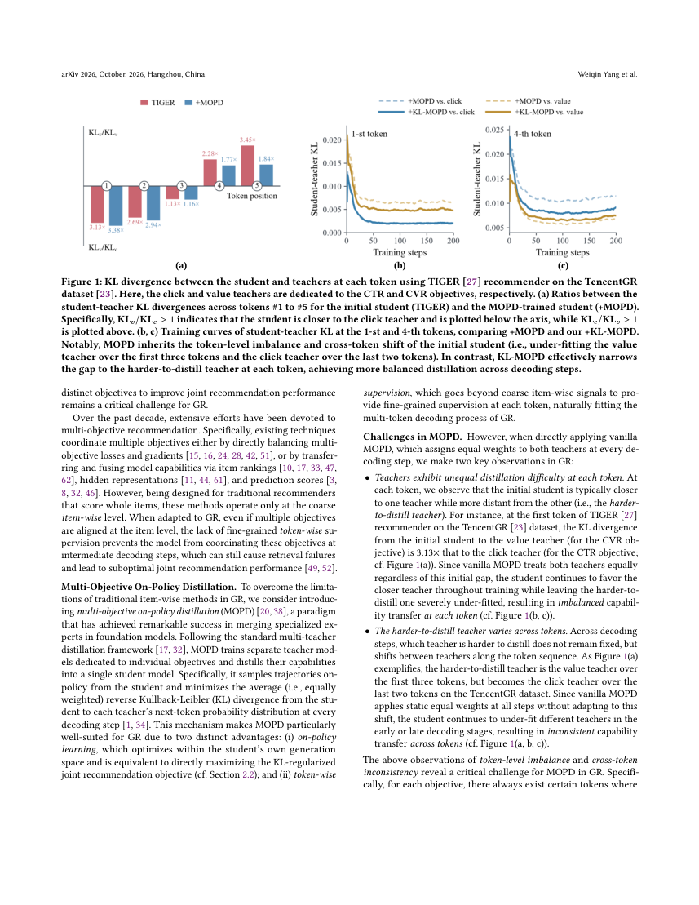
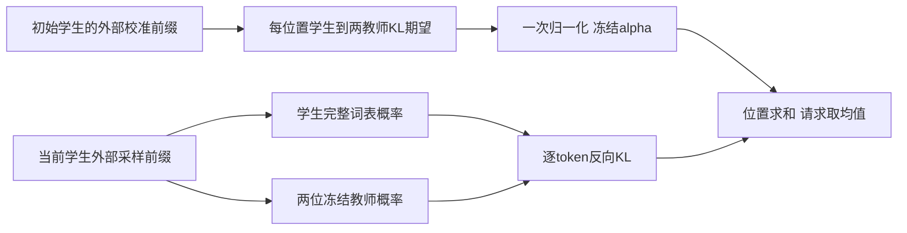

# KL-MOPD：按初始差距校准的多目标在策略蒸馏

> 本地为 **L1 可微损失组件 / diagnostic only**，不是完整推荐器或在线采样器。完整训练与生产实验**成本过高，不复现（审查 DONE）**；未接入 Evolve。

## 论文信息

| 字段 | 内容 |
| --- | --- |
| 论文链接 | [固定 v1](https://arxiv.org/abs/2610.36973v1)、[全文](https://arxiv.org/html/2610.36973v1) |
| 原始标题 | KL-MOPD: Discrepancy-Aware Multi-Objective On-Policy Distillation for Generative Recommendation |
| 公司 / 作者机构 | 一作 Weiqin Yang：Zhejiang University；合作 Alibaba Group |
| 首次公开日期 | 2026-10-27 10:28:05 UTC，arXiv v1；10月28日公告 |
| 原作者代码 | 正文给出 [Yandorn/KL-MOPD](https://github.com/Yandorn/KL-MOPD)，固定 `28d9bcbd8fc9f5ccaa52def5db77d4c34bade965`，MIT；不复制作者实现 |
| 本地 adapter / 稳定键 | `kl-mopd`；`adapter: null`，独立公式组件 |
| 本地代码位置 | `src/auto_research/reproductions/kl_mopd.py`；`tests/test_oct29_root_components.py` |
| 本地证据 | [三种子机制指标](metrics/component-cuda-seeds42-44.json)、[A100回执](../../gpu-validations/kl-mopd-a100-20261029.json) |

## 原始论文总结

### 背景与主要改动

生成式推荐必须连续生成一个商品的多个语义 token；某个位置没学到转化教师的偏好，就可能使整个商品无法召回。把点击教师和价值教师每一步都按一半融合，忽略了两者在不同位置的学习难度可能相反。

KL-MOPD先在**冻结的初始学生**生成前缀上，按位置估计学生到两位教师的反向 KL。该差距只校准一次，归一化后作为固定教师权重；训练时在**当前学生**自己的前缀上计算加权反向 KL。不应改成逐步动态重算，也不是先平均教师概率再蒸馏。

<!-- paper-figure:start -->
### 原论文关键图



原始PDF整页截图，未重绘；页码、来源及哈希见 `assets/provenance.json`。原图版权归作者，论文CC BY-NC-ND 4.0。
<!-- paper-figure:end -->



### 核心公式

Eqs.3.1–3.3中，初始学生为 $p_0$、当前学生为 $p_\theta$、两位教师为 $q_j$：

$$
d_{j,t}=\mathbb E_{x,y\sim p_0}D_{KL}(p_0(\cdot|x,y_{<t})\|q_j(\cdot|x,y_{<t})),\quad
\alpha_{j,t}=\frac{d_{j,t}}{d_{c,t}+d_{v,t}}.
$$

$$
\mathcal L=\mathbb E_{x,y\sim p_\theta}\sum_t\sum_{j\in\{c,v\}}\alpha_{j,t}
D_{KL}(p_\theta(\cdot|x,y_{<t})\|q_j(\cdot|x,y_{<t})).
$$

本地校准按位置对有效前缀等权，随后对每个请求的token**求和**再对请求取均值，不偷偷改成长度归一化。论文脚注假设两位教师差距均大于零；零差距或缺失位置直接拒绝，不自行添加epsilon或均匀回退。两路教师及alpha停止梯度。

### 论文离线与线上效果

正文Table5工业数据joint objective平均相对MOPD提升3.19%。Section4的生产A/B持续5天，对照/实验各占10%真实流量；Table6广告收入+1.63%、GMV+2.20%，均 $p<0.05$。这些是作者完整系统的结果，不是本地合成张量指标。

## 本地复现与边界

```bash
PYTHONPATH=src python -c 'from auto_research.reproductions.kl_mopd import diagnostic; print(diagnostic(42))'
```

`calibrate_weights`和`kl_mopd_loss`保留完整词表的KL方向、固定逐位置权重、教师冻结及两级聚合。独立概率域参考、反向/正向KL负控、动态重校准负控、padding零梯度与真实学生更新均可检查。

校准前缀是否来自初始学生、训练前缀是否来自当前学生由调用者保证；本组件不能替调用方证明on-policy，不实现语义ID、两塔/RQ-kmeans、TIGER/REG4Rec、真实rollout或推荐评测。随机logits的SGD下降不是业务效果。

### 高成本完整实验

原文含三套公开大数据及十亿级私有广告日志，需初始学生预训、两教师微调、蒸馏、多基线调参与线上流量；工业decoder为5层、维度1024，每个末日切分超过11M请求。作者未给总GPU时数，本地不编造。对单卡A100/A30或Mac，完整多阶段实验超出本轮预算：**成本过高，不复现（审查 DONE）**，不下载大数据、不自动重试。
