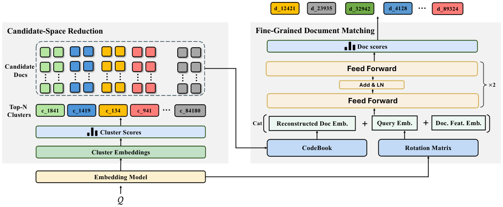
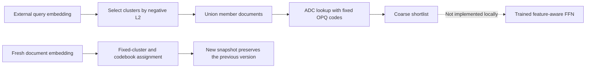

# WeSearch: Cluster-constrained candidate spaces and atomic-document matching

<!-- source-sha256: b9df98a4ba9bcd275dd5979b9457fb2370b15e4b9b01d2de83309c585075b933 -->

[简体中文](README.md)

> **L1 CPU index/numerical components; diagnostic only.** The full model and production experiments are not reproduced due to cost (review complete). No executable Evolve integration.

## Paper information

| Field | Details |
| --- | --- |
| Paper | [Fixed v1](https://arxiv.org/abs/2611.00530v1), [full text](https://arxiv.org/html/2611.00530v1) |
| Title | WeSearch: A Unified Model-Centric Retrieval Framework for WeChat Search |
| Affiliation | First author Kepu Zhang, Tencent / WeChat Search Group. Yuzhe Cai and Yue Shu are also equal contributors. |
| First publication | October 31, 2026, 01:35:20 UTC (v1); announced November 3, not first published on this review date. |
| Author code | No WeSearch author release was found/verified in the reviewed paper and arXiv links. Referenced frameworks are not its implementation. |
| Local adapter / key | `wesearch`; `adapter: null`, standalone CPU component |
| Local code | `src/auto_research/reproductions/wesearch_components.py`; `tests/test_nov04_wesearch.py` |
| Evidence | [Three-seed CPU component metrics](metrics/component-cpu-seeds42-44.json); no GPU training or capability evaluation |

## What the paper changes

A cluster constrains the candidate space rather than becoming an irreversible semantic-ID prefix. The union retains atomic documents for a coarse-to-fine ranker. The learned OPQ artifacts and rolling index updates matter; random fixed codebooks cannot replace the training pipeline.

### Original paper figure



Unmodified image from [v1 Figure 2](https://arxiv.org/html/2611.00530v1#S3.F2). Copyright belongs to the authors; the paper has an arXiv non-exclusive license. See `assets/provenance.json` for source and hash.



### Core equations

Equations 2–3/13 select clusters and take their document union:

$$
\mathcal C_q=\operatorname{TopN}_c(-\|h_q-e_c\|_2),\qquad
\mathcal D_q=\bigcup_{c\in\mathcal C_q}\mathcal D_c.
$$

Equations 7–11 rotate and quantize each subspace. Reconstruction stays in **rotated space**. Equation 26 computes squared distance by table lookup:

$$
T_{j,k}=\|(Rh_q)^{(j)}-b_{j,k}\|_2^2,\qquad
D(q,d)=\sum_jT_{j,z_d^{(j)}}=\|Rh_q-\widehat h_d\|_2^2.
$$

Equation 15 scores with $-\sqrt D$. Its ranking matches negative squared distance but numerical thresholds do not. The caller supplies trained rotation, centroids and codebooks; local code does not fit OPQ or RQ-KMeans.

### Reported results, not local measurements

Section 6.5.2/Table 5 reports a one-month full-traffic production A/B: relative CTR +0.68%, per-user article clicks +2.27% and dwell time +0.71%, with $p<0.05$. Whole-system resource cost falls 41% and graphic-text retrieval latency 19 ms. These are not CPU-component results or isolated ADC effects.

## Local execution and boundaries

```bash
PYTHONPATH=src python -c 'from auto_research.reproductions.wesearch_components import diagnostic; print(diagnostic(42))'
```

### Data and interpretation

Small matrices from seeds 42/43/44 test the ADC/reconstruction identity, candidate union, shortlist ordering, invalid-code rejection and snapshot isolation. This is not a retrieval benchmark, split-based tuning or recommendation-quality comparison. Stable cluster order/document IDs resolve ties by a local deterministic convention.

### Code mapping

`quantize/reconstruct` map to Equations 7–11; `adc_squared_distance` to Equation 26; `candidates/coarse_shortlist` to Algorithm 1 steps 5–8. `mount` constructs a fresh immutable snapshot with fixed artifacts. The caller must perform any visibility swap; distributed atomicity is not implemented.

### Full experiment: not reproduced due to cost

The private corpus scales from hundreds of millions to billions of documents, plus tens of millions of fresh items. Private teachers, query encoders/FFNs, rolling training and month-long production testing exceed the single A100/A30 or Mac budget. Full GPU-hours are undisclosed; this is a resource assessment, not a local runtime estimate. No models/corpus are downloaded or automatically retried. CPU checks do not reproduce the encoder, FFN, lexical tree or service stack.
