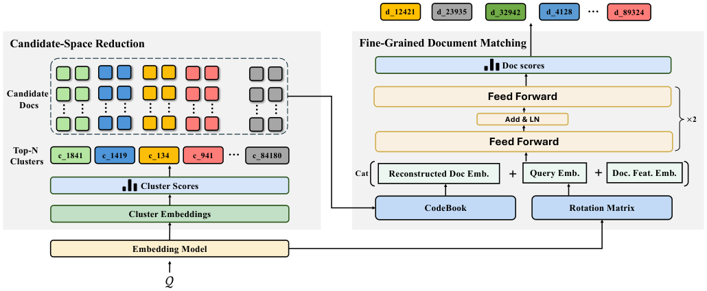
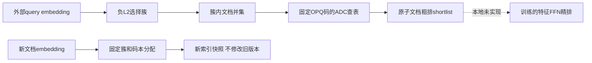

# WeSearch：簇约束候选空间与原子文档匹配

> **L1 CPU索引/数值组件，diagnostic only**。完整模型与生产实验成本过高，不复现（审查 DONE）；未接入执行型Evolve。

## 论文信息

| 字段 | 内容 |
| --- | --- |
| 论文链接 | [固定v1](https://arxiv.org/abs/2611.00530v1)、[全文](https://arxiv.org/html/2611.00530v1) |
| 原始标题 | WeSearch: A Unified Model-Centric Retrieval Framework for WeChat Search |
| 公司 / 作者机构 | 一作Kepu Zhang，Tencent / WeChat Search Group；共同一作另有Yuzhe Cai、Yue Shu |
| 首次公开日期 | 2026-10-31 01:35:20 UTC，arXiv v1；11月3日公告，不按11月4日检索日期计新首发 |
| 原作者代码 | 原文及arXiv链接未找到/未核验发布WeSearch代码；引用框架不等于作者实现 |
| 本地adapter / 稳定键 | `wesearch`；`adapter: null`，独立CPU组件 |
| 本地代码位置 | `src/auto_research/reproductions/wesearch_components.py`；`tests/test_nov04_wesearch.py` |
| 本地证据 | [CPU三种子组件指标](metrics/component-cpu-seeds42-44.json)；无GPU训练或能力评测 |

## 原始论文总结

### 背景与主要改动

多主题文档很难绑定唯一SID路径，早期前缀失误又会永久丢掉相关文档。WeSearch只用簇收缩候选空间，不让簇承担完整语义标识；在并集内对原子文档先粗后精匹配。OPQ旋转和码本参与相关性学习，不能以固定随机量化器代替论文训练。滚动挂载复用已有参数，模型和全量索引刷新则需版本整体切换。

<!-- paper-figure:start -->
### 原论文关键图



来自[固定v1 HTML Figure2](https://arxiv.org/html/2611.00530v1#S3.F2)，原图未重绘；版权归原作者所有，论文为arXiv非独占许可。来源和哈希见`assets/provenance.json`。
<!-- paper-figure:end -->



### 核心公式

原文Eq.2–3/13：

$$
\mathcal C_q=\operatorname{TopN}_c(-\|h_q-e_c\|_2),\qquad
\mathcal D_q=\bigcup_{c\in\mathcal C_q}\mathcal D_c.
$$

Eq.7–11先旋转、分子空间，逐块选最近码字，拼接得到**旋转空间**重构。Eq.26 ADC是平方距离的查表求和：

$$
T_{j,k}=\|(Rh_q)^{(j)}-b_{j,k}\|_2^2,\qquad
D(q,d)=\sum_jT_{j,z_d^{(j)}}=\|Rh_q-\widehat h_d\|_2^2.
$$

粗排Eq.15的分数是$-\sqrt D$，而不是负平方距离本身；排序相同不意味着数值阈值相同。本地实现保留该区别。码本/旋转由调用者提供，不训练OPQ或RQ-KMeans。

### 论文离线与线上效果

正文6.5.2/Table5：生产基线对照、一个月全流量A/B，CTR相对+0.68%、人均文章点击+2.27%、停留+0.71%，报告$p<0.05$。整体系统资源-41%、图文召回延迟-19ms；这些是原文完整系统结果，**不是本地组件结果**，也不能归因于ADC单独实现。

## 本地复现与边界

```bash
PYTHONPATH=src python -c 'from auto_research.reproductions.wesearch_components import diagnostic; print(diagnostic(42))'
```

### 数据协议与结果解释

只用固定种子42/43/44生成小矩阵，验证ADC与显式重构距离相等、候选并集、粗排顺序、输入非法码拒绝及快照隔离。不是公开检索benchmark，不含训练/验证/测试候选调参，更不是推荐质量比较。平局以稳定簇序/文档ID决定，属于本地可复现约定。

### 代码映射

`quantize/reconstruct`对应Eq.7–11；`adc_squared_distance`对应Eq.26；`candidates/coarse_shortlist`对应Algorithm1步骤5–8；`mount`只实现固定参数的新快照构造。新快照可见性的原子切换由外部存储负责，本地不声称分布式原子性。

### 高成本完整实验

Section6.1.1的数亿至数十亿私有文档、千万新文档、行为/满意度教师、生产query encoder/FFN与多轮训练和一个月A/B超出单卡A100/A30、Mac可负担范围。作者未给完整GPU小时，不虚构本地估算值。**成本过高，不复现（审查 DONE）**；不下载模型/语料，不自动重试。CPU组件通过不等于查询编码器、FFN、词法树或整个服务系统复现。
