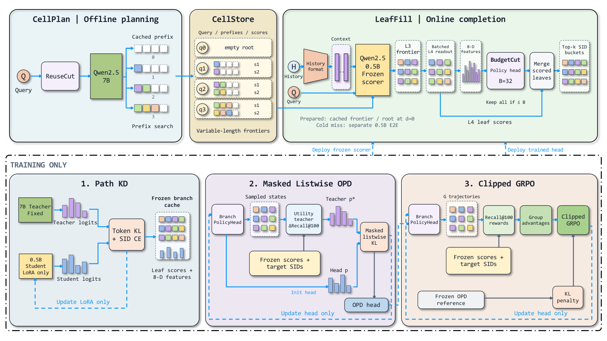
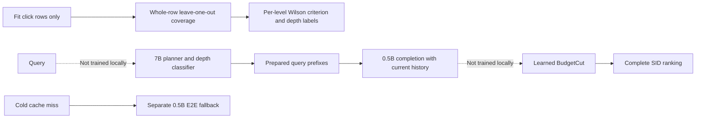

<!-- source-sha256: bd9583c50e55417953377e4962bed389e2047c8125a396e119bb0ee90c62fb98 -->
# ReuseGR: shared prefix planning and request-specific personalization

[简体中文](README.md)

> **L1 CPU mechanism components; diagnostic only.** The complete experiment is too costly and is not reproduced (review DONE). No generator or branch policy is trained; no executable Evolve integration is claimed.

## Paper information

| Field | Details |
| --- | --- |
| Paper | [Pinned v1](https://arxiv.org/abs/2611.04259v1), [full text](https://arxiv.org/html/2611.04259v1) |
| Original title | ReuseGR: Offline–Online Decoupled Generative Retrieval via Adaptive Prefix Reuse |
| Company / institutions | First author Xujing Wang, Xidian University; collaboration with Alibaba International Digital Commerce Group, with Yufeng Chen as project leader |
| First public date | 2026-11-03 03:51:38 UTC; announced and first collected here on November 4, not first published on November 4 |
| Author code | No author implementation found in the pinned paper or its arXiv links; cited retrieval systems are not this paper's code |
| Local adapter / key | `reusegr`; `adapter: null`, standalone CPU mechanism components |
| Local code | `src/auto_research/reproductions/reusegr_components.py`; `tests/test_nov04b_recommendation.py` |
| Local evidence | [Three-seed CPU contracts](metrics/component-cpu-seeds42-44.json), not a retrieval-quality comparison |

## Original paper

### Motivation and changes

An all-online generator repeatedly predicts similar coarse SID prefixes when different users submit the same query. ReuseGR moves query-level 7B planning offline and gives the current user's history to a 0.5B online suffix model. Prefix depth is a coverage–cost boundary, not a quantity to maximize. Path KD trains the suffix scorer before freezing it; OPD and GRPO then train BudgetCut. A branch's usefulness depends on the branches already admitted, so static score ranking is not a substitute for the learned admission policy.

### Original figure



From [pinned v1, Figure 2](https://arxiv.org/html/2611.04259v1#S4.F2), without redrawing. Copyright remains with the authors; the paper is CC BY 4.0. Source and checksum are in `assets/provenance.json`.



### Equations

In Eqs. 5–6, prefix top-N sets are ranked by the **click mass** of other aggregated rows, whereas coverage gives each original aggregated row equal weight. Fit-side leave-one-out removes every click in the held-out row, not a single repeated click. Apply the Wilson lower endpoint with $z=1.96$ at each level, then choose

$$
d^*(q)=\max\{s:\underline C_t(q)\ge0.4,\ \forall\,1\le t\le s\}.
$$

Queries with fewer than five rows are `Unknown`, use depth zero in training-cache construction, and are excluded from classifier fitting. A deeper passing level cannot bypass a failed shallower level. The Wilson endpoint is the paper's finite-support criterion, not an IID confidence guarantee for dependent LOO estimates.

Eq. 10 combines an offline prefix log-probability with online suffix log-probabilities:

$$
s_x(y)=\beta s_q(y_{1:d})+\sum_{j=d+1}^L\log\pi_\theta(y_j\mid y_{<j},q,h).
$$

A prepared depth-zero query starts at the empty root with the Path-KD scorer. A genuine cold miss uses a **separate E2E model**. Having no stored prefix does not make these routes equivalent.

### Published offline and online results

Section 5.7 and Appendix D report a 14-day user-randomized production A/B test, 10% search-advertising traffic per arm, against the 0.5B E2E retriever. Other channels, quotas, ranking, and bidding are unchanged. Relative changes are CTR +0.93%, RPM +1.05%, orders/request +0.78%, and **CVR -0.21%**; the negative result is retained. Offline HR@100 improves by 3.83 percentage points over the 0.5B baseline, with mean online latency -38.9% when the cache is prepared. That latency boundary excludes the complete offline-planning cost. None of these are local measurements.

## Local components and boundaries

```bash
PYTHONPATH=src python -c 'from auto_research.reproductions.reusegr_components import diagnostic; print(diagnostic(42))'
```

### Data protocol and code map

`ClickRow/label_reuse_depth` implement Fit-side whole-row LOO and the sequential depth criterion in Eqs. 5–6. `cache_route` distinguishes prepared depth zero from a cold miss; `composite_score` implements Eq. 10. Inputs are explicit external rows and model log-probabilities. The caller must supply real training data, time-respecting histories, and cache updates. Test labels must not fit depths or complete candidate sets.

### Results, negative controls, and limitations

Seeds 42/43/44 generate small contract inputs checking whole-row removal, row-macro weighting, non-skippable shallow failures, Unknown versus cache miss, and score identities. We do not train the query classifier, 7B/0.5B models, Path KD, OPD, or GRPO. Learned BudgetCut is not implemented. No retrieval improvement or complete serving system is claimed.

### High-cost complete experiment

Appendix A requires roughly two million private query–item records, 3.38 million items, multi-stage 7B/0.5B LoRA training (eight KD epochs), multiple baselines, and 14 days of production A/B testing. These are outside a lightweight single-A100/A30 or Mac reproduction. One A100 used for latency measurement does not establish cheap complete training. **Too costly; not reproduced (review DONE).** No model/log download or automatic retry.
