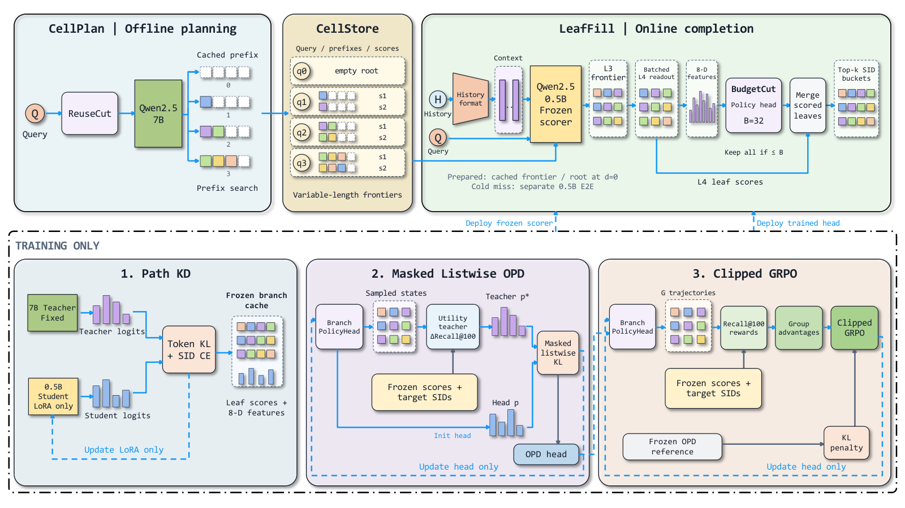
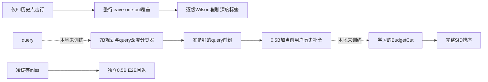

# ReuseGR：共享前缀规划与当前请求个性化分工

> **L1 CPU机制组件，diagnostic only**。完整实验成本过高，不复现（审查 DONE）；未训练生成器或分支策略，未接入执行型Evolve。

## 论文信息

| 字段 | 内容 |
| --- | --- |
| 论文链接 | [固定v1](https://arxiv.org/abs/2611.04259v1)、[全文](https://arxiv.org/html/2611.04259v1) |
| 原始标题 | ReuseGR: Offline–Online Decoupled Generative Retrieval via Adaptive Prefix Reuse |
| 公司 / 作者机构 | 一作Xujing Wang，西安电子科技大学；合作机构Alibaba International Digital Commerce Group，Yufeng Chen为项目负责人 |
| 首次公开日期 | 2026-11-03 03:51:38 UTC；11月4日公告与本轮首次收录，不等于11月4日首发 |
| 原作者代码 | 固定v1及其链接未发现作者实现；不把引用的其他生成召回系统当本文开源 |
| 本地adapter / 稳定键 | `reusegr`；`adapter: null`，独立CPU机制组件 |
| 本地代码位置 | `src/auto_research/reproductions/reusegr_components.py`；`tests/test_nov04b_recommendation.py` |
| 本地证据 | [CPU三种子合同指标](metrics/component-cpu-seeds42-44.json)，不是检索质量比较 |

## 原始论文总结

### 背景与主要改动

相同query由不同用户重复搜索时，完全在线的生成器反复预测相似的粗粒度SID前缀。ReuseGR将query级7B规划留在离线，把当前用户历史交给0.5B在线后缀补全。前缀深度是可调的覆盖—成本边界，不是越深越好。Path KD先训练后缀评分器，随后冻结评分器，用OPD和GRPO学习BudgetCut：某个分支的作用依赖已经选入的其他分支，不能用静态top-score假装实现。

### 原论文关键图

<!-- paper-figure:start -->


来自[固定v1 Figure2](https://arxiv.org/html/2611.04259v1#S4.F2)，原图未重绘。版权归原作者，论文CC BY 4.0；来源和校验见`assets/provenance.json`。
<!-- paper-figure:end -->



### 核心公式

Eq.5–6中，前缀top-N按其他聚合行的**点击质量**排序，评估覆盖则对原始聚合行等权。Fit中必须移除被留出行的全部点击，而不是只减一次。对每层覆盖计算$z=1.96$的Wilson下端点$\underline C_s$，再选：

$$
d^*(q)=\max\{s: \underline C_t(q)\ge0.4,\ \forall\,1\le t\le s\}.
$$

少于5行标`Unknown`，训练缓存取深度0，并排除深度分类器拟合。深层单独达标不能跳过浅层失败；Wilson在这里是论文有限样本准则，不是对相关LOO估计的独立同分布置信保证。

Eq.10的复合分数是离线prefix logp加在线suffix logp：

$$
s_x(y)=\beta s_q(y_{1:d})+\sum_{j=d+1}^L\log\pi_\theta(y_j\mid y_{<j},q,h).
$$

缓存已准备但$d=0$时，从空根用Path-KD scorer补全；真正冷miss走**独立E2E模型**。两者不能因为“没有存prefix”就合并。

### 论文离线与线上效果

Section5.7/AppendixD：14天用户级随机A/B、每臂10%搜索广告流量，对照0.5B E2E，其他通道、配额、排序、竞价不变。CTR相对+0.93%、RPM+1.05%、订单/请求+0.78%，同时CVR为-0.21%，不能隐去负向结果。离线HR@100相对0.5B基线提高3.83个百分点，缓存准备好时平均在线延迟-38.9%；这些边界不含离线规划的全部成本，不能当成本地实测。

## 本地复现与边界

```bash
PYTHONPATH=src python -c 'from auto_research.reproductions.reusegr_components import diagnostic; print(diagnostic(42))'
```

### 数据协议与代码映射

`ClickRow/label_reuse_depth`对应Eq.5–6的Fit侧整行LOO与逐级准则；`cache_route`保留准备好的深度0与冷miss的不同端点；`composite_score`对应Eq.10。这里只接受外部显式行和模型logp。真实训练数据、历史时间截断和线上缓存更新由调用者提供，测试标签不可用于拟合深度或补全候选。

### 结果、负控与边界

42/43/44只用于小型合成合同，检查整行移除、行等权、浅层失败不能跳过、Unknown与miss的区别和分数恒等。不训练query classifier、7B/0.5B、Path KD、OPD/GRPO；没有实现学习的BudgetCut，不报告召回提升，也不把本地普通函数当完整服务系统。

### 高成本完整实验

AppendixA的约200万私有query–item记录、338万商品，7B/0.5B多阶段LoRA训练（KD八轮）、多个基线和14天生产A/B不可在单张A100/A30或Mac的轻量预算内忠实取得。论文用单A100做延迟测量不代表完整训练便宜。**成本过高，不复现（审查 DONE）**；不下载模型/日志，不自动重试。
