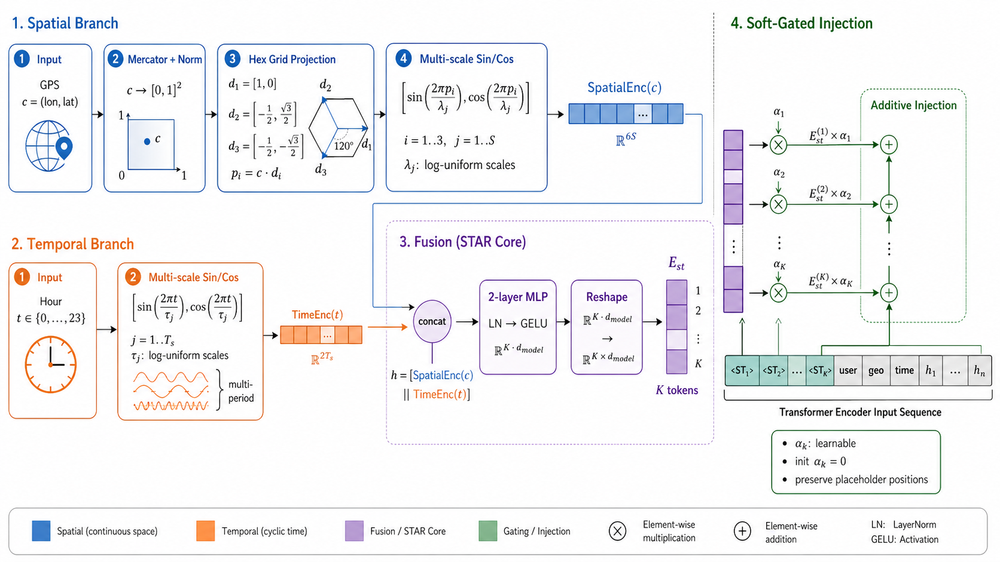

<!-- source-sha256: 6d9880f3ed5f725da8a2dc5693515675ad57ea5bfdd5fc84cd2efdc7330ebec4 -->
# SPADE: business-aligned tokenization and bounded diversity decoding

[简体中文](README.md)

> **L1 CPU tokenization/decoding operators; diagnostic only.** The complete experiment is too costly and is not reproduced (review DONE). This is not a local-search model or online-result reproduction; no executable Evolve integration is claimed.

## Paper information

| Field | Details |
| --- | --- |
| Paper | [Pinned v1](https://arxiv.org/abs/2611.04662v1), [full text](https://arxiv.org/html/2611.04662v1) |
| Original title | SPADE: Spatiotemporal Preference Alignment and Diversity Enhancement for Local Search |
| Company / institutions | First author Chenxu Wang, Meituan; Shuxian Bi is an independent coauthor |
| First public date | 2026-11-03 10:50:31 UTC; announced and first collected here on November 4 |
| Author code | No author implementation found in pinned v1 or arXiv resources; unrelated same-name projects are not evidence |
| Local adapter / key | `spade-local-search`; `adapter: null` |
| Local code | `src/auto_research/reproductions/spade_components.py`; `tests/test_nov04b_recommendation.py` |
| Local evidence | [Three-seed CPU contracts](metrics/component-cpu-seeds42-44.json), not query-quality evaluation |

## Original paper

### Motivation and changes

A local-service homepage must suggest executable, location/time-appropriate and distinct search intents before the user types. SPADE changes four stages together: business-weighted OA-BPE merges; multiscale spatial/temporal STAR representations with soft gates; MARS-DPO alignment to production impression/click preferences; and a bounded parent-rank bonus in SDBS. Locally we implement only OA-BPE primitives and the SDBS expansion step. Omitting the other stages cannot count as reproducing complete SPADE.

### Original figure



From [pinned v1, Figure 2](https://arxiv.org/html/2611.04662v1#S3.F2), without redrawing. Copyright remains with the authors under the paper's arXiv non-exclusive license. This illustrates **STAR, which is not implemented locally**. Source and checksum are in `assets/provenance.json`.


### Equations

Section 3.2, Eq. 1 is $\operatorname{score}(a,b)=\sum_s w(s)\operatorname{count}_s(a,b)$. Unit weights recover ordinary pair frequency. Adjacent occurrences may overlap when counting, while an actual merge scans non-overlapping pairs. The caller supplies weights; we do not learn them from private CTR/CVR or provide a complete byte tokenizer.

Section 3.5, Eq. 17 and Algorithm 1 use

$$
\phi(b)=\beta\left[\frac1{1+\gamma e^{-\alpha b}}-\frac1{1+\gamma}\right],\quad
\widetilde S_{b,v}=S_b+\log P(v\mid y_b)+\phi(b).
$$

Here $\alpha>0,\beta\ge0,0<\gamma\le1$, and $b$ is the **parent-beam rank after sorting at this step**. Each parent contributes its top-$2B$ tokens; merge and retain the top-$B$ expansions. Accumulated scores retain previous bonuses. We permit $\beta=0$ as the ordinary-beam negative control. Although $\phi(0)=0$, a rival receiving a bonus can overtake the original top continuation. The paper itself conditions top-1 preservation on a margin larger than the maximum bonus; it is not unconditional.

### Published offline and online results

Section 4.8 reports one week of production A/B testing, 20% traffic per arm against the production baseline: relative Module CTR +1.88%, Search Volume +0.177%, and Search DAU +0.105%, all with $p<0.05$. Section 4.1 trains on 30 days, validates on the next day, and tests on the following day. Relative offline changes against the strong baseline are HR@5 +5.6%, GeoC@5 (distance; lower is better) -40.3%, and Exec@5 +1.9%. Exec uses an independent Qwen3-32B judge but remains a proxy, not observed business response. We do not rerun these results.

## Local components and boundaries

```bash
PYTHONPATH=src python -c 'from auto_research.reproductions.spade_components import diagnostic; print(diagnostic(42))'
```

### Data protocol and code map

`oa_pair_scores/merge_pair` implement weighted pair statistics and a local merge. `sigmoid_bonus/sdbs_step` implement Eq. 17 and one step of Algorithm 1. Callers supply model readouts, stopping tokens, length budgets, and full tokenization. Evaluation results must not select business weights or bonus parameters.

### Results, negative controls, and limitations

Synthetic contracts check weighted rare-pair ordering, overlapping counts versus non-overlapping replacement, a monotonic bounded concave bonus, the $\beta=0$ limit, and a rival overtaking an unbonused top parent. No real queries, semantic diversity, or geographic consistency are evaluated. Parent-rank bonuses do not compute semantic distances between candidates.

### High-cost complete experiment

Section 4.1 uses private production data: 100K users, 1.48 million queries, 7.79 million pretraining samples and 3.08 million alignment samples. The six-layer, width-512 model trains for 3+1 epochs on eight data-center GPUs, with a 32B judge and a production retrieval system. **Too costly; not reproduced (review DONE).** Only model-free CPU operators are delivered; no private data/model downloads or automatic retry.
