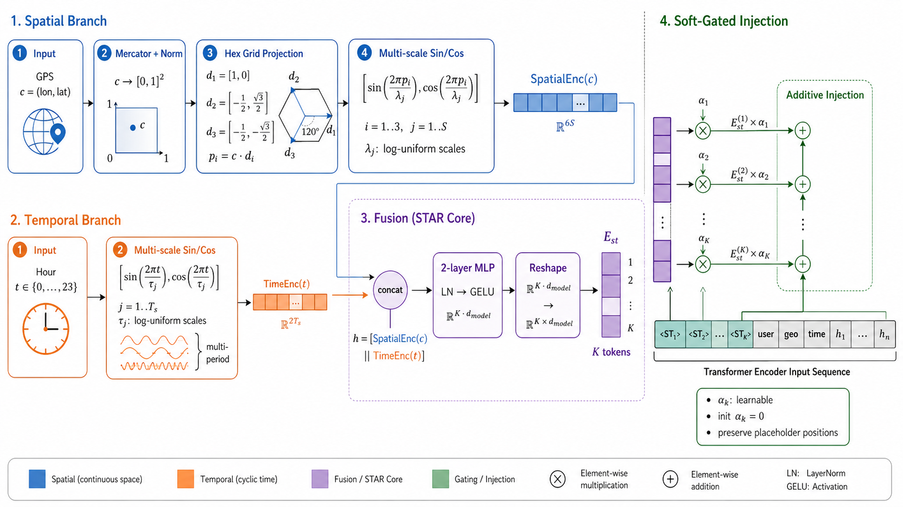
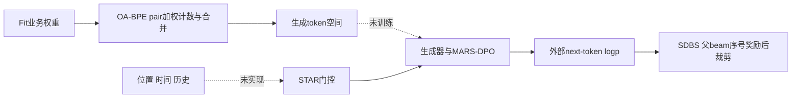

# SPADE：业务对齐分词与有界多样性解码

> **L1 CPU分词/解码算子，diagnostic only**。完整实验成本过高，不复现（审查 DONE）；不是本地搜索模型或线上效果复现，未接入执行型Evolve。

## 论文信息

| 字段 | 内容 |
| --- | --- |
| 论文链接 | [固定v1](https://arxiv.org/abs/2611.04662v1)、[全文](https://arxiv.org/html/2611.04662v1) |
| 原始标题 | SPADE: Spatiotemporal Preference Alignment and Diversity Enhancement for Local Search |
| 公司 / 作者机构 | 一作Chenxu Wang，美团；正文另有独立研究者Shuxian Bi |
| 首次公开日期 | 2026-11-03 10:50:31 UTC；11月4日公告与本轮首次收录 |
| 原作者代码 | 固定v1及arXiv资源未发现作者实现；同名项目不作开源证据 |
| 本地adapter / 稳定键 | `spade-local-search`；`adapter: null` |
| 本地代码位置 | `src/auto_research/reproductions/spade_components.py`；`tests/test_nov04b_recommendation.py` |
| 本地证据 | [CPU三种子合同指标](metrics/component-cpu-seeds42-44.json)，不是query质量评测 |

## 原始论文总结

### 背景与主要改动

本地生活首页要在用户输入前生成可执行、匹配当前位置/时间且互不重复的搜索意图。SPADE同时改变四层：OA-BPE用业务价值重加权合并；STAR以多尺度位置/时间表示和软门控注入上下文；MARS-DPO对齐生产曝光点击偏好；SDBS在解码阶段按父beam排序加有界奖励。本地只实现OA-BPE局部算子与SDBS扩展步骤，不能把其他两层略去后称完整SPADE。

### 原论文关键图

<!-- paper-figure:start -->


来自[固定v1 Figure2](https://arxiv.org/html/2611.04662v1#S3.F2)，原图未重绘。版权归原作者，论文arXiv非独占许可；此图解释完整方法中的STAR，**本地未实现STAR网络**。来源与校验见`assets/provenance.json`。
<!-- paper-figure:end -->



### 核心公式

Section3.2 Eq.1为$\operatorname{score}(a,b)=\sum_s w(s)\operatorname{count}_s(a,b)$。$w=1$退化成普通频数；一条序列里相邻对可以重叠计数，但真正执行合并时采用不重叠扫描。本地权重由调用者提供，未从私有CTR/CVR学习业务权重，也不是完整byte tokenizer。

Section3.5 Eq.17/Algorithm1：

$$
\phi(b)=\beta\left[\frac1{1+\gamma e^{-\alpha b}}-\frac1{1+\gamma}\right],
\quad \widetilde S_{b,v}=S_b+\log P(v\mid y_b)+\phi(b),
$$

其中$\alpha>0,\beta\ge0,0<\gamma\le1$，$b$是本步重新排序后的**父beam序号**。先各父beam取top-$2B$词，再合并保留top-$B$；累计分数含先前奖励。本地允许$\beta=0$作为普通beam负控。虽然$\phi(0)=0$，其他beam获得奖励后仍可超过原top1；论文自己也限定保留top1需领先间隔大于最大奖励，不能宣传无条件保证。

### 论文离线与线上效果

Section4.8披露一周生产A/B、每臂20%流量、生产基线对照：Module CTR相对+1.88%、搜索量+0.177%、搜索DAU+0.105%，三项均$p<0.05$。Section4.1采用30天训练、后一天validation、再一天test；离线相对强基线HR@5+5.6%、GeoC@5（距离，越低越好）-40.3%、Exec@5+1.9%。Exec使用独立Qwen3-32B judge，仍是代理评分，不等于真实业务响应。本地不重跑上述结果。

## 本地复现与边界

```bash
PYTHONPATH=src python -c 'from auto_research.reproductions.spade_components import diagnostic; print(diagnostic(42))'
```

### 数据协议与代码映射

`oa_pair_scores/merge_pair`对应加权pair统计与局部合并；`sigmoid_bonus/sdbs_step`对应Eq.17与Algorithm1一步。调用者负责模型readout、结束符、长度预算及完整tokenization；本地不根据评测结果选择业务权重或奖励参数。

### 结果、负控与边界

合成例检查稀有高权重pair改变合并排序、重叠计数与不重叠替换、单调有界凹奖励、$\beta=0$退化，以及其他beam可超过未加奖励的top-parent。没有生成真实query，没有测语义多样性/地理一致性；父beam名次奖励不包含任意两候选的语义距离。

### 高成本完整实验

Section4.1的100K用户、148万query、779万预训练与308万对齐样本来自私有生产数据；6层512维模型在8张数据中心GPU上训练3+1轮，另含32B judge和生产系统。**成本过高，不复现（审查 DONE）**；只保留无模型CPU算子，不下载私有数据、模型或自动重试。
