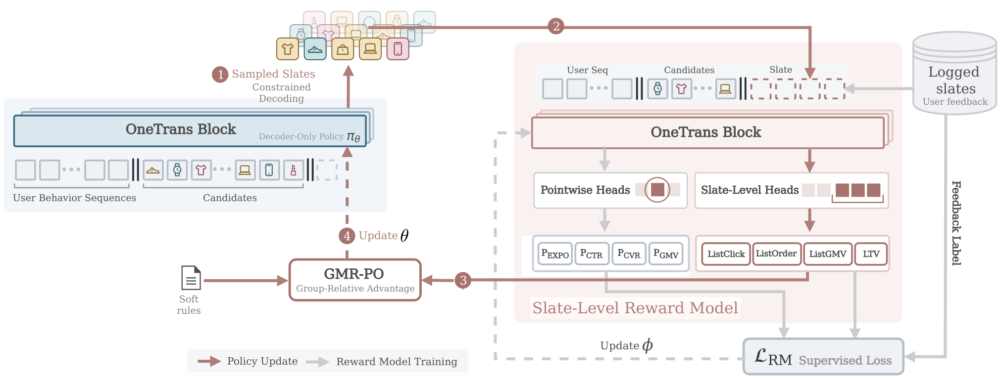
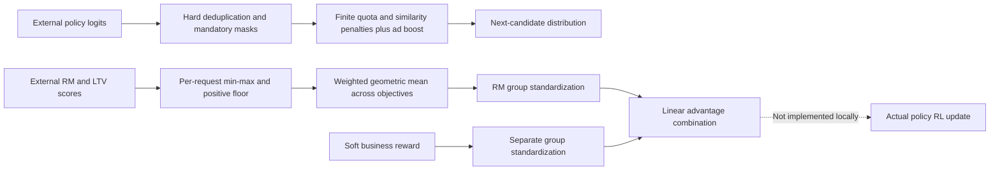

<!-- source-sha256: 4274257426dd3ae9815f43b7d08943474347ace3c76bd64730523517d332b06c -->
# OneTrans-GSR: business constraints and multi-objective rewards in unified slate generation

[简体中文](README.md)

> **L1 CPU constraint/reward arithmetic references; diagnostic only.** The complete experiment is too costly and is not reproduced (review DONE). No OneTrans policy or RM is trained and no online A/B test is run; no executable Evolve integration is claimed.

## Paper information

| Field | Details |
| --- | --- |
| Paper | [Pinned v1](https://arxiv.org/abs/2611.04720v1), [full text](https://arxiv.org/html/2611.04720v1) |
| Original title | OneTrans-GSR: A Generative Slate Ranking Paradigm Unifying Reranking and Mix-Ranking with One Autoregressive Transformer |
| Company / institutions | ByteDance Global E-Commerce Recommendation Foundation Team; Appendix A lists equal contributors Feng Cheng, Yu-Hsuan Huang, Fengyi Wang, and the other authors in order |
| First public date | 2026-11-03 11:42:02 UTC; announced and first collected here on November 4 |
| Author code | No author implementation found in pinned v1 or its arXiv links; original OneTrans or third-party code is not evidence of a GSR release |
| Local adapter / key | `onetrans-gsr`; `adapter: null` |
| Local code | `src/auto_research/reproductions/onetrans_gsr_components.py`; `tests/test_nov04b_recommendation.py` |
| Local evidence | [Three-seed CPU contracts](metrics/component-cpu-seeds42-44.json), not a slate-policy capability comparison |

## Original paper

### Motivation and changes

A conventional Generator–Evaluator system proposes slates through multiple rules and lets a small model choose among them. OneTrans-GSR uses one autoregressive policy to select products, short videos, livestreams and ads from a unified pool, handling reranking and mix-ranking together. A larger slate RM is used only for offline training. At serving, the system selects the generated slate with the highest accumulated sequence log-probability rather than rescoring all slates with the RM. Hard constraints remain in decoding and soft preferences enter rewards; the method does not remove every rule.

### Original figure



From [pinned v1, Figure 2](https://arxiv.org/html/2611.04720v1#S4.F2), without redrawing. Copyright remains with the authors under the paper's arXiv non-exclusive license. Source and checksum are in `assets/provenance.json`.



### Equations

Section 5.3, Eqs. 9–10 add rule contributions to each candidate logit. A rule is locally violated when a tagged candidate exceeds the window maximum, or an untagged choice leaves too few future tag opportunities to reach the minimum. A soft rule adds only $-\eta_r$ (default 0.1); mandatory rules use $-\infty$, as does item deduplication. Passing separate checks does not guarantee a jointly feasible completion. An all-masked set raises explicitly rather than silently relaxing rules.

Section 5.4, Eqs. 13–15 normalize each objective across the rollout group **for the same request**, then apply a positive floor:

$$
\widetilde R_g^v=\max\left(10^{-4},\frac{R_g^v-\min_jR_j^v}{\max_jR_j^v-\min_jR_j^v+10^{-8}}\right),
\quad r_g^{RM}=\prod_v(\widetilde R_g^v)^{w_v}.
$$

Positive weights sum to one. A constant objective puts every value at the floor without inducing a within-group preference. Eq. 11 uses $A=A^{RM}+0.1A^{rule}$ after **separate** group standardization, with population variance and $10^{-8}$ inside the square root. Mixing raw rewards before normalizing is a different method. A geometric mean guarantees neither Pareto improvement nor real GMV gains. The ensemble's $\mu-0.01\sigma$ is a conservative heuristic, not a statistically calibrated LCB.

### Published offline and online results

Section 6.7/Table 11 report account-randomized production A/B testing over one week with equal eligible traffic shares, against the production G-E cascade. Upstream retrieval, fine ranking, and the rule set are unchanged. Relative gains are GMV/u +2.63%, advertiser value +2.06%, and repurchase rate +2.03%, all with $p<0.05$. Repurchase is evaluated only after the full 14-day observation window. End-to-end latency across reranking and mix-ranking falls by 13%, excluding upstream stages. Offline relative RM gains are proxy-score ratios, not observed click/order lift; unexposed counterfactual slates have no observed labels.

## Local components and boundaries

```bash
PYTHONPATH=src python -c 'from auto_research.reproductions.onetrans_gsr_components import diagnostic; print(diagnostic(42))'
```

### Data protocol and code map

`business_logits` consumes external logits, the current prefix, explicit rules, and a bound on future tagged availability. It implements local quotas, deduplication, similarity penalties, and ad boosts. `geometric_reward/separate_advantages` are **float64 CPU mathematical references** for Eqs. 11/13–15. The paper accumulates FP32 statistics; bitwise equivalence is not claimed. Different requests must be processed separately rather than normalized together.

### Results, negative controls, and limitations

Synthetic contracts distinguish finite penalties from hard masks and check all-masked rejection, constant-objective flooring and separate standardization. RM scores, embeddings, and model logits are external inputs. We do not train the reward, long-term-value, or autoregressive models; execute GMR-PO; share KV caches; or run production mix-ranking. No observed business effect is claimed.

### High-cost complete experiment

Three months of private exposure logs, a three-member RM ensemble, 32 slates per request, a 1,024-request global batch, multiple training/serving comparisons and the complete online observation window exceed a lightweight single-A100/A30 or Mac budget. Unexposed slates are RM estimates, not a justification for replacing production counterfactuals with synthetic feedback. **Too costly; not reproduced (review DONE).** No large downloads or automatic retry.
