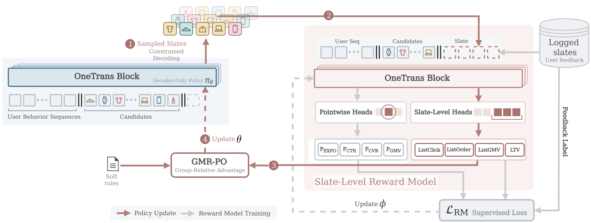
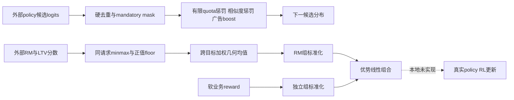

# OneTrans-GSR：统一混排策略中的业务约束与多目标奖励

> **L1 CPU约束/奖励算术参考，diagnostic only**。完整实验成本过高，不复现（审查 DONE）；未训练OneTrans策略、RM或执行线上A/B，未接入执行型Evolve。

## 论文信息

| 字段 | 内容 |
| --- | --- |
| 论文链接 | [固定v1](https://arxiv.org/abs/2611.04720v1)、[全文](https://arxiv.org/html/2611.04720v1) |
| 原始标题 | OneTrans-GSR: A Generative Slate Ranking Paradigm Unifying Reranking and Mix-Ranking with One Autoregressive Transformer |
| 公司 / 作者机构 | ByteDance Global E-Commerce Recommendation Foundation Team；AppendixA按顺序列Feng Cheng、Yu-Hsuan Huang、Fengyi Wang等共同贡献者 |
| 首次公开日期 | 2026-11-03 11:42:02 UTC；11月4日公告与本轮首次收录 |
| 原作者代码 | 固定v1及arXiv链接未发现作者实现；原OneTrans或第三方项目不代表GSR源码已发布 |
| 本地adapter / 稳定键 | `onetrans-gsr`；`adapter: null` |
| 本地代码位置 | `src/auto_research/reproductions/onetrans_gsr_components.py`；`tests/test_nov04b_recommendation.py` |
| 本地证据 | [CPU三种子合同指标](metrics/component-cpu-seeds42-44.json)，非整页策略能力比较 |

## 原始论文总结

### 背景与主要改动

传统Generator–Evaluator系统先用多种规则生成候选整页，再由小模型选择。OneTrans-GSR以一个自回归policy从统一候选池顺序选择商品、短视频、直播与广告，重排/混排一起处理。较大的整页RM仅用于离线训练；在线按累计序列logp选择生成页，不按RM给所有页重新打分。硬约束仍在解码保留，软业务偏好进入奖励，不是“全部规则都取消”。

### 原论文关键图

<!-- paper-figure:start -->


来自[固定v1 Figure2](https://arxiv.org/html/2611.04720v1#S4.F2)，原图未重绘。版权归原作者，论文arXiv非独占许可；来源和校验见`assets/provenance.json`。
<!-- paper-figure:end -->



### 核心公式

Section5.3 Eq.9–10：候选logit加各规则贡献。窗口内tag超上限，或选非tag后即使未来可放tag仍达不到下限，判该规则局部违例。软规则只加$-\eta_r$（默认0.1）；mandatory规则才置$-\infty$，重复item也硬mask。各规则单独通过不保证多个相互作用配额有完整可行解；全mask时本地显式报错，不悄悄取消规则。

Section5.4 Eq.13–15对每个请求的rollout组、每个目标先min–max归一化，再加正值下限：

$$
\widetilde R_g^v=\max\left(10^{-4},\frac{R_g^v-\min_jR_j^v}{\max_jR_j^v-\min_jR_j^v+10^{-8}}\right),
\quad r_g^{RM}=\prod_v(\widetilde R_g^v)^{w_v}.
$$

正权重和为1。常数目标全部落在floor，但不会引入组内偏好。Eq.11采用$A=A^{RM}+0.1A^{rule}$，**分别**按组标准化；人口方差加$10^{-8}$在平方根内。不能先混合两种raw reward再标准化。几何均值不是Pareto或真实GMV改善保证；集成RM的$\mu-0.01\sigma$也只是保守启发式，不是有统计覆盖率的LCB。

### 论文离线与线上效果

Section6.7/Table11：账户级随机A/B，一周试验、两臂相同eligible流量份额，对照生产G-E级联；上游召回、精排与规则集合固定。GMV/u相对+2.63%、广告价值+2.06%、复购率+2.03%，均$p<0.05$；复购率等完整14天观察窗结束才评估。重排与混排阶段总延迟-13%，不含上游阶段。离线RM相对增益是代理分数比值，不是同口径的真实点击/成交提升；未曝光反事实页没有观测label。

## 本地复现与边界

```bash
PYTHONPATH=src python -c 'from auto_research.reproductions.onetrans_gsr_components import diagnostic; print(diagnostic(42))'
```

### 数据协议与代码映射

`business_logits`接收外部logits、当前prefix、显式规则与未来tag可用数量上界；实现局部quota、去重、相似度和广告偏置。`geometric_reward/separate_advantages`对应Eq.11/13–15的**float64 CPU数学参考**；论文实际用FP32统计，本地不宣称逐bit相同。不同请求须分开调用，不能跨组归一化。

### 结果、负控与边界

合成合同区分有限惩罚与硬mask，检查全mask拒绝、常数目标floor和独立标准化。所有RM分数、candidate embedding及模型logits均为外部输入；没有训练奖励模型、长期价值模型或自回归policy，没有执行GMR-PO、KV共享或生产混排，不报告真实业务效果。

### 高成本完整实验

三个月私有曝光日志、三成员RM集成、每请求32个slate、1024请求global batch、多个训练/服务对照与完整线上观察窗超出单卡A100/A30或Mac的轻量范围。未曝光页只由RM估值，不能用合成反馈替代生产反事实。**成本过高，不复现（审查 DONE）**；无大模型下载或自动重试。
