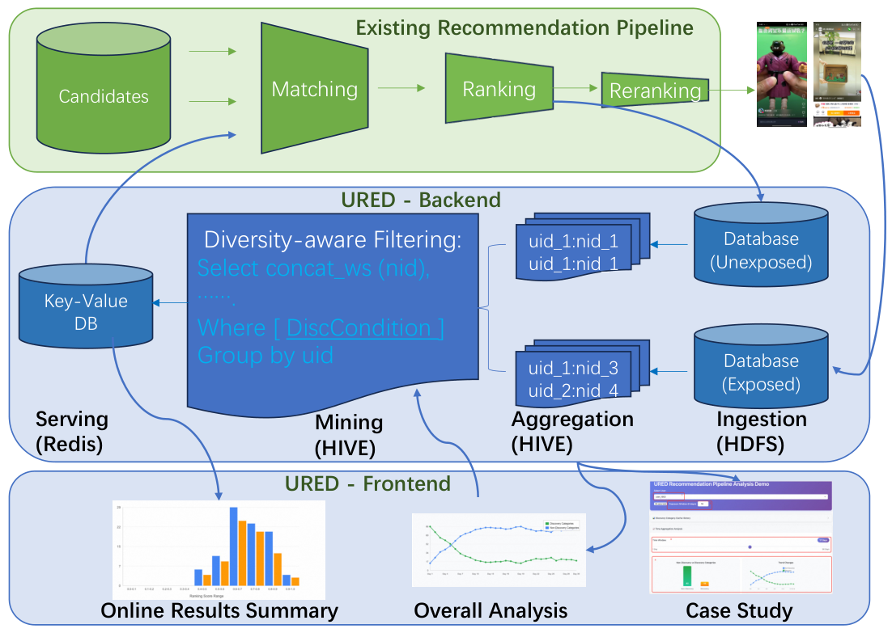

<!-- source-sha256: 37575cd0a3b06eace005d10aebe7b066b7b50f986d16f918c901280043847d1f -->
# URED: Recycling highly scored unshown candidates into Taobao feed retrieval

[简体中文](README.md)

> **Local delivery: an L1 CPU candidate-processing component.** The complete production experiment is not reproduced due to cost (review DONE).

## Paper information

| Field | Details |
| --- | --- |
| Paper | [arXiv:2611.05997v1](https://arxiv.org/abs/2611.05997v1) · [Pinned full text](https://arxiv.org/html/2611.05997v1) |
| Original title | From Waste to Discovery: Recycling High-Scored Unexposed Candidates in Taobao Feed Recommendation |
| First author and affiliation | Ge Fan, Alibaba Taobao & Tmall Group |
| First public date | 2026-11-04 05:45:30 UTC; November 5 arXiv bulletin |
| Author code | No public implementation found in pinned v1 or its links. Generic storage software mentioned in the paper is not its implementation |
| Local key | `ured`; `adapter: null` |
| Local source | `src/auto_research/reproductions/ured_components.py` |
| Evidence | [CPU three-seed mechanism metrics](metrics/component-cpu-seeds42-44.json) |

## Original paper

### Motivation and method

Boosting cold candidates directly can amplify errors the ranker already makes. URED instead accumulates candidates that the ranker scored highly but did not show. A per-user recent-exposure category filter targets discovery. The mined pool is an extra recall channel through the unchanged downstream ranker.

### Original figure

Unmodified author PNG from [the original paper](https://arxiv.org/html/2611.05997v1#S3.F1), Figure 1. Copyright remains with the authors.

### Mechanism

Keep the highest-scoring $k_1$ unshown entries per session. Aggregate over $t$ days, retain the newest observation per item, then truncate the user pool to $k_2$. Filter categories seen in the previous $d$ days and already exposed items, then apply serving quota $k$. The paper uses $k_1=200,t=30,k_2=10000,d=15,k=1000$. The per-user cap is applied before discovery filtering, not after it.

### Published offline and online results

Table 1 reports PCOC of 1.147 for discovery candidates before boosting versus 1.042 for nondiscovery candidates. In §5, users were randomized between the existing pipeline (10% of traffic) and URED treatment buckets (5–10%), for over a week per experiment. Table 2 reports discovered categories +3.47%, richness +8.47%, and completed views +2.62%; +0.36% total views is not significant. The paper reports under 1% serving latency overhead, not measured in this local component.

## Local reproduction boundary

`mine_ured` consumes ranker-scored sessions and separately supplied observed exposures. A left-closed, right-open window excludes events at or after the cutoff. Score determines session selection and breaks timestamp ties; a high old score cannot replace the newest item record. Exposed-item deduplication is limited to the supplied history.

Three-seed diagnostics check 30-day versus one-day retention, future-data isolation and quota ordering. There is no learned ranker, distributed storage, display policy or online treatment. The original evaluation requires private Taobao logs, batch parallelism up to a thousand cores, and randomized production traffic serving tens of millions of daily users. This full experiment is not reproduced (review DONE).
