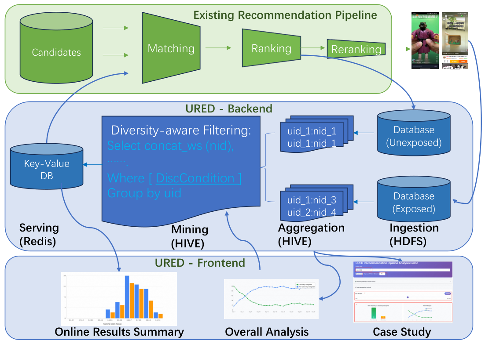

# URED：把高分未曝光候选回收到淘宝 Feed 召回

> **本地交付：L1 CPU 候选处理。** 完整生产实验成本过高，不复现（审查 DONE）；不把离线样例的候选数量当线上提升。

## 论文信息

| 字段 | 内容 |
| --- | --- |
| 论文 | [arXiv:2611.05997v1](https://arxiv.org/abs/2611.05997v1) · [固定版本全文](https://arxiv.org/html/2611.05997v1) |
| 原题 | From Waste to Discovery: Recycling High-Scored Unexposed Candidates in Taobao Feed Recommendation |
| 一作及机构 | Ge Fan，阿里巴巴淘天集团 |
| 首次公开日期 | 2026-11-04 05:45:30 UTC；arXiv 公告为 11 月 5 日 |
| 原作者源码 | 固定 v1 及论文链接未找到公开实现；不把文中提到的通用存储框架算作论文代码 |
| 本地键 | `ured`；`adapter: null` |
| 本地源码 | `src/auto_research/reproductions/ured_components.py` |
| 验证证据 | [CPU 三种子机制指标](metrics/component-cpu-seeds42-44.json) |

## 原始论文总结

### 背景与主要改动

为了增加内容发现，直接给冷候选提权可能放大排序器已有的误差。URED 复用已经被排序器打高分、但当次没有展示的候选；先累积，再按用户近期曝光类目过滤，最后作为额外召回通道送回原排序链，不改原排序器参数。

<!-- paper-figure:start -->
### 原论文关键图

图片来自[原论文](https://arxiv.org/html/2611.05997v1#S3.F1) Figure 1，版权归原作者所有。作者 PNG 未重绘。
<!-- paper-figure:end -->

### 核心公式

先从每个会话的未展示候选中保留分数最高的 $k_1$ 项；在截止时间前 $t$ 天聚合、按时间保留同一商品的最新记录，再截断到用户池 $k_2$。保留其中类别不在过去 $d$ 天曝光集合里的候选，再应用已曝光商品去重和服务配额。原文取 $k_1=200,t=30,k_2=10000,d=15$，生产通道最多取 $k=1000$；用户池截断发生在发现过滤之前。

### 论文离线与线上效果

原文 Table 1 报告未加权发现区域的 PCOC 1.147，非发现区域 1.042；两者不是同一校准质量。§5 随机分流，控制组为原有链路（10% 流量），实验组增加 URED（5–10% 流量），各实验超过一周。Table 2 报告新发现类目 +3.47%、丰富度 +8.47%、完播 +2.62%；总播放 +0.36% 不显著。作者报告线上增加不到 1% 延迟；本地没有测量生产吞吐或收益。

## 本地复现

### 数据协议、代码映射与结果边界

`mine_ured` 接收带用户、时间和类目的排序器评分日志，以及独立的观察曝光历史。本地窗口为左闭右开；截止时刻和未来的记录不参与筛选。分数只用于会话 top-k 和同一时刻的确定性排序，不用最高历史分替换按时间选最新记录。观察到的已曝光商品排除仅覆盖调用者提供的历史。

三种子诊断验证 30 天/1 天的候选保留、未来记录隔离和配额顺序；不训练排序器，也不实现 HDFS/Hive/Redis、展示策略和跨通道线上实验。

### 完整实验成本

论文使用淘宝私有流量日志和分布式候选存储；§4 报告每日批处理并行度最多一千核，服务覆盖数千万日活。无法在单卡/本地获得数据和随机流量。**成本过高，不复现（审查 DONE）**；不把本地列表筛选当成生产部署。
