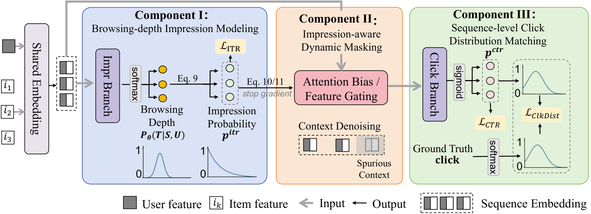

<!-- source-sha256: ed61ccc8196cffb228bdf9e354fc86a91a26ad594a1f36ae95445fdeab74e846 -->
# ICE: From display through impression to click in slate evaluation

[简体中文](README.md)

> **Local delivery: L1 tensor mechanisms.** The complete production experiment is not reproduced due to cost (review DONE). This is not a trained evaluator.

## Paper information

| Field | Details |
| --- | --- |
| Paper | [arXiv:2611.07591v1](https://arxiv.org/abs/2611.07591v1) · [Pinned full text](https://arxiv.org/html/2611.07591v1) |
| Original title | Beyond Independent Predictions: Learning the Browsing Journey for Sequence-Level Re-ranking |
| First author and affiliation | Jiayi Zhang, Alibaba Taobao & Tmall Group; collaboration with Xi'an Jiaotong University |
| First public date | 2026-11-05 07:41:22 UTC; November 6 arXiv bulletin |
| Author code | No public implementation found in pinned v1 or its links. The paper's CC BY 4.0 license does not establish a code release |
| Local key | `ice`; `adapter: null` |
| Local source | `src/auto_research/reproductions/ice_components.py` |
| Evidence | [CUDA three-seed mechanism metrics](metrics/component-cuda-seeds42-44.json) · [A100 receipt](../../gpu-validations/ice-a100-20261106.json) |

## Original paper

### Motivation and method

Displaying a slate does not mean its entire length was seen. ICE separates whether a user reaches a position from whether the user clicks after reaching it. A depth distribution constrains reach probabilities, which then dampen click-branch context from positions unlikely to be seen. The listwise click distribution models competition between positions. The production generator is unchanged; the evaluator scores the expected utility of candidate slates.

### Original figure

Unmodified author PNG from [the original paper](https://arxiv.org/html/2611.07591v1#S4.F2), Figure 2. Copyright remains with the authors.

### Equations

For depth $T$ in $1,\ldots,L$, reach is $r_k=\sum_{t\ge k}\Pr(T=t)$. It is nonincreasing, with $r_1=1$. Joint click probability is $r_k\sigma(z_k)$. The attention branch adds $\log(r_a r_b+\epsilon)$; the feature branch multiplies by $\alpha r_k+1-\alpha$. Both detach $r$.

Equation 12 normalizes observed clicks by their total, uses a uniform target for no-click slates, and takes $\mathrm{KL}(y\|p)$ against $p=\mathrm{softmax}(z/\tau)$. The implementation follows the equation, not a literal second softmax on binary labels inferred from the diagram. The training objective combines impression BCE, conditional click BCE on reached positions, and listwise KL.

### Published offline and online results

Table 2 reports Transformer SeqAUC moving from 81.31% to 85.84%. In §5.5, the Taobao Guess You Like experiment used 5% traffic for 14 days, comparing against the production Transformer evaluator with the generator fixed. The authors report impressions +0.58%, clicks +0.70%, revenue +3.67%, LT-14d +0.23%, and less than 0.5 ms added mean response time, followed by full deployment. These are paper results, not local measurements.

## Local reproduction boundary

The component consumes synthetic depth and click logits and binary observations. It implements the tail sum, detached gates, losses and joint utility in Eqs. 8–13. A log-tail/log-head BCE avoids early probability saturation. The contract rejects clicks outside the reached prefix, gaps in the prefix, and zero-depth records, which the paper's depth support does not model.

Three seeds check arithmetic, zero-click targets, finite gradients and detachment; no generator, embeddings or trained click network is supplied. No CTR or SeqAUC gains, production A/B, or Evolve promotion is claimed. The private seven-day corpus has 48.38M users and 141.79M slates, with six backbone families and a production control. That complete experiment is not reproduced (review DONE); no checkpoints or data were downloaded.
