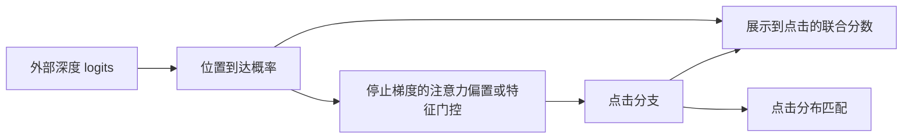
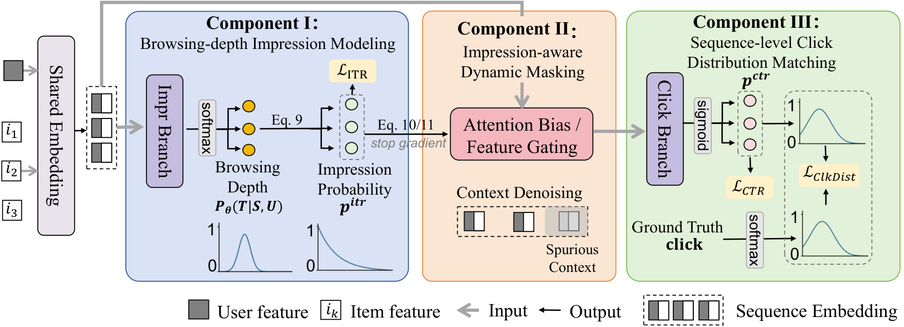

# ICE：从展示到曝光再到点击的序列级重排评估

> **本地交付：L1 张量机制组件。** 只验证浏览深度、停止梯度门控和点击分布损失；不训练生产评估器。完整实验成本过高，不复现（审查 DONE）。

## 论文信息

| 字段 | 内容 |
| --- | --- |
| 论文 | [arXiv:2611.07591v1](https://arxiv.org/abs/2611.07591v1) · [固定版本全文](https://arxiv.org/html/2611.07591v1) |
| 原题 | Beyond Independent Predictions: Learning the Browsing Journey for Sequence-Level Re-ranking |
| 一作及机构 | Jiayi Zhang，阿里巴巴淘天集团；与西安交通大学合作 |
| 首次公开日期 | 2026-11-05 07:41:22 UTC；arXiv 公告为 11 月 6 日 |
| 原作者源码 | 固定 v1 及论文链接未找到公开实现；论文许可为 CC BY 4.0，不等于代码开源 |
| 本地键 | `ice`；`adapter: null` |
| 本地源码 | `src/auto_research/reproductions/ice_components.py` |
| 验证证据 | [CUDA 三种子机制指标](metrics/component-cuda-seeds42-44.json) · [A100 收据](../../gpu-validations/ice-a100-20261106.json) |

## 原始论文总结

### 背景与主要改动

重排器把整个列表交给用户，不代表用户看到了每个位置。ICE 将展示后的行为分解成「是否到达并曝光」与「曝光后是否点击」，让深度分布约束到达概率，再用曝光概率抑制点击分支的上下文噪声。点击分布的列表级监督建模位置间的竞争；原有生成器保持不变，由评估器为候选序列算期望价值。

<!-- paper-figure:start -->
### 原论文关键图

图片来自[原论文](https://arxiv.org/html/2611.07591v1#S4.F2) Figure 2，版权归原作者所有。作者 PNG 未重绘。
<!-- paper-figure:end -->

### 核心公式

令浏览深度 $T$ 取 $1,\ldots,L$，曝光概率 $r_k=\sum_{t\ge k}\Pr(T=t)$；它非递增，且 $r_1=1$。联合点击概率为 $r_k\sigma(z_k)$。注意力分支加 $\log(r_a r_b+\epsilon)$，特征分支乘 $\alpha r_k+1-\alpha$，两处都停止 $r$ 的梯度。

原文 Eq. 12 将观测点击按总点击数归一化，零点击列表用均匀目标，并与 $\mathrm{softmax}(z/\tau)$ 计算 $\mathrm{KL}(y\|p)$。本地按正文公式，不把图中的箭头解释为对二值点击再做 softmax。训练目标由曝光 BCE、只在曝光位置计算的条件点击 BCE，以及列表 KL 组成。

### 论文离线与线上效果

原文 Table 2 的 Transformer SeqAUC 由 81.31% 到 85.84%。§5.5 淘宝「猜你喜欢」14 天、5% 流量 A/B，对照为生产 Transformer 评估器，生成器固定；曝光 +0.58%、点击 +0.70%、商业收入 +3.67%、LT-14d +0.23%，平均响应时间增加不到 0.5 ms。作者报告随后全流量上线。这些均为原文结果，不是本地验证指标。

## 本地复现

### 数据协议、代码映射与结果边界

输入为合成深度 logits、点击 logits、达到前缀和二值点击。实现 Eq. 8–13 的尾和、门控、损失与联合效用算术，不实现生成器、共享 embedding 或训练后的点击网络。用 log-tail/log-head 计算曝光 BCE，避免极端 logits 先饱和为 0/1；拒绝未到达位置上的点击、非前缀曝光及零深度输入，因为论文深度支持不含零。

三种子检查只衡量公式误差、零点击目标、梯度有限性和门控停止梯度。不比较 CTR/SeqAUC 提升，不进入 Evolve 晋级。

### 完整实验成本

原文使用私有 7 日生产日志（4,838 万用户、1.4179 亿列表）和六类评估器的重复对照，并需要真实生产流量。单卡和本地无法取得同口径数据与线上控制组。**成本过高，不复现（审查 DONE）**；未下载模型或数据。
