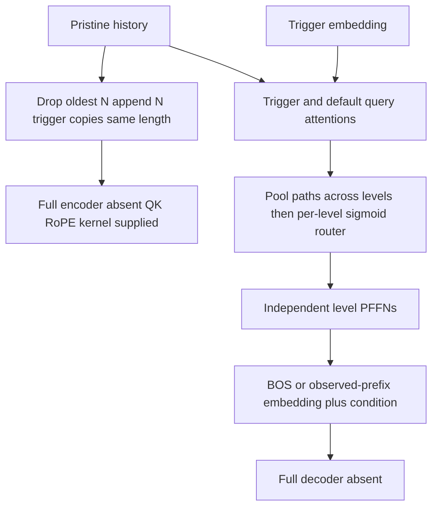
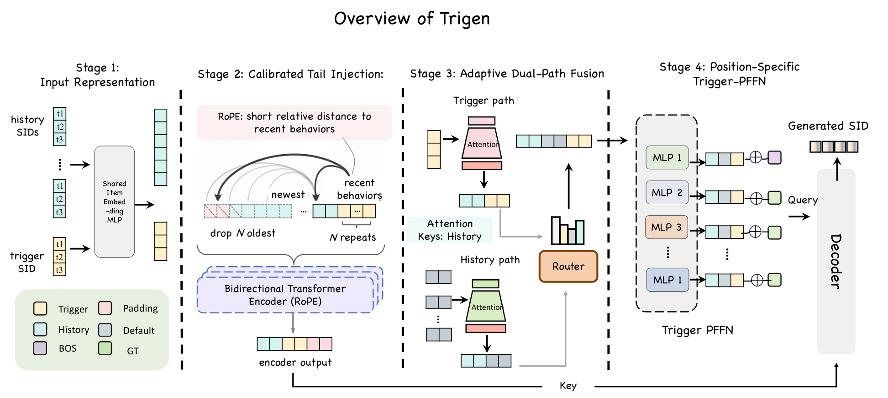

<!-- source-sha256: 3ce4ba847498e9545b3043d67b586147e385b84060a05c837b475925fa8e4f77 -->
[简体中文](README.md)

# TriGen: separate immediate triggers from persistent preferences

> **L1 differentiable conditioning components, diagnostic only.** Local Eqs.4–8 structures, not a full encoder/decoder or recommender training. The full industrial matrix is too costly and is not reproduced (review DONE).

## Paper information

| Field | Value |
|---|---|
| Paper | [TriGen: A Generative Paradigm for Trigger-Induced Recommendation](https://arxiv.org/abs/2611.16395v1); [fixed v1](https://arxiv.org/html/2611.16395v1) |
| Company / institution | First author **Muyu Zou, Alibaba International Digital Commerce Group**; Nankai University and independent-researcher collaborators |
| Original publication | **2026-11-12 07:07:10 UTC**, arXiv v1 |
| Authors' code | No verified TriGen implementation found in the fixed source/author entry points as of 2026-11-15; framework/baseline links are not a method release |
| Code license / revision | No verified method code; not applicable |
| Local adapter / key | `trigen`; standalone conditioning, `adapter: null` |
| Local code | `src/auto_research/reproductions/trigen_components.py`: `tail_inject`, `rotary`, `DualPathConditioner`, `condition_decoder_inputs` |
| Local evidence | [CPU](metrics/component-cpu-seeds42-44.json), [CUDA](metrics/component-cuda-seeds42-44.json), [real GPU receipt](../../gpu-validations/trigen-a100-20261115.json); not recall or revenue |

## Original paper summary

### Background and main changes

A recent product-page click signals intent but should not erase all historical preferences. Simply appending a trigger mixes immediate steering and long-term continuity. TriGen repeats the trigger at a fixed-window tail with RoPE, then separately extracts trigger-query and default-query conditions from **pristine history**, fuses them with an input-dependent router and applies independent PFFNs per SID level.

Tail-injected encoder input is distinct from the raw history read by both conditioning paths. The default history branch must not change with the trigger. RoPE transforms queries/keys, not arbitrary sinusoidal additions to embeddings.



<!-- paper-figure:start -->
### Key original figure



[Fixed v1 original Figure 2 PNG](https://arxiv.org/html/2611.16395v1/trigen.png), not redrawn. Copyright belongs to the authors; provenance records hashes and visual review. Teacher-forced known prefixes in the source do not authorize future labels at inference.
<!-- paper-figure:end -->

### Core equations

Section 4 Eq.4 preserves a window of M positions:

$$
\widetilde H=(h_{N+1},\ldots,h_M,\underbrace{e^{trg},\ldots,e^{trg}}_{N\text{ copies}}).
$$

Both Eq.5 paths read pristine H:

$$
t_l=\operatorname{softmax}\left[\frac{(W_l^{tr}e^{trg})(HW_K)^\top}{\sqrt d}\right]HW_V,\quad
h_l=\operatorname{softmax}\left[\frac{q_l^{def}(HW_K)^\top}{\sqrt d}\right]HW_V.
$$

Eq.6 pools across levels before producing per-level gates:

$$
w=\sigma(W_r[\operatorname{mean}_l(t_l)\|\operatorname{mean}_l(h_l)]+b_r),\quad
c_l=w_lt_l+(1-w_l)h_l.
$$

Eqs.7–8 apply independent MLPs, then add conditions to shifted decoder inputs: c-tilde_l=MLP_l(c_l), x1=e(BOS)+c-tilde1, xl=e(y_l-1)+c-tilde_l. A shared MLP is not position-specific. MLP internals are unspecified; the local configurable two-layer GELU is an explicit choice, not recovered author code. Inference accepts generated/observed prefixes, never future target SIDs.

### Offline and online results

The source compares trigger-free, append, conditioning and history-attention baselines on public/industrial data with recall/NDCG ablations. Industrial recall is multi-positive and cannot be compared with random local tensors.

Section 5.5 reports **June 28–July 2, 2026**, six Southeast Asian markets, 10% random traffic per bucket. Control is deployed GR+trigger append, with identical upstream sources/downstream serving. All-country revenue gains range +1.64% to +8.16%; traffic-weighted revenue is **+3.27%**, GMV **+0.90%**, p<0.05. GMV improves in four of six countries, not all. Serving is about 10.5ms; full production deployment starts July. These are author results, not a business lift reproduced by local conditions.

## Local reproduction

### Data protocol and code mapping

Tiny random histories/triggers pass through real dual attention, pooled routing, separate PFFNs and backward with padding masks. Tail injection, Q/K RoPE and BOS/observed-prefix conditioning are independently callable. There is no complete bidirectional encoder, causal decoder, SID tokenizer, semantic dataset or recommendation loss.

```bash
PYTHONPATH=src python -m pytest tests/reproductions/test_nov15_recommendation_components.py -q
PYTHONPATH=src python -c 'from auto_research.reproductions.trigen_components import diagnostic; print(diagnostic(42, device="cpu"))'
```

### Results, negative controls and boundaries

Checks cover fixed-context tail replacement, padding isolation, trigger-independent default history, input-dependent routing, independent level parameters, BOS conditioning, RoPE relative-score invariance to common position shifts and finite gradients. No optimization loop or real item returns are supplied. CUDA forward/backward needs actual A100/A30 evidence; component gradients do not establish recommendation capability or Evolve integration.

### High-cost full experiment

Appendix D's 1.51M public configuration still requires quantization, 15 epochs, multiple baselines, five seeds and ablations. The industrial eight-level-SID long-history models train on **eight L20s** and private production data. Full industrial multi-arm/online experiments are **too costly, not reproduced (review DONE)**. Only bounded tensor verification is run; no data/model downloads, full exploratory training or automatic retries.
