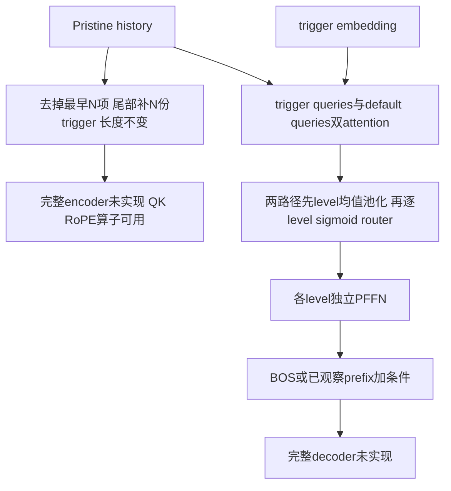
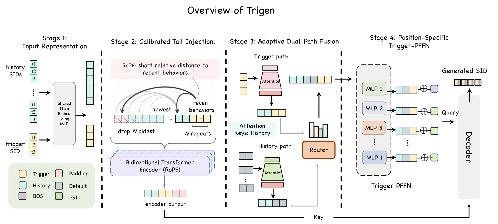

# TriGen：把即时 trigger 与长期偏好分开建模

> **L1 可微条件模块，diagnostic only**。实现 Eq.4–8 的局部结构，不含完整 encoder/decoder 或推荐训练；完整工业矩阵成本过高，不复现（审查 DONE）。

## 论文信息

| 字段 | 内容 |
|---|---|
| 论文链接 | [TriGen: A Generative Paradigm for Trigger-Induced Recommendation](https://arxiv.org/abs/2611.16395v1)；[固定 v1 全文](https://arxiv.org/html/2611.16395v1) |
| 公司 / 作者机构 | 一作 **Muyu Zou，Alibaba International Digital Commerce Group**；含 Nankai University 与独立研究者合作者 |
| 原始发布日期 | **2026-11-12 07:07:10 UTC**，arXiv v1 |
| 原作者代码 | 截至2026-11-15，固定原文与作者入口未找到已核实 TriGen 方法代码；框架/基线链接不是该方法开源 |
| 原作者代码许可 / 版本 | 未找到方法实现，许可/固定版本不适用 |
| 本地 Adapter / key | `trigen`；独立条件结构，`adapter: null` |
| 本地代码 | `src/auto_research/reproductions/trigen_components.py`：`tail_inject`、`rotary`、`DualPathConditioner`、`condition_decoder_inputs` |
| 本地指标 / GPU 证据 | [CPU](metrics/component-cpu-seeds42-44.json)、[CUDA](metrics/component-cuda-seeds42-44.json)、[真实 GPU 收据](../../gpu-validations/trigen-a100-20261115.json)；不是推荐 Recall 或生产收益 |

## 原始论文总结

### 背景与主要改动

商品详情页上刚点击的 trigger 代表即时意图，却未必应该覆盖用户全部历史。简单把 trigger 拼接进序列会将短期 steering 与长期偏好混在一起。TriGen 在固定窗口尾部校准地重复 trigger，以 RoPE 建模相对位置；另从**未被 trigger 改写的 pristine history**提取 trigger-query 与 default-query 双路径，经输入相关 router 融合，再给各 SID level 独立的 PFFN 条件。

关键不是“所有 attention 都读同一份拼接历史”。tail-injected encoder 序列与双路径条件读取的原始历史必须分开；默认查询分支不应随 trigger 变化。RoPE 施加在 query/key，而不是给输入 embedding 任意加正弦向量。



<!-- paper-figure:start -->
### 原论文关键图



图片来自[原论文](https://arxiv.org/html/2611.16395v1/trigen.png)固定 v1 Figure 2 原始 PNG，未重绘。版权归原作者所有；源图/本地哈希与视觉核验见 `assets/provenance.json`。原图 teacher-forcing 的已知前缀不是推理时可偷看的未来标签。
<!-- paper-figure:end -->

### 核心公式

§4 Eq.4 固定 $M$ 长窗口：

$$
\widetilde H=(h_{N+1},\ldots,h_M,\underbrace{e^{trg},\ldots,e^{trg}}_{N\text{份}}).
$$

Eq.5 双路径都读 pristine $H$：

$$
t_l=\operatorname{softmax}\!\left[\frac{(W_l^{tr}e^{trg})(HW_K)^\top}{\sqrt d}\right]HW_V,\quad
h_l=\operatorname{softmax}\!\left[\frac{q_l^{def}(HW_K)^\top}{\sqrt d}\right]HW_V.
$$

Eq.6 先分别对 level 均值池化，再计算各位置权重：

$$
w=\sigma(W_r[\operatorname{mean}_l(t_l)\|\operatorname{mean}_l(h_l)]+b_r),\quad
c_l=w_lt_l+(1-w_l)h_l.
$$

Eqs.7–8：$\widetilde c_l=MLP_l(c_l)$，$x_1^{dec}=e(BOS)+\widetilde c_1$，$x_l^{dec}=e(y_{l-1})+\widetilde c_l$。每个 level 独立参数，不共享一个 MLP 冒充位置专属。原文未唯一规定 MLP 内部；本地显式选择可配 hidden width 的两层 GELU，不声称找回作者代码。推理只能喂已生成 prefix，不能输入未来目标 SID。

### 论文离线与线上效果

原文对比 trigger-free、append、conditioning 与 history-attention 等方法，在公开及工业数据报告多种 Recall/NDCG 与消融。工业评测是 multi-positive recall，不与本地随机张量比较。

§5.5 **2026-06-28 至 07-02**，六个东南亚市场各桶10%随机生产流量，control 为已上线 GR+trigger append，upstream sources/downstream serving不变。各市场收入 +1.64%至+8.16%，流量加权收入 **+3.27%**、GMV **+0.90%**，p<0.05；GMV四国提高而非全部六国。线上约10.5ms，7月起生产全量。这些是作者的线上证据，不是局部条件层已复现出的业务提升。

## 本地复现

### 数据协议与代码映射

小随机历史与 trigger 张量经过真实双路径 attention、pooled router、独立 PFFN 和 backward；含明确padding mask。tail injection、Q/K RoPE、BOS/observed-prefix 加条件分别是独立可调用算子，没有完整 bidirectional encoder、causal decoder、SID tokenizer、语义训练数据或推荐 loss。

```bash
PYTHONPATH=src python -m pytest tests/reproductions/test_nov15_recommendation_components.py -q
PYTHONPATH=src python -c 'from auto_research.reproductions.trigen_components import diagnostic; print(diagnostic(42, device="cpu"))'
```

### 结果、负控与边界

检查 fixed-context 尾部替换、padding隔离、default history path 的 trigger 不变性、输入相关 router、独立 level 参数、BOS conditioning、RoPE统一位置平移下的相对分数及有限梯度。无参数优化循环或真实 item 回报。CUDA 的局部 forward/backward 需要真实 A100/A30收据；不把组件梯度当推荐能力，不参与 evolve 晋级。

### 高成本完整实验

Appendix D 公开配置虽为1.51M参数，仍包含量化、15epochs、多基线/五种子/消融；工业模型8-level SID、长历史，在 **8张L20** 上训练并使用私有生产数据。完整工业多臂和线上实验**成本过高，不复现（审查 DONE）**，本轮只做已有小张量组件验收，不下载数据/模型、不完整试训、不自动重试。
