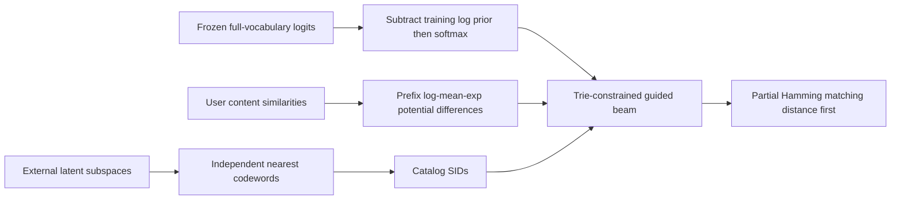
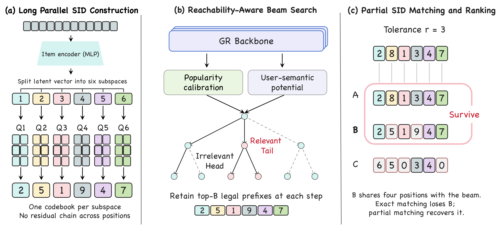

<!-- source-sha256: aa17c2202a55ee2c9cbed5071e733d965d51624ea52d088dd8639d61ed0b9ad0 -->
[简体中文](README.md)

# ReSID: making long-tail items reachable in generative retrieval

> **L1 CPU quantization / guided-beam / partial-match components, diagnostic only.** No item encoder, Semantic IDs or recommender is trained. Full industrial training and production experiments are too costly and are not reproduced (review DONE).

## Paper information

| Field | Value |
|---|---|
| Paper | [ReSID: Rethinking Long-Tail Retrieval in Generative Recommendation through item Reachability](https://arxiv.org/abs/2611.16404v1); [fixed v1](https://arxiv.org/html/2611.16404v1) |
| Company / institution | First author **Muyu Zou, Alibaba International Digital Commerce Group**; Nankai University collaboration |
| Original publication | **2026-11-12 07:12:15 UTC**, arXiv v1 |
| Authors' code | [Gabriel-reina/ReSID](https://github.com/Gabriel-reina/ReSID), public release at reviewed SHA `bb5bdc94707f43223eb1c1cca067534b42be9117` |
| Code license | Apache-2.0; the release does not open private industrial data or production serving |
| Local adapter / key | `resid`; standalone components, `adapter: null`, no Evolve promotion |
| Local code | `src/auto_research/reproductions/resid_components.py`: `parallel_quantize`, `guided_beam`, `partial_match` |
| Local metrics | [CPU three-seed diagnostics](metrics/component-cpu-seeds42-44.json), not long-tail recall, revenue or measured serving latency |

## Original paper summary

### Background and main changes

Semantic representations alone do not make tail items reachable. Residual quantization can propagate early errors, narrow beams can prune rare prefixes, and exact matching can discard useful near-matches. ReSID addresses these with independent-subspace long parallel SIDs, popularity/user-semantic beam guidance and Hamming-tolerant partial matching.

This is not a tail bonus applied after retrieval. Guidance must preserve relevant low-frequency branches during search, without injecting a held-out target. Supplied user/content similarities must not be relevance labels or gold.



<!-- paper-figure:start -->
### Key original figure



Original SVG from [fixed v1 Figure 5](https://arxiv.org/html/2611.16404v1#S3.F5), rendered to PNG without redrawing. Copyright belongs to the authors; source/render hashes are in `assets/provenance.json`. The illustrated encoder/backbone is not a locally trained model.
<!-- paper-figure:end -->

### Core equations

Section 4 Eq.1 independently quantizes latent subspaces:

$$
c_{i,l}=\arg\min_k\|z_i^{(l)}-e_{l,k}\|_2^2.
$$

This differs from TIGER's successive residual chain. Eqs.2–3 define:

$$
\Phi_u(p)=\log\left[|\mathcal I(p)|^{-1}\sum_{i\in\mathcal I(p)}
\exp(q_u^\top t_i/\tau)\right],\quad
\widetilde P(v|p)=\operatorname{softmax}_{vocab}(a_v-\lambda\log\pi(v|p)),
$$

$$
S(pv)=S(p)+\log\widetilde P(v|p)+\beta[\Phi_u(pv)-\Phi_u(p)].
$$

Inputs are dot products of normalized user/content vectors. Normalize over the **full vocabulary before trie masking**, not a separately renormalized legal-child vocabulary. Priors are training transition frequencies; smoothing is caller policy, and nonpositive inputs are rejected. Potential differences telescope on complete paths, but intermediate pruning still affects candidates.

Section 4.3 ranks catalog items first by minimum Hamming mismatch, then the corresponding higher beam score. Final exact ties use a declared local item-index rule. Different items sharing one SID remain distinct.

### Offline and online results

Table 1 exposes accuracy/tail tradeoffs: on Office, ReSID overall R@200 is 31.52 versus TIGER 34.03, while tail R@200 is 20.54 versus 4.48. Not all metrics improve.

Section 5.7 reports **July 1–12, 2026** user-randomized A/B, 15% traffic per bucket. Control uses TIGER-style retrieval; other retrieval channels and downstream ranking stay fixed. Advertising revenue rises **1.3%**, CTR **1.1%**, GMV **0.8%**, and tail-exposure share **4.0%**, all p<0.05. Mean online response is 10.3ms, with full production deployment since July. These qualify as author production evidence, not local or budget-matched results.

## Local reproduction

### Data protocol and code mapping

Independent quantization does not train an MLP, decoder or codebooks. Guided beam receives catalog SIDs, similarities, full-vocabulary logits and training-prior callbacks, with no target argument, recommender or learned user projection. Partial matching enumerates a finite catalog; it is not an industrial index-throughput reproduction.

```bash
PYTHONPATH=src python -m pytest tests/reproductions/test_nov15_recommendation_components.py -q
PYTHONPATH=src python -c 'from auto_research.reproductions.resid_components import diagnostic; print(diagnostic(42))'
```

### Results, negative controls and boundaries

Exhaustive enumeration checks beam scores and telescoping. Tests cover isolated-subspace perturbations, valid prefixes, duplicate SIDs, Hamming ranking and invalid priors. The fixture's `guided_tail` means a branch changes under supplied synthetic similarities, not measured long-tail capability. Three seeds remain L1 diagnostics. CPU-only, no CUDA receipt or Evolve promotion.

### High-cost full experiment

The source trains item quantizers, recommender backbones and user projections, and evaluates multiple datasets, baselines and serving configurations. Industrial data/serving are private. Full industrial training/production A/B is **too costly, not reproduced (review DONE)** on one A100/A30 or a Mac. No weights/private data, trial training or automatic retries; tiny arrays do not substitute for recall or revenue.
