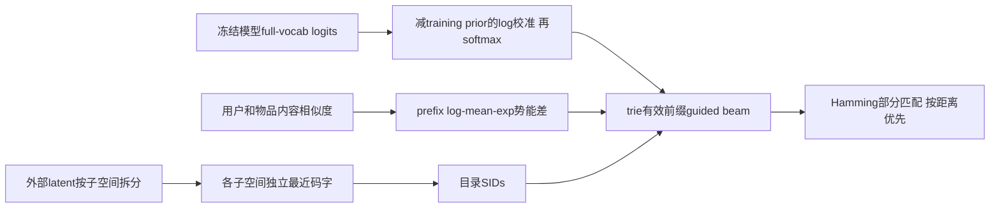
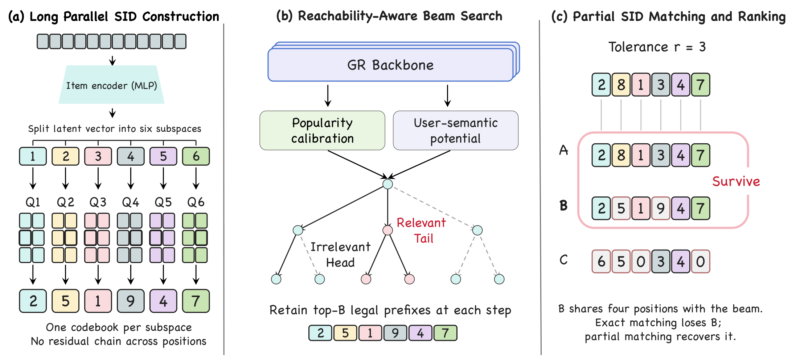

# ReSID：让长尾物品在生成式召回中真正可达

> **L1 CPU 量化 / guided beam / partial-match 组件，diagnostic only**。未训练物品编码器、Semantic ID 或推荐网络；完整工业训练与线上实验成本过高，不复现（审查 DONE）。

## 论文信息

| 字段 | 内容 |
|---|---|
| 论文链接 | [ReSID: Rethinking Long-Tail Retrieval in Generative Recommendation through item Reachability](https://arxiv.org/abs/2611.16404v1)；[固定 v1 全文](https://arxiv.org/html/2611.16404v1) |
| 公司 / 作者机构 | 一作 **Muyu Zou，Alibaba International Digital Commerce Group**；含 Nankai University 合作者 |
| 原始发布日期 | **2026-11-12 07:12:15 UTC**，arXiv v1 |
| 原作者代码 | [Gabriel-reina/ReSID](https://github.com/Gabriel-reina/ReSID)，固定 SHA `bb5bdc94707f43223eb1c1cca067534b42be9117`；原作者已公开 |
| 原作者代码许可 | Apache-2.0；公开实现不等于工业私有数据或生产服务已开放 |
| 本地 Adapter / key | `resid`；独立组件，`adapter: null`，不参与 evolve 晋级 |
| 本地代码 | `src/auto_research/reproductions/resid_components.py`：`parallel_quantize`、`guided_beam`、`partial_match` |
| 本地指标 | [CPU 三种子机制诊断](metrics/component-cpu-seeds42-44.json)，不是长尾 Recall、线上收益或实测服务时延 |

## 原始论文总结

### 背景与主要改动

长尾物品即使有语义表示，也可能因三个连续瓶颈从未进入候选：残差量化上游误差传播、窄 beam 早期剪去低频前缀、exact SID matching 无法容忍少数 token 错误。ReSID 分别用独立子空间的长 parallel SID、流行度校准与用户语义势能引导，以及带 Hamming 容忍度的 partial matching 改善“可达性”。

它不只是对最终列表加一个长尾分数。用户语义引导要在每次 beam 扩展前保留相关低频分支，而不是召回结束才补一个真实目标。调用者提供的 user/content 相似度不能是 held-out relevance 或 gold 标签。



<!-- paper-figure:start -->
### 原论文关键图



图片来自[原论文](https://arxiv.org/html/2611.16404v1#S3.F5)固定 v1 Figure 5，原始 SVG 渲染为 PNG，未重绘；版权归原作者所有。来源、源图与渲染图 SHA256 见 `assets/provenance.json`。图中的编码器和 backbone 不是本地已训练模型。
<!-- paper-figure:end -->

### 核心公式

§4 Eq.1 在独立子空间作最近邻码字：

$$
c_{i,l}=\arg\min_k\|z_i^{(l)}-e_{l,k}\|_2^2.
$$

这不是 TIGER 的逐层 residual 递推。§4.2 Eqs.2–3：

$$
\Phi_u(p)=\log\!\left[\frac1{|\mathcal I(p)|}\sum_{i\in\mathcal I(p)}
\exp(q_u^\top t_i/\tau)\right],\quad
\widetilde P(v|p)=\operatorname{softmax}_{vocab}(a_v-\lambda\log\pi(v|p)),
$$

$$
S(pv)=S(p)+\log\widetilde P(v|p)+\beta[\Phi_u(pv)-\Phi_u(p)].
$$

相似度须来自规范化 user/content 向量；本地接收其外部点积。**完整词表先归一化，再做 trie 有效前缀屏蔽**；不能在每个 prefix 的合法子词表另做 softmax 而声称相同分数。prior 是 training transition frequency，零值平滑由调用方明确，本地拒绝非正值。势能差沿路径望远镜相消，但窄 beam 的中间剪枝仍改变候选。

§4.3 比较物品 SID 与已生成 SID 的 Hamming 距离，先按最少 mismatch，再按对应更高 beam score 排序；最后完全并列时本地用 item index 稳定打破并列。相同 SID 的不同目录物品不擅自合并。

### 论文离线与线上效果

Table 1 展示长尾召回/覆盖改善，也存在总体精度取舍：Office 的 ReSID R@200 为31.52，TIGER34.03，但 Tail R@200 为20.54对4.48，不能只挑长尾结果称所有指标提升。

§5.7 **2026-07-01 至 07-12** 的 user-randomized A/B，每桶15%流量，TIGER-style retrieval 作 control，其他召回通道与下游排序保持不变；作者报告广告收入 **+1.3%**、CTR **+1.1%**、GMV **+0.8%**、长尾曝光份额 **+4.0%**，均 p<0.05，线上均值10.3ms，7月起全流量生产。此为论文收录的线上证据，不是本地实验或同预算复现。

## 本地复现

### 数据协议与代码映射

独立 quantization 不训练 MLP/decoder/codebook。guided beam 接收目录 SID、外部相似度、full-vocab logits 回调和训练 prior 回调；没有 target 参数、推荐网络、用户向量训练或线上请求。partial match 是有限目录枚举，不是工业索引吞吐复现。

```bash
PYTHONPATH=src python -m pytest tests/reproductions/test_nov15_recommendation_components.py -q
PYTHONPATH=src python -c 'from auto_research.reproductions.resid_components import diagnostic; print(diagnostic(42))'
```

### 结果、负控与边界

专测用完整枚举对照 beam score 和势能望远镜，检查独立子空间扰动、有效前缀、重复 SID、Hamming 排序及非正 prior 拒绝。夹具中的 `guided_tail`只是人为有限相似度下分支改变，不代表真实长尾能力。三种子不改变 L1 designation；纯 CPU，不要求 CUDA 回执，不接入 evolve 晋级。

### 高成本完整实验

原文包含 learned item quantizer、推荐 backbone、用户投影和多数据/多基线/服务实验，工业数据与生产系统未公开。对单 A100/A30 或 Mac，完整工业训练/生产 A/B **成本过高，不复现（审查 DONE）**。不下载模型或私有数据，不以小数组替代真实 Recall/收益，不启动完整试训或自动重试。
