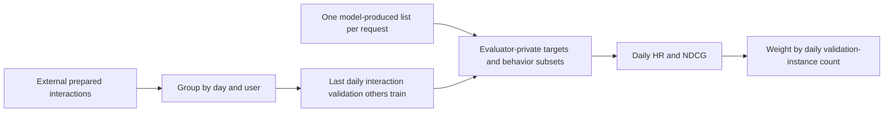
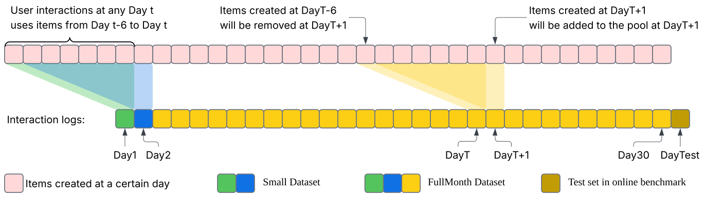

<!-- source-sha256: c660e4e753d0e01f56d3aa95feec51d3ebe96b7b06d0ce3f597686f2e170dd37 -->
[简体中文](README.md)

# KuaiRecV2: daily validation and one-retrieval multi-task evaluation

> **L0 finite protocol interface, diagnostic only.** No KuaiRecV2 download, model integration or benchmark run. Full continual training/evaluation is too costly and is not reproduced (review DONE). Included as public evaluation infrastructure, not misrepresented as industrial A/B.

## Paper information

| Field | Value |
|---|---|
| Paper | [KuaiRecV2: Benchmarking Large-Scale Continual Learning for Diversified and Multi-task Recommendation](https://arxiv.org/abs/2611.16795v1); [fixed v1](https://arxiv.org/html/2611.16795v1) |
| Company / institution | First author **Chenxu Li, University of Science and Technology of China**, with Kuaishou Technology collaboration; not duplicated across every coauthor affiliation |
| Original publication | **2026-11-12 13:39:12 UTC**, arXiv v1 |
| Authors' code | The paper links [cxli2333/KuaiRecV2](https://github.com/cxli2333/KuaiRecV2), but GitHub API returned 404 during review. Accessible implementation/data, license and SHA are unverified; not downloaded or successfully integrated |
| Local adapter / key | `kuairec-v2-protocol`; `adapter: null`, evaluation interface, not a model |
| Local code | `src/auto_research/reproductions/kuairec_v2_protocol.py`: `daily_leave_one_out`, `full_month_score`, `single_retrieval_evaluate_all` |
| Local metrics | [CPU protocol diagnostics](metrics/component-cpu-seeds42-44.json); finite examples are not official FullMonth/leaderboard results |

## Original paper summary

### Background and main changes

Static item pools and one-shot splits can hide continual-learning problems. KuaiRecV2 supplies thirty days, rolling seven-day creation windows, cross-day histories and multi-behavior feedback to expose adaptation/forgetting after candidate-pool changes.

Three protocol details matter: the last interaction **per user per day is validation**; FullMonth aggregation weights validation instances, not days equally; each request retrieves once and reuses that list for all behavior subsets. Separate favorable click/like lists violate this contract. Local code supplies these finite interfaces, not data ingestion or a continual learner.



<!-- paper-figure:start -->
### Key original figure



Original SVG from [fixed v1 Figure 1](https://arxiv.org/html/2611.16795v1#S1.F1), rendered to PNG without redrawing. Copyright belongs to the authors; source/render hashes are in `assets/provenance.json`. The online-benchmark hold-out test differs from daily validation.
<!-- paper-figure:end -->

### Core equations

Section 3.1 sorts each day/user group by timestamp, placing its last interaction in validation and preceding interactions in training. Exact timestamp ties are rejected because no unique source tie-break is specified. Earlier-day validation labels are not automatically recycled into later training/history.

$$
M_{FullMonth}=\frac{\sum_tN_tM_t}{\sum_tN_t},\quad
HR@K=\mathbf1(rank\le K),\quad
NDCG@K=\frac{\mathbf1(rank\le K)}{\log_2(rank+1)}.
$$

N_t counts validation instances. NDCG uses the standard rank discount for one held-out positive; missed targets score zero. Behavior subsets reuse one request list and are selected using evaluator-private labels. Duplicate recommendations are rejected. Appendix D does not uniquely specify every token-diversity aggregation/normalization; these are explicitly **not implemented**, rather than invented as official metrics.

### Offline and online results

FullMonth has **484,045,145** interactions, **124,055** users and **24,898,648** items; Small still contains 38,955,949 interactions. Author comparisons of SASRec/GRURec and generative baselines discuss dynamic-pool drops, continual adaptation, diversity and multi-task tradeoffs. The repository/data are unverified locally, and source tables are not reproduced. No production A/B is reported. This is a public-evaluation-infrastructure exception, not a relaxed industrial A/B gate.

## Local reproduction

### Data protocol and code mapping

`Interaction` contains user/day/timestamp/item only. The split has no model. The finite evaluator separates absent retrieval producers from private target labels; gold belongs only in evaluation and must not be sent back to an agent/generator. Callers must enforce actual execution/data isolation; interface shapes alone do not prove nonleakage.

```bash
PYTHONPATH=src python -m pytest tests/reproductions/test_nov15_recommendation_components.py -q
PYTHONPATH=src python -c 'from auto_research.reproductions.kuairec_v2_protocol import diagnostic; print(diagnostic(42))'
```

### Results, negative controls and boundaries

Four finite interactions check daily rather than global splitting and train/validation separation. Two requests check shared-list behavior HR/NDCG. A one-versus-three-instance weighting case rejects macro averaging. Tests reject task-specific lists, duplicate recommendations and ambiguous ties. No ingestion, seven-day pool builder, cross-day history, model checkpoints or training/forgetting curves are supplied. CPU L0 only, not Evolve or leaderboard capability.

### High-cost full experiment

Appendix E's thirty-day stream spans millions/tens of millions of items, Qwen2.5-0.5B SFT/RL, groups of eight, beam50 and default eight-GPU distributed evaluation. FullMonth has about 484 million interactions and the official link is currently unverified. The full benchmark is **too costly, not reproduced (review DONE)** on one A100/A30 or a Mac. No synthetic split substitutes for official results; no downloads, exploratory runs or automatic retries.
