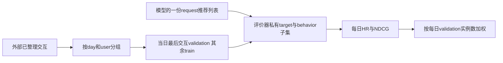
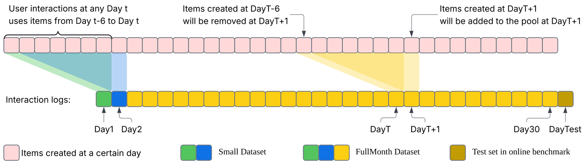

# KuaiRecV2：把每日验证与单次召回多任务评测说清楚

> **L0 有限协议接口，diagnostic only**。没有下载 KuaiRecV2 数据、接入模型或完成 benchmark；完整持续训练/评测成本过高，不复现（审查 DONE）。以公共评测基础设施收录，不伪称工业 A/B 论文。

## 论文信息

| 字段 | 内容 |
|---|---|
| 论文链接 | [KuaiRecV2: Benchmarking Large-Scale Continual Learning for Diversified and Multi-task Recommendation](https://arxiv.org/abs/2611.16795v1)；[固定 v1 全文](https://arxiv.org/html/2611.16795v1) |
| 公司 / 作者机构 | 一作 **Chenxu Li，University of Science and Technology of China**；与 Kuaishou Technology 合作；不按全部作者机构重复分组 |
| 原始发布日期 | **2026-11-12 13:39:12 UTC**，arXiv v1 |
| 原作者代码 / 数据 | 原文链接 [cxli2333/KuaiRecV2](https://github.com/cxli2333/KuaiRecV2)，本轮 GitHub API 返回404，未核实可访问实现/数据、license或固定SHA；不标为已下载或已成功接入 |
| 本地 Adapter / key | `kuairec-v2-protocol`；`adapter: null`，评测接口而非模型 |
| 本地代码 | `src/auto_research/reproductions/kuairec_v2_protocol.py`：`daily_leave_one_out`、`full_month_score`、`single_retrieval_evaluate_all` |
| 本地指标 | [CPU 三种子协议诊断](metrics/component-cpu-seeds42-44.json)；有限例子不是官方 FullMonth/leaderboard 结果 |

## 原始论文总结

### 背景与主要改动

静态 item pool 和一次性切分会掩盖生成式推荐的持续学习难题。KuaiRecV2提供30天交互、滚动7天创建窗口、跨日历史和多行为反馈，要求观察每天候选池变化后的适应与遗忘，而不只报最终一个分数。

本文的协议价值在于明确三点：每天每用户最后一次交互是**validation**；FullMonth汇总按验证实例数加权而不是天数宏平均；同一请求只做一次召回，再对不同反馈子集评价，不能为“like”“click”分别生成有利列表。本地仅把这三点变为有限接口，不宣称已实现数据流水线或持续学习系统。



<!-- paper-figure:start -->
### 原论文关键图



图片来自[原论文](https://arxiv.org/html/2611.16795v1#S1.F1)固定 v1 Figure 1，原始 SVG 渲染为 PNG，未重绘。版权归原作者所有；源图与渲染图哈希见 `assets/provenance.json`。图中 online benchmark 的 hold-out test 与本地 daily validation 必须区分。
<!-- paper-figure:end -->

### 核心公式

§3.1 对每个 day $t$、user $u$，按 timestamp 排序，最后一条进入 $V_t$，其余进入 $D_t$。本地拒绝同一用户/日精确timestamp并列，因为原文未给唯一tie-break；也不自动把前一日validation标签挪回下一日train/history。

$$
M_{FullMonth}=\frac{\sum_tN_tM_t}{\sum_tN_t},\quad
HR@K=\mathbf1(rank\le K),\quad
NDCG@K=\frac{\mathbf1(rank\le K)}{\log_2(rank+1)}.
$$

$N_t$为验证实例数。对单一held-out正例，以上NDCG即标准rank discount；behavior-wise统计复用同一个request列表，仅由评价器私有label决定分组。无命中记零；重复推荐拒绝。Appendix D部分token-diversity描述未唯一规定聚合/归一化，本地明确**未实现**，不自行补公式称“官方指标”。

### 论文离线与线上效果

FullMonth有 **484,045,145**条交互、**124,055**用户、**24,898,648**物品，Small也有38,955,949条交互。原文对比SASRec/GRURec及生成式基线，展示动态item pool的性能下滑、持续适应、多样性和多任务取舍；这些是作者benchmark研究。本轮未验证仓库或下载数据，未复现其表格。原文未给生产A/B，按公共评测基础设施入口收录，不放宽工业A/B门槛。

## 本地复现

### 数据协议与代码映射

`Interaction`只含user/day/timestamp/item。split接口没有模型；有限metric接口把retrieval producer与evaluator labels分开，producer并不存在，函数接收的gold只能属于评价器，不应回传给Agent或生成器。外部调用方还需真正隔离数据和执行顺序；接口形状不能独自证明无泄漏。

```bash
PYTHONPATH=src python -m pytest tests/reproductions/test_nov15_recommendation_components.py -q
PYTHONPATH=src python -c 'from auto_research.reproductions.kuairec_v2_protocol import diagnostic; print(diagnostic(42))'
```

### 结果、负控与边界

四条有限交互检查daily而非global split、validation不混入train；两个请求检查同列表behavior子集HR/NDCG；1对3实例权重检查FullMonth不能宏平均。拒绝task-specific多份列表、重复推荐与不明确timestamp tie。没有数据ingestion、7天候选池构造、跨日history、模型checkpoint或训练/遗忘曲线；纯CPU L0，不接入evolve或leaderboard能力比较。

### 高成本完整实验

Appendix E的30天流式训练覆盖百万至千万物品，Qwen2.5-0.5B SFT/RL、group8、beam50以及默认8GPU分布式评测；完整FullMonth约4.84亿交互且当前官方链接无法核实。相对单A100/A30或Mac预算，完整benchmark**成本过高，不复现（审查 DONE）**。不以自造小切分代替官方结果，不下载、不探跑、不自动重试。
