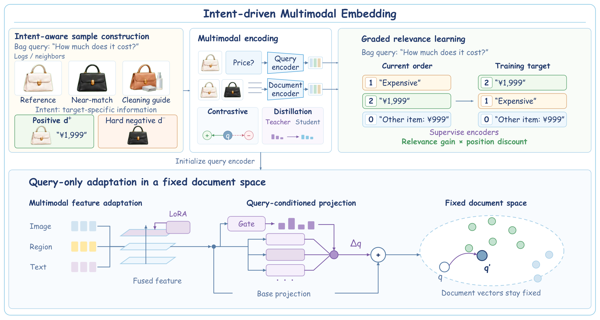

<!-- source-sha256: 6658557ea90280fdd772b0b094413b79e9554d36af3e4fc3e737902b4e1ebaad -->
# IntentFlow: An Intent-Driven Real-Time Multimodal Search System with Image-Text Queries at Xiaohongshu

[简体中文](README.md)

> L1 bounded mechanism component, not a capability benchmark or Evolve promotion.

## Paper information

| Field | Content |
| --- | --- |
| Paper | [IntentFlow: An Intent-Driven Real-Time Multimodal Search System with Image-Text Queries at Xiaohongshu](https://arxiv.org/abs/2611.20448v1); [fixed v1](https://arxiv.org/html/2611.20448v1) |
| Institution | First author Dongjia Zhao: Xiaohongshu; fixed-v1 byline checked |
| First publication | 2026-11-16 03:17:14 UTC, arXiv v1 |
| Original source code | No publicly verifiable paper-specific author implementation found in the fixed paper and linked sources. Cited dependencies or integration claims are not verified paper-specific code. |
| Local adapter / key | `intentflow`; adapter is null, not a complete model |
| Local implementation | `src/auto_research/reproductions/intentflow_components.py` |

## Paper summary

### Motivation and changes

Finding an exact item, styling an outfit and seeking usage information require different evidence even for the same image. IntentFlow unifies intent hierarchy, verified three-grade relevance, agentic data construction, multimodal retrieval and intent-conditioned reranking. After indexing, query-only upper-layer LoRA and six-expert residual projections avoid recomputing the document corpus.

<!-- paper-figure:start -->
### Original figure



Image from the [original paper](https://arxiv.org/pdf/2611.20448v1); copyright belongs to the original authors. Original asset/PDF crop, not local results. [Provenance and SHA256](assets/provenance.json).
<!-- paper-figure:end -->

### Core formulas

$$
f(q)=\operatorname{norm}\left[u_q+0.1\|u_q\|\sum_{j=1}^2\sum_{k=1}^6\alpha_k(q)U_{j,k}V_jh_q\right],\quad L_{KD}=\tfrac12 KL_{q\to d}+\tfrac12 KL_{d\to q}.
$$

Eqs16,18–21 and24 are implemented: one query gate mixes two shared-bottleneck branches (paper ranks8/64), retaining a frozen base projection. Both distillation directions share valid candidate sets and detach the teacher. CSLS subtracts only offline document density relative to a training-query bank. Zero-initialized up projections are a local stability convention, not an initialization specified by the paper or a complete model recipe.

### Author results

Table1 uses the same production control in user-level A/B: recognition+reranking yields relative Top4QCTR/QCTR/dwell lifts21.65%/15.12%/9.66%; adding retrieval yields28.17%/18.96%/12.56%. These cumulative configurations do not isolate retrieval alone. End-to-end P50 is1.07s; component quantiles cannot simply be added.

## Local implementation and boundaries

### Data protocol and code mapping

Inputs are externally supplied fused features and candidate scores. No rules impersonate the0.8B recognizer, and the full LoRA/VLM, agentic verification or NDCG-weighted training chain is absent. Unchanged document tensors in diagnostics do not establish improved semantic retrieval.

```bash
PYTHONPATH=src python -c 'from auto_research.reproductions.intentflow_components import diagnostic; print(diagnostic(42, device="cpu"))'
```

### Results, controls and limits

L1 bounded mechanism component, not a capability benchmark or Evolve promotion. Seeds42/43/44 check explicit fixtures/small-tensor arithmetic and gradients, not three independent model-capability trials. CPU and actual GPU evidence remain separate. Author scores must not populate local dashboards.

### High-cost full experiments

0.8B multimodal full-parameter students,2Bteacher, agentic evidence acquisition and ten-billion-entry production index; no vision model or intent classifier is replaced by rules **Not reproduced due to high cost; review DONE.** No automatic training/retry queue and no blocking of declared review closure.

### Same-topic comparison

WeSearch constrains candidates by clusters and atomic matching; IntentFlow defines evidence required by the request and adapts query encoding to a fixed document space. Candidate organization and intent-supervised representations differ, and component gradients prove neither online lift.
