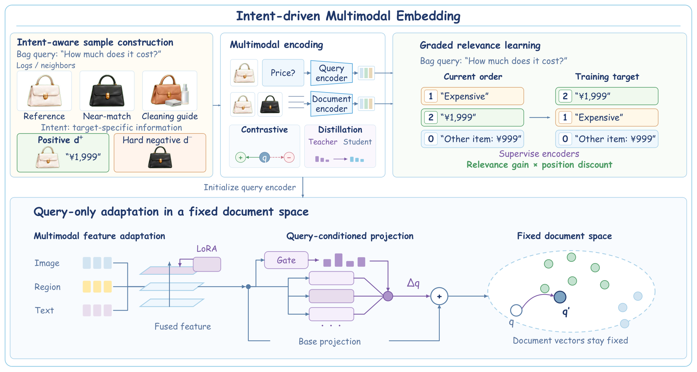

# IntentFlow：意图条件多模态搜索与固定索引适配

[English](README-en.md)

> L1低成本机制组件；不是能力benchmark，未接入Evolve晋级。

## 论文信息

| 字段 | 内容 |
| --- | --- |
| 论文链接 | [IntentFlow: An Intent-Driven Real-Time Multimodal Search System with Image-Text Queries at Xiaohongshu](https://arxiv.org/abs/2611.20448v1)；[固定v1全文](https://arxiv.org/html/2611.20448v1) |
| 公司 / 作者机构 | 一作 Dongjia Zhao：Xiaohongshu；按固定v1作者栏核对 |
| 首次公开日期 | 2026-11-16 03:17:14 UTC（arXiv v1） |
| 原作者开源代码 | 原文及其关联链接未找到/未核验公开的本论文专属作者代码。引用依赖或声称集成不等于已核验专属实现。 |
| 本地adapter / 稳定键 | `intentflow`；adapter为null，不冒充完整模型 |
| 本地复现代码目录 | `src/auto_research/reproductions/intentflow_components.py` |

## 原始论文总结

### 背景与主要改动

相同图片上的找同款、找搭配和问使用信息需要不同证据，纯视觉相似性不足。IntentFlow将意图层级、可验证三档相关性、agentic数据构造、多模态检索和意图条件重排统一起来。索引固定后只在查询侧进行高层LoRA与六专家残差投影，避免全库重算。

<!-- paper-figure:start -->
### 原论文关键图



图片来自[原论文](https://arxiv.org/pdf/2611.20448v1)，版权归原作者所有；为原图或PDF裁剪，不是本地结果。[出处与SHA256](assets/provenance.json)。
<!-- paper-figure:end -->

### 核心公式

$$
f(q)=\operatorname{norm}\left[u_q+0.1\|u_q\|\sum_{j=1}^2\sum_{k=1}^6\alpha_k(q)U_{j,k}V_jh_q\right],\quad L_{KD}=\tfrac12 KL_{q\to d}+\tfrac12 KL_{d\to q}.
$$

实现Eq16、18–21、24：同一查询门控混合两个共享瓶颈分支（原设置rank8/64），保留冻结基础投影；蒸馏两方向使用相同合法候选并detach教师；CSLS只减去文档对训练query参考库的离线密度项。零初始化up projection是本地稳定初始化约定，原文未明确此初始化，不伪称完整模型配方。

### 论文离线与线上效果

Table1为相同生产control的用户级A/B：识别+重排Top4QCTR/QCTR/停留相对+21.65%/+15.12%/+9.66%；加入召回后+28.17%/+18.96%/+12.56%。两配置是累计组合，不等于召回单独贡献。端到端P50为1.07秒，不能将组件分位数直接相加。

## 本地复现与边界

### 数据协议与代码映射

输入仅为外部融合特征和候选分数；没有用规则假装0.8B意图识别器，也未实现完整LoRA/VLM、agentic核验或NDCG权重训练链。文档输入在诊断中保持不变，不意味着语义召回已提升。

```bash
PYTHONPATH=src python -c 'from auto_research.reproductions.intentflow_components import diagnostic; print(diagnostic(42, device="cpu"))'
```

### 结果、负控与边界

L1低成本机制组件；不是能力benchmark，未接入Evolve晋级。 种子42/43/44只验证显式夹具/小张量的数值和梯度，不是三次独立模型能力试验。CPU与实际GPU证据分别保存，不能用作者指标填充本地看板。

### 高成本完整实验

0.8B多模态全参数学生、2B教师、agentic证据采集与百亿条生产索引的完整矩阵超出短预算，不用规则假装模型。 **成本过高，不复现（审查DONE）**；不阻塞已声明的审查闭环，不进入自动训练或补跑队列。

### 同主题对照

WeSearch用簇限制候选并原子匹配；IntentFlow先定义请求满足所需证据，再让查询编码适配固定文档空间。一个侧重候选组织，一个侧重意图监督与查询表示，均不能仅凭组件前后向推断线上收益。
