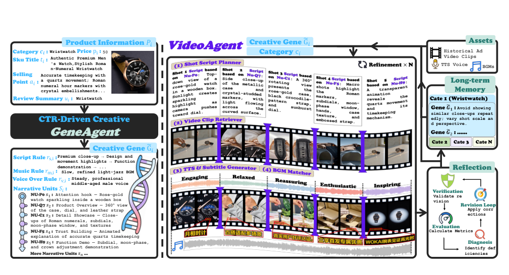

<!-- source-sha256: b11b921cd5dee3b6454f0a0b56dffddb338bab85d7fe85e16b6ffc44f5defec6 -->
# CutAgent: Creative-Gene-Driven Planning and Experience-Guided Self-Refinement for High-CTR E-commerce Advertising Video Creation

[简体中文](README.md)

> Review-only admission. High-cost full experiments not reproduced; no local capability or algorithm-execution results.

## Paper information

| Field | Content |
| --- | --- |
| Paper | [CutAgent: Creative-Gene-Driven Planning and Experience-Guided Self-Refinement for High-CTR E-commerce Advertising Video Creation](https://arxiv.org/abs/2611.22418v1); [fixed v1](https://arxiv.org/html/2611.22418v1) |
| Institution | First author Xuyue Huang: JD.com / Tsinghua University; fixed-v1 byline checked |
| First publication | 2026-11-17 08:54:39 UTC, arXiv v1 |
| Original source code | No publicly verifiable paper-specific author implementation found in the fixed paper and linked sources. Cited dependencies or integration claims are not verified paper-specific code. |
| Local adapter / key | `cutagent`; adapter is null, not a complete model |
| Local implementation | `None: review-only, no empty adapter` |

## Paper summary

### Motivation and changes

CutAgent separates multimodal product planning from reliable video production into GeneAgent and VideoAgent, linked by a structured creative gene. Genes specify narrative units and voice/music/script rules. High-CTR SFT and CTR-level GRPO train planning; production expands storyboards, retrieves product clips, performsTTS/BGM/rendering and selectively repairs temporally grounded defects.

<!-- paper-figure:start -->
### Original figure

Image from the [original paper](https://arxiv.org/pdf/2611.22418v1); copyright belongs to the original authors. Original asset/PDF crop, not local results. [Provenance and SHA256](assets/provenance.json).
<!-- paper-figure:end -->

### Core formulas

$$
R=0.60\widetilde R_{ctr}+0.25R_{fmt}+0.15R_{div},\qquad CTR_m=\frac{\sum_i C_i^m}{\sum_i E_i^m}\times100\%.
$$

GeneAgent uses Qwen3-VL-8B with visual modules frozen and language LoRA only. SFT uses the top20% observed-CTR samples; GRPO samples eight genes per product. A LightGBM category-relativeLow/Mid/High CTR-level predictor is a training reward, not onlineCTR. VideoAgent selects one of43 category memory shards then retrieves gene-similar verified failure/correction constraints. This memory is distinct from clip pools; scripted success cannot substitute for reflection.

### Author results

Section4.3.4/AppendixD.6 describe one week of randomly allocated production traffic over430 products in43 categories and more than10M impressions. Aggregate click/impressionCTR is2.21% for CutAgent versus1.98% for AutoCut. The separate60.4% figure is forced-choice human preference over200 products,30 participants and1,600 judgments—not CTR lift or production A/B success. Missing per-arm counts/uncertainty prevent an independent significance claim.

## Local implementation and boundaries

### Data protocol and code mapping

Review-only: full experiment not reproduced due to cost(reviewDONE). No70K-product corpus with90–120 clips each, multimodal teachers,8B training/retrieval,TTS/rendering,397B judge or production traffic is run. No downloads or mock gene planner/retriever/localCTR are supplied. No paper-specific author repository is verified in fixedv1; cited FireRed baseline code is not a CutAgent release.

Review-only: no pretend training command or synthetic capability metrics.

### Results, controls and limits

Review-only admission. High-cost full experiments not reproduced; no local capability or algorithm-execution results. No external API, model/private-data download or automatic retry. Review DONE is not complete reproduction.

### High-cost full experiments

8BVLM gene planner,70Kproducts with90–120clips each, multimodal teacher calls,TTS/BGM/video production and397Bjudge; full random-traffic CTR campaign cannot be reproduced on one card. No mock gene planner or fake CTR **Not reproduced due to high cost; review DONE.** No automatic training/retry queue and no blocking of declared review closure.

### Same-topic comparison

AgenticRecTune stores experiment-backed recommendation-configuration insights in a SkillHub. CutAgent stores category/gene-conditioned video-production corrections. Both reuse experience, but optimization objects, feedback and test permissions differ. Its LightGBM surrogate is not a recommendation experiment platform and cannot replace randomized production evidence.
