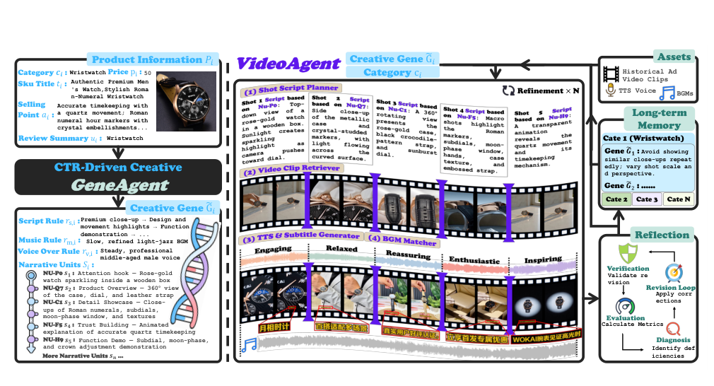

# CutAgent：以创意基因连接广告规划、制作与经验反思

[English](README-en.md)

> 仅收录审查；高成本完整实验不复现，没有本地能力或算法执行结果。

## 论文信息

| 字段 | 内容 |
| --- | --- |
| 论文链接 | [CutAgent: Creative-Gene-Driven Planning and Experience-Guided Self-Refinement for High-CTR E-commerce Advertising Video Creation](https://arxiv.org/abs/2611.22418v1)；[固定v1全文](https://arxiv.org/html/2611.22418v1) |
| 公司 / 作者机构 | 一作 Xuyue Huang：JD.com / Tsinghua University；按固定v1作者栏核对 |
| 首次公开日期 | 2026-11-17 08:54:39 UTC（arXiv v1） |
| 原作者开源代码 | 原文及其关联链接未找到/未核验公开的本论文专属作者代码。引用依赖或声称集成不等于已核验专属实现。 |
| 本地adapter / 稳定键 | `cutagent`；adapter为null，不冒充完整模型 |
| 本地复现代码目录 | `无新增执行代码（review-only；不制造空adapter）` |

## 原始论文总结

### 背景与主要改动

CutAgent把多模态商品理解与可靠视频制作拆为GeneAgent和VideoAgent，以结构化creative gene连接。Gene规定narrative units和配音／音乐／脚本规则；前者经高CTR SFT和CTR-level GRPO学习规划，后者展开分镜并检索商品素材、做TTS/BGM和渲染，再只修复带时间证据的缺陷。

<!-- paper-figure:start -->
### 原论文关键图

图片来自[原论文](https://arxiv.org/pdf/2611.22418v1)，版权归原作者所有；为原图或PDF裁剪，不是本地结果。[出处与SHA256](assets/provenance.json)。
<!-- paper-figure:end -->

### 核心公式

$$
R=0.60\widetilde R_{ctr}+0.25R_{fmt}+0.15R_{div},\qquad CTR_m=\frac{\sum_i C_i^m}{\sum_i E_i^m}\times100\%.
$$

GeneAgent采用Qwen3-VL-8B，冻结视觉模块、仅语言LoRA；SFT取观测CTR前20%，GRPO每商品采8个gene。LightGBM按类目内Low/Mid/High预测CTR-level，仅是训练奖励，不充当线上CTR。VideoAgent先按43类目选memory shard，再用gene相似度取已验证failure-correction作为制作约束；memory不是商品clip pool，反思不能用固定模板成功代替。

### 论文离线与线上效果

§4.3.4与AppendixD.6报告一周随机分流线上实验，43类目430商品、超过1000万广告曝光，CTR按总点击／总曝光聚合：CutAgent2.21%，AutoCut1.98%。60.4%另属200商品、30参与者、1600次强制二选一的人类偏好研究，不是生产CTR提升或线上A/B成功率。原文未给足分臂计数／不确定性，不能由总体CTR自行推显著性。

## 本地复现与边界

### 数据协议与代码映射

本篇review-only，完整实验成本过高，不复现（审查DONE）。70K商品每件90–120clips、多模态teacher、8B训练／检索、TTS与渲染、397Bjudge及真实流量均未运行；不下载资源，不编造creative-gene规划器、素材检索或本地CTR。固定v1没有核实本篇作者仓库，FireRed等第三方baseline代码不算CutAgent开源。

本条为review-only，不提供伪训练命令或合成能力指标。

### 结果、负控与边界

仅收录审查；高成本完整实验不复现，没有本地能力或算法执行结果。 不执行外部API、下载模型/私有数据或自动重试；审查DONE不等于论文复现完成。

### 高成本完整实验

8B多模态规划器、70K商品各90–120视频片段、教师数据、TTS/BGM/渲染、397B评审与真实广告流量完整矩阵超出单卡/本地预算。 **成本过高，不复现（审查DONE）**；不阻塞已声明的审查闭环，不进入自动训练或补跑队列。

### 同主题对照

AgenticRecTune把推荐系统配置方案经实验平台反馈沉淀到SkillHub，CutAgent把广告制作失败修复写成类目／gene条件经验。二者都复用执行经验，但优化对象、反馈和测试权限不同；本篇的LightGBM surrogate不是推荐实验平台，也不能替代真实线上随机分流证据。
