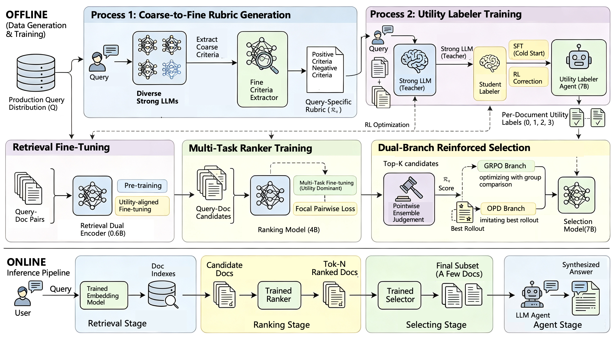

<!-- source-sha256: f79f80548329a40d2bb20638f0df7929f1f9258ffd7ecdb5e03b3ea410abe7d1 -->
# From Relevance to Utility: Rubric Alignment in Yuanbao Search

[简体中文](README.md)

> L1 bounded mechanism component, not a capability benchmark or Evolve promotion.

## Paper information

| Field | Content |
| --- | --- |
| Paper | [From Relevance to Utility: Rubric Alignment in Yuanbao Search](https://arxiv.org/abs/2611.22503v1); [fixed v1](https://arxiv.org/html/2611.22503v1) |
| Institution | First author Yu Lu: Tencent; fixed-v1 byline checked |
| First publication | 2026-11-17 10:00:05 UTC, arXiv v1 |
| Original source code | No publicly verifiable paper-specific author implementation found in the fixed paper and linked sources. Cited dependencies or integration claims are not verified paper-specific code. |
| Local adapter / key | `yuanbao-rubric`; adapter is null, not a complete model |
| Local implementation | `src/auto_research/reproductions/yuanbao_rubric_components.py` |

## Paper summary

### Motivation and changes

Pointwise relevance need not supply useful evidence for downstream reasoning. Yuanbao builds query-specific weighted positive and negative rubrics, distills labels for retrieval and four-head ranking, and trains subset selection with set-level rewards. Below-mean rollouts imitate the best in-group trajectory with reward-gap weights instead of receiving negative-advantage suppression.

<!-- paper-figure:start -->
### Original figure



Image from the [original paper](https://arxiv.org/pdf/2611.22503v1); copyright belongs to the original authors. Original asset/PDF crop, not local results. [Provenance and SHA256](assets/provenance.json).
<!-- paper-figure:end -->

### Core formulas

$$
L_{sel}=L_{GRPO,+}+0.5L_{distill},\quad w_g=r^*-r_g,\quad A_g=(r_g-\bar r)/(\sigma_r+10^{-4}).
$$

Sections2.1 and Eqs4–6 are implemented. Positive criteria can be covered collectively and any document can trigger a deduction. Focal pairwise ranking uses a label-gap minus score-gap hinge, not ordinary CE. Each selection branch has its own mean; poor-rollout weights multiply the same best-trajectory token NLL. Padding, empty branches and tied zero updates are preserved. Reference KL is an explicit caller input, not an invented estimator.

### Author results

Section3.2/Table2 reports14-day A/B on5% production traffic, approximately2.8M queries: retrieval/ranking/selection individually improve GSB by0.40%/3.94%/4.82%, while the full pipeline improves8.52%. Their9.16% sum is not the end-to-end gain. These are author production measurements, not local results.

## Local implementation and boundaries

### Data protocol and code mapping

No rubric generator, DeepSeek judge, Qwen encoder or real search is run. Diagnostics check best-trajectory imitation gradients, absent poor-trajectory imitation gradients, detached rewards and zero padding gradients; these are not answer-accuracy scores.

```bash
PYTHONPATH=src python -c 'from auto_research.reproductions.yuanbao_rubric_components import diagnostic; print(diagnostic(42, device="cpu"))'
```

### Results, controls and limits

L1 bounded mechanism component, not a capability benchmark or Evolve promotion. Seeds42/43/44 check explicit fixtures/small-tensor arithmetic and gradients, not three independent model-capability trials. CPU and actual GPU evidence remain separate. Author scores must not populate local dashboards.

### High-cost full experiments

610M production query/document pairs; 0.6B/4B/7B pipeline with DeepSeek-V4-Flash judge; production corpus and14-day5% traffic test are unavailable locally **Not reproduced due to high cost; review DONE.** No automatic training/retry queue and no blocking of declared review closure.

### Same-topic comparison

WeSearch narrows candidates using clusters and atomic document matching; Yuanbao aligns upstream labels with final subset rewards. They are not the same SID/retrieval architecture, and neither local ADC nor the dual-branch loss replaces end-to-end search validation.
