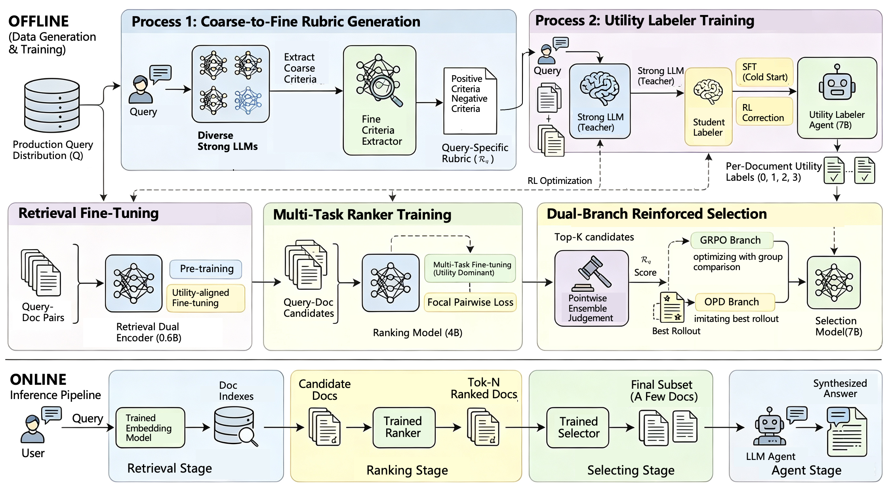

# 元宝搜索：Rubric 对齐检索、排序与集合选择

[English](README-en.md)

> L1低成本机制组件；不是能力benchmark，未接入Evolve晋级。

## 论文信息

| 字段 | 内容 |
| --- | --- |
| 论文链接 | [From Relevance to Utility: Rubric Alignment in Yuanbao Search](https://arxiv.org/abs/2611.22503v1)；[固定v1全文](https://arxiv.org/html/2611.22503v1) |
| 公司 / 作者机构 | 一作 Yu Lu：Tencent；按固定v1作者栏核对 |
| 首次公开日期 | 2026-11-17 10:00:05 UTC（arXiv v1） |
| 原作者开源代码 | 原文及其关联链接未找到/未核验公开的本论文专属作者代码。引用依赖或声称集成不等于已核验专属实现。 |
| 本地adapter / 稳定键 | `yuanbao-rubric`；adapter为null，不冒充完整模型 |
| 本地复现代码目录 | `src/auto_research/reproductions/yuanbao_rubric_components.py` |

## 原始论文总结

### 背景与主要改动

传统逐文档相关性不等于给下游推理提供有用证据。元宝先生成查询特定的加权正向标准和扣分标准，用蒸馏标签统一训练召回与四头排序，再用集合奖励训练选择器。低于组均值的轨迹并不接受负优势惩罚，而是按奖励差蒸馏组内最佳轨迹。

<!-- paper-figure:start -->
### 原论文关键图



图片来自[原论文](https://arxiv.org/pdf/2611.22503v1)，版权归原作者所有；为原图或PDF裁剪，不是本地结果。[出处与SHA256](assets/provenance.json)。
<!-- paper-figure:end -->

### 核心公式

$$
L_{sel}=L_{GRPO,+}+0.5L_{distill},\quad w_g=r^*-r_g,\quad A_g=(r_g-\bar r)/(\sigma_r+10^{-4}).
$$

对应§2.1、Eq4–6。正向标准允许多文档共同覆盖，负向标准由任一文档触发扣分；focal pairwise 是标签差减分数差的 hinge，不是普通 CE。两分支分别求均值；较差轨迹的权重作用于同一个最佳轨迹的 token NLL，保留 padding mask、空分支和奖励并列时零更新。参考 KL 由调用者显式提供，不擅自选择估计器。

### 论文离线与线上效果

§3.2/Table2：5%生产流量、约280万查询、14天 A/B；单独召回/排序/选择 GSB 相对提升0.40%/3.94%/4.82%，整条链路8.52%。单项和9.16%不可当成全链路效果。这些均为作者线上结果，不是本地实测。

## 本地复现与边界

### 数据协议与代码映射

没有运行 rubric 生成、DeepSeek judge、Qwen 编码器或真实搜索。诊断检查最佳轨迹有蒸馏梯度、失败轨迹没有模仿梯度、奖励不反传、padding 梯度为零；它们不是答案准确率。

```bash
PYTHONPATH=src python -c 'from auto_research.reproductions.yuanbao_rubric_components import diagnostic; print(diagnostic(42, device="cpu"))'
```

### 结果、负控与边界

L1低成本机制组件；不是能力benchmark，未接入Evolve晋级。 种子42/43/44只验证显式夹具/小张量的数值和梯度，不是三次独立模型能力试验。CPU与实际GPU证据分别保存，不能用作者指标填充本地看板。

### 高成本完整实验

610M生产query-document预训练、0.6B/4B/7B链路、外部大模型judge和14天生产A/B超出单卡/本地短预算，私有语料和流量亦不可用。 **成本过高，不复现（审查DONE）**；不阻塞已声明的审查闭环，不进入自动训练或补跑队列。

### 同主题对照

WeSearch用簇和原子文档匹配收缩候选空间；元宝用rubric统一上游标签和最终集合奖励。两者不是同一种SID/召回架构，局部ADC或双分支loss都不能替代端到端搜索验证。
