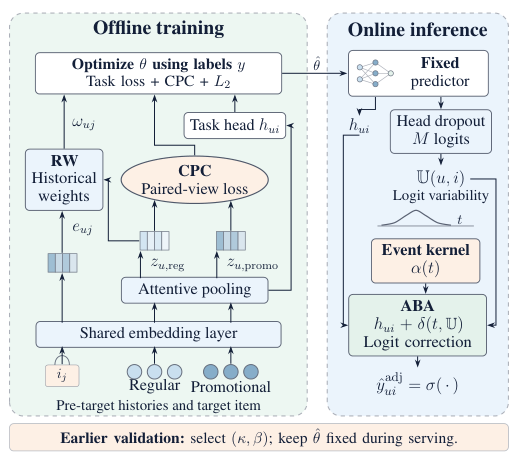

<!-- source-sha256: 98ca63f3d54543ec2dc479a6fd25bfefadfbe21f01c96dc95ca8bcc2f4b03abc -->
# COTTI: Contrastive Training and Time-Aware Inference for Robust Industrial Recommendation under Promotional Drift

[简体中文](README.md)

> L1 bounded mechanism component, not a capability benchmark or Evolve promotion.

## Paper information

| Field | Content |
| --- | --- |
| Paper | [COTTI: Contrastive Training and Time-Aware Inference for Robust Industrial Recommendation under Promotional Drift](https://arxiv.org/abs/2611.22597v1); [fixed v1](https://arxiv.org/html/2611.22597v1) |
| Institution | First author Maolei Huang: Alibaba Group; fixed-v1 byline checked |
| First publication | 2026-11-17 11:18:28 UTC, arXiv v1 |
| Original source code | No publicly verifiable paper-specific author implementation found in the fixed paper and linked sources. Cited dependencies or integration claims are not verified paper-specific code. |
| Local adapter / key | `cotti`; adapter is null, not a complete model |
| Local implementation | `src/auto_research/reproductions/cotti_components.py` |

## Paper summary

### Motivation and changes

COTTI separates historical preference continuity during training from promotion-time probability correction. CPC uses a differentiable consistency gate on regular/promotion views, RW weights examples by standardized historical distance with stopped gradients, and ABA adds an event- and head-variance-dependent bounded correction to fixed predictor logits.

<!-- paper-figure:start -->
### Original figure



Image from the [original paper](https://arxiv.org/pdf/2611.22597v1); copyright belongs to the original authors. Original asset/PDF crop, not local results. [Provenance and SHA256](assets/provenance.json).
<!-- paper-figure:end -->

### Core formulas

$$
\eta_u=1-\sigma(\|z_{reg}-z_{promo}\|^2/(4d)),\quad \omega=\operatorname{sg}\exp[-\gamma(d-\mu_b)/(\sigma_b+\epsilon)],\quad p_{adj}=\sigma(h+\alpha(t)\tanh(\beta U)).
$$

Eqs6–16 are retained: CPC gates raw representation distances and remains differentiable. RW is neither clipped nor mean-normalized; weights are positive influence factors, not reliability probabilities. ABA uses population variance of repeated head-only dropout logits, not full-encoder uncertainty. The event center is announced beforehand, width comes from history and amplitude is selected on validation. The correction only increases scores and cannot fix overprediction.

### Author results

SectionIV-E reports December1–10,2025 A/B on25% of real-time traffic against serving control HDR: relative CVR+3.14% and RPM+2.68%. The December12 full-rollout trace is descriptive. Arm allocation, randomization unit, arm counts and aggregation weights are not reported, limiting independent balance/interference assessment.

## Local implementation and boundaries

### Data protocol and code mapping

Only CPC/RW/ABA tensors run locally, without history construction, missing-regular-view fallback or serving fusion. The author-reported decline in paid-item recall for novel categories is retained; aggregate AUC does not erase the discovery trade-off.

```bash
PYTHONPATH=src python -c 'from auto_research.reproductions.cotti_components import diagnostic; print(diagnostic(42, device="cpu"))'
```

### Results, controls and limits

L1 bounded mechanism component, not a capability benchmark or Evolve promotion. Seeds42/43/44 check explicit fixtures/small-tensor arithmetic and gradients, not three independent model-capability trials. CPU and actual GPU evidence remain separate. Author scores must not populate local dashboards.

### High-cost full experiments

Full pipeline reports64A100,20workers and20parameter servers plus proprietary Fliggy logs and online traffic. Missing-view/history/calibration settings are incompletely specified, not invented **Not reproduced due to high cost; review DONE.** No automatic training/retry queue and no blocking of declared review closure.

### Same-topic comparison

BAFF filters logs for bidding-policy interference; COTTI changes promotion-example influence using historical distance. Neither weighting/filtering automatically yields causal unbiasedness, and COTTI calibration does not establish uncontaminated A/B logs.
