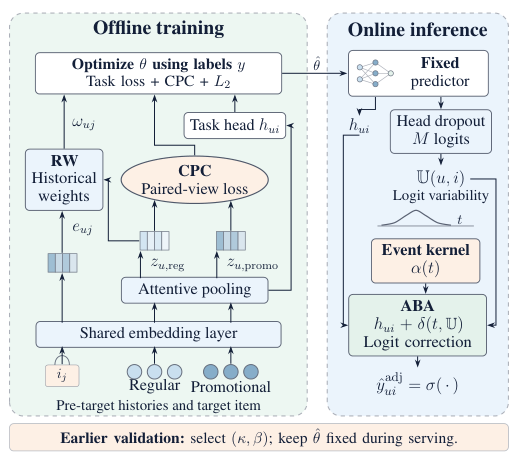

# COTTI：促销漂移中的跨周期对比与时变校准

[English](README-en.md)

> L1低成本机制组件；不是能力benchmark，未接入Evolve晋级。

## 论文信息

| 字段 | 内容 |
| --- | --- |
| 论文链接 | [COTTI: Contrastive Training and Time-Aware Inference for Robust Industrial Recommendation under Promotional Drift](https://arxiv.org/abs/2611.22597v1)；[固定v1全文](https://arxiv.org/html/2611.22597v1) |
| 公司 / 作者机构 | 一作 Maolei Huang：Alibaba Group；按固定v1作者栏核对 |
| 首次公开日期 | 2026-11-17 11:18:28 UTC（arXiv v1） |
| 原作者开源代码 | 原文及其关联链接未找到/未核验公开的本论文专属作者代码。引用依赖或声称集成不等于已核验专属实现。 |
| 本地adapter / 稳定键 | `cotti`；adapter为null，不冒充完整模型 |
| 本地复现代码目录 | `src/auto_research/reproductions/cotti_components.py` |

## 原始论文总结

### 背景与主要改动

COTTI把训练时历史偏好连续性和上线时促销概率修正分开。CPC比较同一用户常态/促销双视图并用可微门控调节一致性；RW按相对历史距离重加权但截断其梯度；ABA在冻结预测器的logit上添加事件强度与预测头方差决定的有界修正。

<!-- paper-figure:start -->
### 原论文关键图



图片来自[原论文](https://arxiv.org/pdf/2611.22597v1)，版权归原作者所有；为原图或PDF裁剪，不是本地结果。[出处与SHA256](assets/provenance.json)。
<!-- paper-figure:end -->

### 核心公式

$$
\eta_u=1-\sigma(\|z_{reg}-z_{promo}\|^2/(4d)),\quad \omega=\operatorname{sg}\exp[-\gamma(d-\mu_b)/(\sigma_b+\epsilon)],\quad p_{adj}=\sigma(h+\alpha(t)\tanh(\beta U)).
$$

严格保留Eq6–16：CPC门控用未归一化表示距离并参与反传；RW不裁剪、不均值归一化，权重是正影响量而非可靠性概率；ABA使用预测头多次dropout logit的总体方差，不是全编码器不确定性。事件中心须事先公告、宽度来自历史，幅度只在验证集选；修正只能向上，不能解决过预测。

### 论文离线与线上效果

§IV-E：2025-12-01至12-10、25%实时流量、HDR serving control，对照CVR相对+3.14%、RPM+2.68%。12月12日全量轨迹仅描述性；原文未披露分臂比例、随机化单元、分臂计数或权重，不能据此独立判断平衡和干扰。

## 本地复现与边界

### 数据协议与代码映射

本地只运行CPC/RW/ABA张量；没有历史构造、缺失常态视图回退或服务融合策略。保留paid-item新类目召回下降的作者负结果，不能拿整体AUC覆盖探索代价。

```bash
PYTHONPATH=src python -c 'from auto_research.reproductions.cotti_components import diagnostic; print(diagnostic(42, device="cpu"))'
```

### 结果、负控与边界

L1低成本机制组件；不是能力benchmark，未接入Evolve晋级。 种子42/43/44只验证显式夹具/小张量的数值和梯度，不是三次独立模型能力试验。CPU与实际GPU证据分别保存，不能用作者指标填充本地看板。

### 高成本完整实验

作者训练使用64A100、20worker和20参数服务器并依赖私有飞猪日志；缺失视图回退、历史构造及选定校准网格也未完全披露。 **成本过高，不复现（审查DONE）**；不阻塞已声明的审查闭环，不进入自动训练或补跑队列。

### 同主题对照

BAFF按竞价策略干扰过滤日志，COTTI按用户历史距离改变促销样本影响；两种权重/过滤都不自动成为因果无偏估计，COTTI的校准也不能证明A/B日志无污染。
