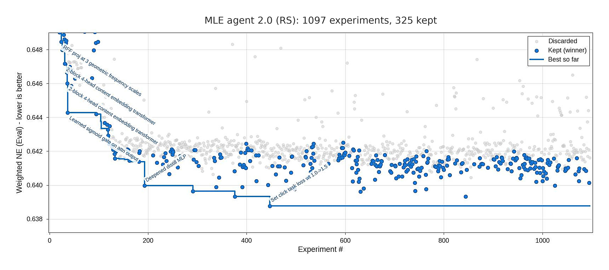

<!-- source-sha256: 0bd7f4f9ad3821aa4f88f89458e31d2fa7baa94a6f033a272f067ce1e64d75b9 -->
# MLE Agents: Autonomous ML Engineering in Large-scale Recommendation Systems

[简体中文](README.md)

> l0_interface: bounded component/interface diagnostic, not complete capability evidence or Evolve promotion.

## Paper information

| Field | Content |
| --- | --- |
| Paper | [arXiv fixed v1](https://arxiv.org/abs/2611.23910v1); [full text](https://arxiv.org/html/2611.23910v1) |
| Institution | First author Matthew Li: Meta Platforms |
| First publication | 2026-11-18 06:00:43 UTC; separate from announcement/directory dates |
| Original source code | No accessible paper-specific author implementation found in fixed v1 and linked sources; dependency repositories do not count as this paper code. |
| Local adapter / key | `mle-agents`; adapter=null, independent component only |
| Local implementation | `src/auto_research/reproductions/mle_agents_components.py` |

## Paper summary

### Motivation and changes

Meta combines hypotheses, code changes, training and metric inspection in a human-on-the-loop development cycle. Version2.0 nominally evaluates seven candidates and a variance probe in parallel, using weighted NE calibrated against online outcomes instead of click AUPRC alone. A failure blocklist, structured outputs and recent uncarried winners limit stale context. Engineers still review the final model and conduct a separate online experiment.

<!-- paper-figure:start -->
### Original figure



From the [original paper](https://arxiv.org/pdf/2611.23910v1); copyright belongs to the original authors. Original asset/PDF crop, not local results. [Provenance](assets/provenance.json).
<!-- paper-figure:end -->

### Core formulas

$$
L=0.3NE_{click}+0.7NE_{downstream},\qquad accept=\mathbf1[L_{probe}-L_{candidate}\ge0.0005].
$$

Section1.2 defines the0.3/0.7 objective; section3.5 compares a candidate to its same-iteration variance probe, not an arbitrary old baseline. Completion needs two independent signals and each candidate makes one coherent change. The0.0005 threshold is estimated from historical training noise, not a significance test or a universal constant. The interface reports offline search admission and required human review without launching jobs or production changes.

### Author results

Of1097 completed candidates,325 were accepted, with155 additional probes; weighted NE changed from0.6611 to0.6388. Production A/B over more than one week reports relative search-session lift+0.23%±0.15 (95% interval, Fieller method), alongside a time-to-render guardrail regression. The15.6% versus29.6% acceptance comparison also changes the objective and budget, so it is not a controlled ablation or an online-success rate.

## Local implementation and boundaries

### Data protocol and code mapping

Only the objective and completion/admission interface run locally. There are no Claude research calls, candidate generation, distributed private-data training, online A/B or executable new Evolve search strategy. Fixture inputs are not Meta model measurements.

```bash
PYTHONPATH=src python -c 'from auto_research.reproductions.mle_agents_components import diagnostic; print(diagnostic(42, device="cpu"))'
```

### Results, controls and limits

Seeds42/43/44 check arithmetic, protocols, negative controls and gradients, not independent capability trials. [CPU diagnostics](metrics/component-cpu-seeds42-44.json). CPU-only protocols need no GPU or fabricated CUDA record.

### High-cost full experiments

Section3.3 reports median training/evaluation time3.54hours per candidate. The full campaign completed1252 jobs on hundreds of millions of private examples and production traffic; one GPU cannot reproduce it. **Not reproduced due to high cost; review DONE.** No automatic retry/training queue. Passing the small component does not change that disposition.

### Same-topic comparison

EvoPilot fixes a matched control/treatment contract and rejects mismatched evidence; MLE Agents emphasizes objective calibration and same-iteration noise probes. Neither treats a completed job as a launchable conclusion, and calibrated objectives do not replace artifact consistency checks.
