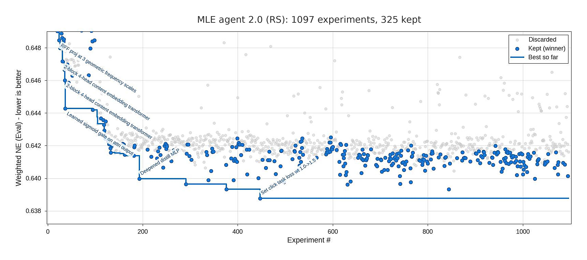

# MLE Agents：工业精排的目标校准与方差探针准入

[English](README-en.md)

> l0_interface：低成本组件/接口诊断，不是完整模型能力证据，不接入Evolve晋级。

## 论文信息

| 字段 | 内容 |
| --- | --- |
| 论文链接 | [MLE Agents: Autonomous ML Engineering in Large-scale Recommendation Systems](https://arxiv.org/abs/2611.23910v1)；[固定v1全文](https://arxiv.org/html/2611.23910v1) |
| 公司 / 作者机构 | 一作 Matthew Li：Meta Platforms；按固定v1及正文核验，不由同名作者/前作推断 |
| 首次公开日期 | 2026-11-18 06:00:43 UTC（arXiv v1；与公告/目录更新时间分开） |
| 原作者开源代码 | 固定v1及关联来源未找到可获取的本论文专用作者代码；依赖仓库不计为本篇开源。 |
| 本地adapter / 稳定键 | `mle-agents`；adapter=null，仅独立组件 |
| 本地复现代码目录 | `src/auto_research/reproductions/mle_agents_components.py` |

## 原始论文总结

### 背景与主要改动

Meta把提假设、改代码、训练和读指标组成有人监督的模型研发循环。2.0每轮名义上并行七个候选和一个方差探针，使用与线上影响校准过的加权NE，而不是只追逐点击AUPRC。失败块名单、结构化输出和只回传近期未采纳赢家控制上下文陈旧；最终模型仍由工程师审核并独立做线上实验。

<!-- paper-figure:start -->
### 原论文关键图



图片来自[原论文](https://arxiv.org/pdf/2611.23910v1)，版权归原作者所有。原始图/PDF裁剪，不是本地结果；[出处与SHA256](assets/provenance.json)。
<!-- paper-figure:end -->

### 核心公式

$$
L=0.3NE_{click}+0.7NE_{downstream},\qquad accept=\mathbf1[L_{probe}-L_{candidate}\ge0.0005].
$$

§1.2给出0.3/0.7目标，§3.5明确与同轮variance probe比较，而不是任意旧基线。完成状态须有两条独立信号；一候选只改一项连贯机制。阈值来自历史噪声探针，不能把0.0005说成显著性检验或跨数据通用常数。接口返回离线搜索接纳和仍需人工审核，不发起训练或生产发布。

### 论文离线与线上效果

1097个完成候选中325个被接受，另有155个探针；加权NE从0.6611到0.6388。超过一周的真实生产A/B使搜索会话量相对+0.23%±0.15（95%区间，Fieller方法），同时time-to-render护栏退化。1.0的15.6%与2.0的29.6%接受率伴随目标和预算变化，不是受控消融；不能把离线接纳率当成线上成功率。

## 本地复现与边界

### 数据协议与代码映射

本地只执行目标与完成/准入接口。没有运行Claude研究调用、候选代码生成、私有数据分布式训练或线上A/B，也没有新增可执行Evolve搜索策略。合成输入不代表Meta模型指标。

```bash
PYTHONPATH=src python -c 'from auto_research.reproductions.mle_agents_components import diagnostic; print(diagnostic(42, device="cpu"))'
```

### 结果、负控与边界

三种子42/43/44只检查数值、协议、失败负控和梯度，不是独立能力试验。[CPU诊断](metrics/component-cpu-seeds42-44.json)。CPU协议无需GPU，不制造CUDA执行记录。

### 高成本完整实验

§3.3记录候选训练评估中位耗时3.54小时，完整活动1252个完成任务并依赖亿级私有样本和生产流量。单卡不能承担原活动。 **成本过高，不复现（审查 DONE）**；不自动重试、不进入训练队列。低成本组件通过不改变此结论。

### 同主题对照

EvoPilot先锁定控制/实验两臂的比较合同并拒绝不匹配证据；MLE Agents强调搜索目标与同轮噪声探针。二者都不让“训练结束”自动成为可发布结论，目标校准也不能取代EvoPilot的产物一致性检查。
