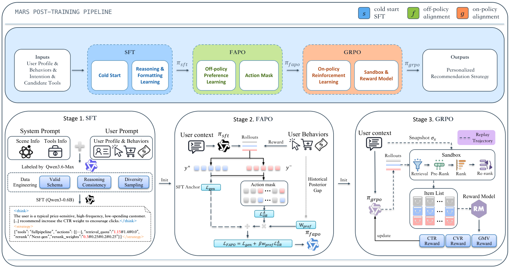

<!-- source-sha256: 111fb9c35ae6ceb7aa1d1d06316e6299db9bd6bf1a67be767f8e07de4ed3f9cb -->
# MARS Technical Report

[简体中文](README.md)

> l1_mechanism: bounded component/interface diagnostic, not complete capability evidence or Evolve promotion.

## Paper information

| Field | Content |
| --- | --- |
| Paper | [arXiv fixed v1](https://arxiv.org/abs/2611.24006v1); [full text](https://arxiv.org/html/2611.24006v1) |
| Institution | First author MARS Team (collective byline): Taobao |
| First publication | 2026-11-18 07:56:58 UTC; separate from announcement/directory dates |
| Original source code | No accessible paper-specific author implementation found in fixed v1 and linked sources; dependency repositories do not count as this paper code. |
| Local adapter / key | `mars-fapo`; adapter=null, independent component only |
| Local implementation | `src/auto_research/reproductions/mars_fapo_components.py` |

## Paper summary

### Motivation and changes

MARS uses a near-line0.6B policy to produce seven-dimensional user configurations spanning retrieval, preranking, ranking and reranking. Validated configurations are cached; online serving never waits for an LLM. SFT establishes valid formatting, FAPO compares differing action-value tokens, and GRPO continues with sandbox replay and a frozen reward model. The manuscript credits Taobao and lists contributors alphabetically rather than assigning an invented individual-first-author affiliation.

<!-- paper-figure:start -->
### Original figure



From the [original paper](https://arxiv.org/pdf/2611.24006v1); copyright belongs to the original authors. Original asset/PDF crop, not local results. [Provenance](assets/provenance.json).
<!-- paper-figure:end -->

### Core formulas

$$
g^A(y)=|A|^{-1}\sum_{t\in A}\log\pi(y_t),\quad \log o^A=g^A-\log(1-e^{g^A}),\quad L=-\overline{\log\pi(y^+)}-\beta w_{pref}\log\sigma(\log o^A_+-\log o^A_-).
$$

Eqs11–13 retain the full chosen-response generation anchor; only preference loss receivesclip(1+2(p+−p−)/scenario_mean,0.2,3). A missing V2P estimate gives weight1. Only weak-evidence pairs meeting the relative-gap rule may reverse; strong pairs retain their business-score ordering. Masks come from a trusted field-value span/token alignment layer and cover complete differing values, not shared JSON structure. No fragile substring matcher impersonates the tokenizer. Historical configuration V2P is observational, not causal.

### Author results

Two-week stable user-randomized A/B uses5% per arm across five Taobao scenarios. Baiyibutie reports V2P+5.22%,GMV+7.34%; a roughly20% Minimal mode mix is associated with12ms lower mean serving latency. ITT includes fallback traffic rather than only valid cached actions. The12ms excludes near-line LLM compute. GMV serial correlation and pCTR user clustering remain reanalysis limitations, and stage-specific causal contributions are not isolated.

## Local implementation and boundaries

### Data protocol and code mapping

Local code implements only historical weighting, weak-pair orientation and the FAPO tensor loss. There is no0.6B generation, field tokenizer, SFT/GRPO, sandbox, reward model, iGraph cache or live recommendation. Chosen structural tokens retain generation gradients; rejected nonaction tokens have no preference gradient.

```bash
PYTHONPATH=src python -c 'from auto_research.reproductions.mars_fapo_components import diagnostic; print(diagnostic(42, device="cpu"))'
```

### Results, controls and limits

Seeds42/43/44 check arithmetic, protocols, negative controls and gradients, not independent capability trials. [CPU diagnostics](metrics/component-cpu-seeds42-44.json). CUDA needs actual A100/A30 execution evidence, never CPU substitution.

### High-cost full experiments

Section5.1 samples about100k examples weekly, uses32H20 GPUs for roughly four hours per SFT/FAPO/GRPO stage, and requires production replay and ten-million-DAU traffic. The full experiment far exceeds one A100/A30. **Not reproduced due to high cost; review DONE.** No automatic retry/training queue. Passing the small component does not change that disposition.

### Same-topic comparison

EvoPilot validates evidence for model-development comparisons; MARS trains serving-pipeline configurations. Cache/fallback safety does not replace an experiment contract, and an ActionMask loss does not establish valid or high-quality policy generation.
