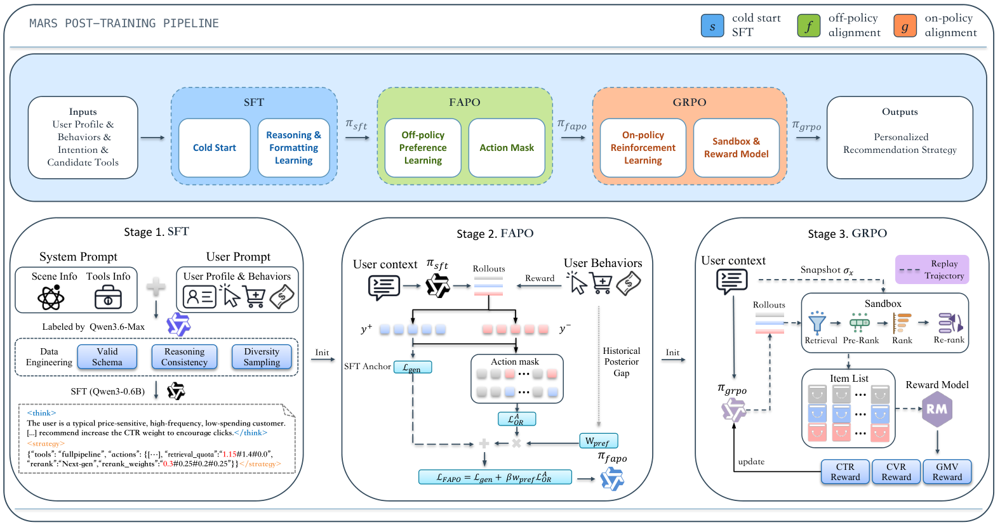

# MARS：近线推荐编排与ActionMask偏好优化

[English](README-en.md)

> l1_mechanism：低成本组件/接口诊断，不是完整模型能力证据，不接入Evolve晋级。

## 论文信息

| 字段 | 内容 |
| --- | --- |
| 论文链接 | [MARS Technical Report](https://arxiv.org/abs/2611.24006v1)；[固定v1全文](https://arxiv.org/html/2611.24006v1) |
| 公司 / 作者机构 | 一作 MARS Team（集体署名）：Taobao；按固定v1及正文核验，不由同名作者/前作推断 |
| 首次公开日期 | 2026-11-18 07:56:58 UTC（arXiv v1；与公告/目录更新时间分开） |
| 原作者开源代码 | 固定v1及关联来源未找到可获取的本论文专用作者代码；依赖仓库不计为本篇开源。 |
| 本地adapter / 稳定键 | `mars-fapo`；adapter=null，仅独立组件 |
| 本地复现代码目录 | `src/auto_research/reproductions/mars_fapo_components.py` |

## 原始论文总结

### 背景与主要改动

MARS让近线0.6B策略为用户产生跨召回、粗排、精排和重排的七维配置，经校验后缓存，在线始终不等待LLM。SFT建立合法格式，FAPO把偏好比较集中到实际不同的动作值token，最后GRPO在沙箱回放和冻结奖励模型上继续优化。正文版权行为Taobao，贡献者按名字母排序，不虚构个人一作机构。

<!-- paper-figure:start -->
### 原论文关键图



图片来自[原论文](https://arxiv.org/pdf/2611.24006v1)，版权归原作者所有。原始图/PDF裁剪，不是本地结果；[出处与SHA256](assets/provenance.json)。
<!-- paper-figure:end -->

### 核心公式

$$
g^A(y)=|A|^{-1}\sum_{t\in A}\log\pi(y_t),\quad \log o^A=g^A-\log(1-e^{g^A}),\quad L=-\overline{\log\pi(y^+)}-\beta w_{pref}\log\sigma(\log o^A_+-\log o^A_-).
$$

Eq11–13保留全chosen回答的生成anchor，只有偏好项乘clip(1+2(p+−p−)/p均值,0.2,3)。缺失任一历史V2P时权重为1。只有弱证据且达到相对gap才允许反转chosen/rejected；强证据不反转。动作mask由可信的字段值span/token对齐层提供，必须包含完整变化值而非共享JSON结构；不以脆弱字符串搜索冒充原tokenizer。历史配置V2P是观察统计，不是因果后验。

### 论文离线与线上效果

两周稳定用户随机分桶，各臂5%，五个淘宝营销场景；百亿补贴V2P+5.22%、GMV+7.34%，整体模式混合约20% Minimal并关联线上均值延迟−12ms。使用ITT包含fallback流量，不仅筛有效缓存请求。近线LLM成本没有计入这12ms；原文说明GMV序列相关与pCTR用户聚类尚需重分析，不能宣称因果拆分各阶段贡献。

## 本地复现与边界

### 数据协议与代码映射

本地只实现posterior启发式权重、弱证据翻转规则与FAPO张量损失；没有0.6B生成、字段tokenizer、SFT/GRPO、Sandbox、奖励模型、iGraph缓存或实时推荐。结构token仍有生成梯度，rejected非动作token没有偏好梯度。

```bash
PYTHONPATH=src python -c 'from auto_research.reproductions.mars_fapo_components import diagnostic; print(diagnostic(42, device="cpu"))'
```

### 结果、负控与边界

三种子42/43/44只检查数值、协议、失败负控和梯度，不是独立能力试验。[CPU诊断](metrics/component-cpu-seeds42-44.json)。CUDA张量路径另需实际A100/A30回执，不能用CPU代替。

### 高成本完整实验

§5.1每周约10万样本，32张H20，每个SFT/FAPO/GRPO阶段约4小时，并需要生产回放及千万DAU流量。完整实验成本远超单A100/A30。 **成本过高，不复现（审查 DONE）**；不自动重试、不进入训练队列。低成本组件通过不改变此结论。

### 同主题对照

EvoPilot校验模型开发实验的两臂证据，MARS生成和训练线上流水线配置。MARS的缓存/fallback是服务安全，不能替代开发比较合同；ActionMask loss也不能证明策略已经能生成合法或优质配置。
