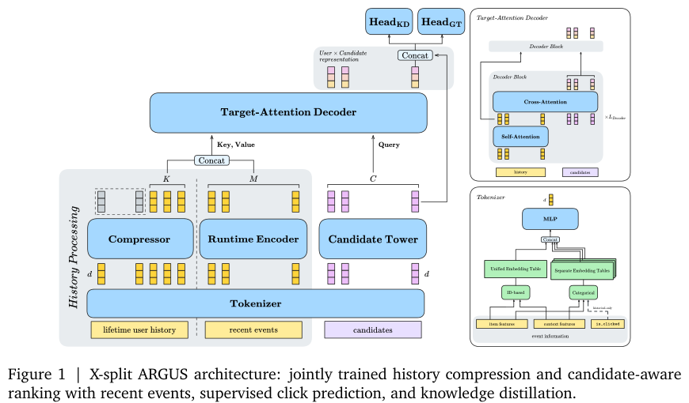

<!-- source-sha256: b5b614058f7d5638c79d0da540dcb805491cf139785fd54ba1f6ca6874c96a69 -->
# X-split Argus: Learning Reusable History Tokens for Efficient CTR Prediction

[简体中文](README.md)

> l1_mechanism: bounded component/interface diagnostic, not complete capability evidence or Evolve promotion.

## Paper information

| Field | Content |
| --- | --- |
| Paper | [arXiv fixed v1](https://arxiv.org/abs/2611.24283v1); [full text](https://arxiv.org/html/2611.24283v1) |
| Institution | First author Alexander Ploshkin: not listed in fixed v1; not inferred from names or an earlier paper |
| First publication | 2026-11-18 11:58:37 UTC; separate from announcement/directory dates |
| Original source code | No accessible paper-specific author implementation found in fixed v1 and linked sources; dependency repositories do not count as this paper code. |
| Local adapter / key | `xsplit-argus`; adapter=null, independent component only |
| Local implementation | `src/auto_research/reproductions/xsplit_argus_components.py` |

## Paper summary

### Motivation and changes

A candidate-independent causal encoder retains the lastK states of older history. Serving encodes only the most recentM events, and candidate tokens cross-attend to both memories. Offline caching is a serving execution choice, not a reason to detach the compressor during training. A supervised click head and an L1 raw-logit distillation head share representations; only the supervised head serves predictions.

<!-- paper-figure:start -->
### Original figure



From the [original paper](https://arxiv.org/pdf/2611.24283v1); copyright belongs to the original authors. Original asset/PDF crop, not local results. [Provenance](assets/provenance.json).
<!-- paper-figure:end -->

### Core formulas

$$
Z(b)=[c_{b-K+1};\ldots;c_b],\quad V_t=[Z(b(t));u_{b(t)+1:t-1}],\quad L=BCE(z^{GT},y+\epsilon(1-y))+\lambda|z^{KD}-sg(z^T)|.
$$

Eqs1–11 require causal, candidate-independent history states and strictly pretarget memory. The default boundary ismax(0,t−1−M); a serving snapshot may overlap recent events or leave a gap. Shared causal local-attention training and serving on only the lastM events have different left boundaries/receptive fields. KD is raw-logit L1, not BCE or KL. Only negatives are smoothed and teacher logits are detached. The small network reduces depth/dimension but executes real attention, separate heads and gradients.

### Author results

Section5.1 reports seven-day stable user-hash A/B,6% of the advertising surface per arm: relative ACV+4.65% and clicks+2.96%,p<0.001, with a reverse test one month later. Serving the same traffic needs15% more online GPUs, not a cost reduction. The fixed PDF byline lists no institution; the Yandex affiliation of the earlier ARGUS paper does not establish this paper affiliation.

## Local implementation and boundaries

### Data protocol and code mapping

Inputs are explicit small event/candidate features. Teacher training, vocabularies, daily caching, RTB data and serving are absent. Changing target/future feedback leaves predictions invariant and KD reaches the compressor; neither check establishes NE or ACV gains.

```bash
PYTHONPATH=src python -c 'from auto_research.reproductions.xsplit_argus_components import diagnostic; print(diagnostic(42, device="cpu"))'
```

### Results, controls and limits

Seeds42/43/44 check arithmetic, protocols, negative controls and gradients, not independent capability trials. [CPU diagnostics](metrics/component-cpu-seeds42-44.json). CUDA needs actual A100/A30 execution evidence, never CPU substitution.

### High-cost full experiments

The paper uses one year/8192 events, six1024-wide layers in each history encoder, private RTB data and recurring precomputation. Full training and production A/B exceed this single-device batch budget. **Not reproduced due to high cost; review DONE.** No automatic retry/training queue. Passing the small component does not change that disposition.

### Same-topic comparison

Earlier ARGUS factorizes the next event as feedback then item. X-split focuses on candidate-independent cached history and candidate-specific click-logit distillation, so token ordering and heads are not interchangeable. Their local negative results/diagnostics are not a matched capability comparison.
