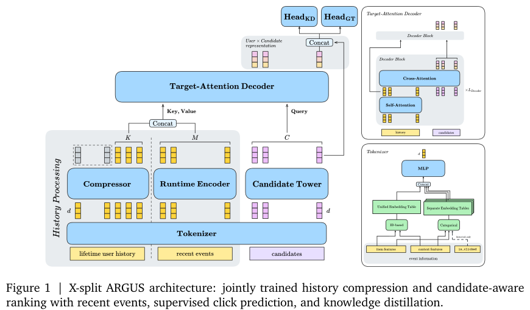

# X-split ARGUS：可复用历史token与双头蒸馏

[English](README-en.md)

> l1_mechanism：低成本组件/接口诊断，不是完整模型能力证据，不接入Evolve晋级。

## 论文信息

| 字段 | 内容 |
| --- | --- |
| 论文链接 | [X-split Argus: Learning Reusable History Tokens for Efficient CTR Prediction](https://arxiv.org/abs/2611.24283v1)；[固定v1全文](https://arxiv.org/html/2611.24283v1) |
| 公司 / 作者机构 | 一作 Alexander Ploshkin：固定v1未列一作机构（不由其他作者邮箱推断）；按固定v1及正文核验，不由同名作者/前作推断 |
| 首次公开日期 | 2026-11-18 11:58:37 UTC（arXiv v1；与公告/目录更新时间分开） |
| 原作者开源代码 | 固定v1及关联来源未找到可获取的本论文专用作者代码；依赖仓库不计为本篇开源。 |
| 本地adapter / 稳定键 | `xsplit-argus`；adapter=null，仅独立组件 |
| 本地复现代码目录 | `src/auto_research/reproductions/xsplit_argus_components.py` |

## 原始论文总结

### 背景与主要改动

将候选无关的旧历史压成因果编码器末K个状态，在线只编码最近M个事件；候选token再对两段记忆做cross-attention。离线缓存是服务时的执行安排，不是训练时detach压缩器。点击监督头与原始logit的L1蒸馏头共享历史表示，但上线只使用监督头。

<!-- paper-figure:start -->
### 原论文关键图



图片来自[原论文](https://arxiv.org/pdf/2611.24283v1)，版权归原作者所有。原始图/PDF裁剪，不是本地结果；[出处与SHA256](assets/provenance.json)。
<!-- paper-figure:end -->

### 核心公式

$$
Z(b)=[c_{b-K+1};\ldots;c_b],\quad V_t=[Z(b(t));u_{b(t)+1:t-1}],\quad L=BCE(z^{GT},y+\epsilon(1-y))+\lambda|z^{KD}-sg(z^T)|.
$$

Eq1–11：历史编码因果且候选无关；训练memory只选目标之前状态。默认b(t)=max(0,t−1−M)，服务缓存cutoff允许与最近事件重叠或留缺口。训练runtime共享全序列因果局部attention，服务只重算最近M条，左边界/有效感受野并不相同。KD是原始logit的L1，不是BCE或KL；仅负标签抬到epsilon，教师完全detach。小网络缩小层数/维度，保留真实attention、双头与梯度。

### 论文离线与线上效果

§5.1：7天用户哈希稳定分桶，每臂为该广告surface的6%；ACV相对+4.65%、clicks+2.96%，p<0.001，一月后反向A/B确认。相同流量需多15%的线上GPU，不能写成成本下降。原文PDF作者栏未给机构；同名ARGUS前作属Yandex不足以推定本篇机构。

## 本地复现与边界

### 数据协议与代码映射

输入是显式小型事件/候选特征；未训练teacher或复现词表、每日缓存、RTB数据和生产服务。负控改目标/未来反馈保持预测不变；KD反传到compressor，但不能据此推断NE或ACV收益。

```bash
PYTHONPATH=src python -c 'from auto_research.reproductions.xsplit_argus_components import diagnostic; print(diagnostic(42, device="cpu"))'
```

### 结果、负控与边界

三种子42/43/44只检查数值、协议、失败负控和梯度，不是独立能力试验。[CPU诊断](metrics/component-cpu-seeds42-44.json)。CUDA张量路径另需实际A100/A30回执，不能用CPU代替。

### 高成本完整实验

原配置一年/8192事件，compressor和runtime各6层、1024维，私有RTB数据及持续离线预计算；完整训练和生产A/B不适合单卡本轮预算。 **成本过高，不复现（审查 DONE）**；不自动重试、不进入训练队列。低成本组件通过不改变此结论。

### 同主题对照

ARGUS前作按反馈→物品分解下一事件分布；X-split重点是候选无关历史缓存和候选特定点击logit蒸馏，目标排列与预测头不能照搬。二者的本地负结果/诊断也不能互相当作能力对照。
