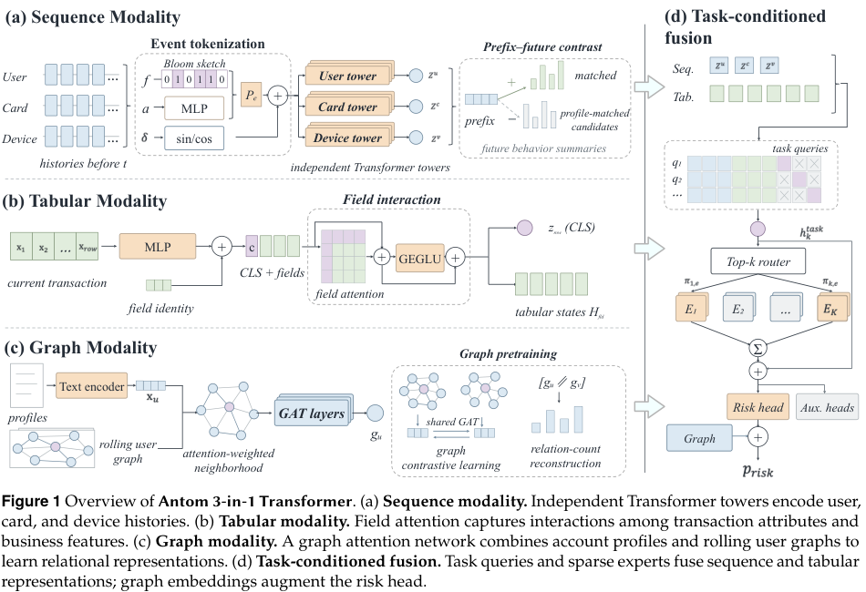

<!-- source-sha256: c4cea100661ec608c7d77caabeb4bf151e6959410d6aba1d5ba3835a9118cc12 -->
# Antom 3-in-1 Transformer: A Payment Foundation Model

[简体中文](README.md)

> **Review only; no executable reproduction**. Full experiment: **high cost, not reproduced (review DONE)**.

## Paper information

| Field | Value |
| --- | --- |
| Paper link | [arXiv:2611.25403v1](https://arxiv.org/abs/2611.25403v1); [fixed PDF](https://arxiv.org/pdf/2611.25403v1) |
| Company / institution / school | Weiyu Han: Ant International (fixed-v1 byline) |
| Original publication date | 2026-11-19T02:47:14Z (arXiv v1); announced2026-11-20 |
| Original source code | No released author method code found; Section2 withholds the detailed recipe. |
| Local adapter / key | `antom-3-in-1`; `adapter: null`; not Evolve-integrated |
| Local reproduction code directory | `None (review-only; no reproduction code)` |

## Original paper summary

### Background and principal changes

Antom separately encodes user/card/device histories, transaction fields and rolling user graphs. Task queries, shared attention and sparse experts fuse modalities for multiple tasks. Sequence pretraining contrasts prefixes with future summaries; graph pretraining combines view agreement and relation-count reconstruction. The frozen graph encoder runs offline; time-aligned embeddings augment online scoring.

[Fixed-v1 primary source](https://arxiv.org/pdf/2611.25403v1)

~~~mermaid
flowchart LR
 H[User card device histories] --> S[Independent sequence towers]
 T[Transaction fields] --> F[Field attention]
 G[Rolling user graph] --> O[Frozen offline graph encoder]
 S --> Q[Task query fusion and sparse experts]
 F --> Q
 Q --> R[Online risk head]
 O --> R
 R --> P[Same policy and intervention budget]
~~~

<!-- paper-figure:start -->
### Original paper figure

Original PDF crop, no semantic editing; author evidence, not a local result. [Provenance](assets/provenance.json). Copyright remains with the authors.
<!-- paper-figure:end -->

### Core equations

$$
\sum_i a_i(q)w_i=q\sum_iw_i,\qquad \mathrm{R@}q=\frac{\sum_i a_i(q)w_iy_i}{\sum_iw_iy_i},\qquad \mathrm{LossRate}=\frac{\mathrm{realized\ financial\ loss}}{\mathrm{successful\ transaction\ amount}}.
$$

These are the disclosed AppendixA evaluation definitions, not an invented full training loss or router algorithm. Sampled populations use inverse-inclusion weights, and tied boundary scores share a fractional allocation to keep the budget fixed. Loss rate divides financial loss by successful transaction amount, not transaction count. Section2 withholds detailed architecture, training and dataset construction.

### Paper offline and online results

The June8–October14 randomized trial covers30% of platform transactions; within it, XGB/SAINT/Antom shares are32.1/37.4/30.4%, not those fractions of all traffic. Portfolio CB/loss rates fall37.74/37.88% versus XGB. StageI has no intervention. StageII uses the same0.5% decision budget: CB falls28.28% pooled or26.09% after common-date weighting over66 dates. These are distinct estimands; online confidence intervals are not provided.

## Local reproduction

### Data protocol and code mapping

Review-only production evidence, mechanism boundaries, original figure and cost. No local model, training/inference code, metrics, GPU receipt or Evolve operator. Public IBM/graph benchmarks do not supply the missing recipe or private training path. A small concatenation/MLP proxy would not reproduce this7B payment foundation model.

### Same-topic comparison and boundaries

MMoE uses task-specific gates over shared experts. Antom first encodes modalities, aggregates them with task queries, routes experts and adds offline graph embeddings. Shared multitask routing does not make them interchangeable. Reported production controls are XGB/SAINT, not MMoE; no measured head-to-head claim is made.

### High-cost full experiment

The industrial model has about6.92B parameters and1.74B active per route, private transaction/graph pretraining, multiple adaptations and a four-month production trial. Detailed training configuration is also withheld. A faithful low-cost single-A100/A30 reproduction is unavailable; no large model download or probe is attempted.

Configuration-based cost judgment, not measured full-run time. **High cost, not reproduced (review DONE)**; no automatic retry or implementation queue, no capability improvement or Evolve promotion claim.
