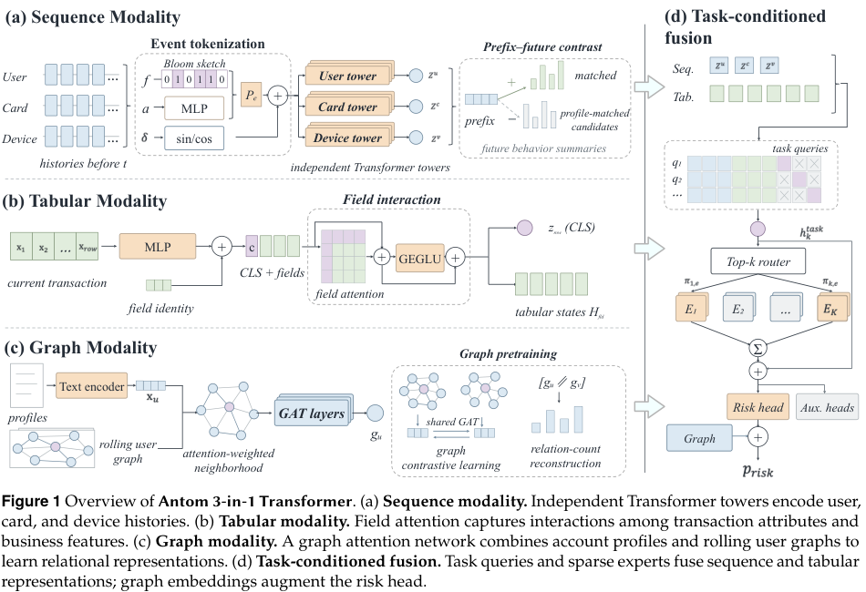

# Antom 3-in-1 Transformer: A Payment Foundation Model

[English](README-en.md)

> **仅审查收录；没有可执行复现**. 完整实验：**成本过高，不复现（审查 DONE）**。

## 论文信息

| Field | Value |
| --- | --- |
| 论文链接 | [arXiv:2611.25403v1](https://arxiv.org/abs/2611.25403v1); [fixed PDF](https://arxiv.org/pdf/2611.25403v1) |
| 公司 / 机构 / 学校 | Weiyu Han: Ant International (fixed-v1 byline) |
| 首次公开日期 | 2026-11-19T02:47:14Z (arXiv v1); announced2026-11-20 |
| 原作者开源代码 | 未找到已发布的原作者方法代码；§2明确未公开详细配方。 |
| 本地 adapter / key | `antom-3-in-1`; `adapter: null`; not Evolve-integrated |
| 本地复现代码目录 | `无（仅审查收录，没有复现代码）` |

## 原始论文总结

### 背景与主要改动

Antom把用户/卡/设备历史、当前交易字段和滚动用户图分开编码，再用任务query、共享注意力与稀疏专家做多任务融合。序列先做prefix-future对比，图先做视图对比及关系计数重建；下游图encoder冻结，图表示离线生成并按交易时间查询，其余主要模块在线打分。

[Fixed-v1 primary source](https://arxiv.org/pdf/2611.25403v1)

~~~mermaid
flowchart LR
 H[User card device histories] --> S[Independent sequence towers]
 T[Transaction fields] --> F[Field attention]
 G[Rolling user graph] --> O[Frozen offline graph encoder]
 S --> Q[Task query fusion and sparse experts]
 F --> Q
 Q --> R[Online risk head]
 O --> R
 R --> P[Same policy and intervention budget]
~~~

<!-- paper-figure:start -->
### 原论文关键图

原始PDF裁切，没有语义编辑；是作者方法/结果，不是本地证据。[页码、裁切与SHA256](assets/provenance.json)，版权归原作者。
<!-- paper-figure:end -->

### 核心公式

$$
\sum_i a_i(q)w_i=q\sum_iw_i,\qquad \mathrm{R@}q=\frac{\sum_i a_i(q)w_iy_i}{\sum_iw_iy_i},\qquad \mathrm{LossRate}=\frac{\mathrm{realized\ financial\ loss}}{\mathrm{successful\ transaction\ amount}}.
$$

这里列的是附录A已公开的固定预算评测口径，不是未公开的完整训练loss或router算法。采样数据使用逆纳入权重；预算边界同分交易可共享分数配额，保证总权重仍等于q倍总体。金额损失率的分母是成功交易金额，不是交易笔数。§2明确未公开详细架构、训练配置和数据构造，不能补写猜测的实现。

### 论文离线与线上效果

2026-06-08至10-14的随机分流试验整体覆盖平台30%交易；试验内XGB、SAINT、Antom份额约32.1/37.4/30.4%，并非各占全站同等比例。业务组合总体相对XGB：CB率-37.74%、损失率-37.88%。I阶段无干预；II阶段同0.5%预算真实决策，CB率相对-28.28%，以66个共同交易日期重加权为-26.09%。这些口径不可混作同一个lift；原文未提供线上置信区间。

## 本地复现

### 数据协议与代码映射

只收录经核对的生产证据、方法边界、原图和成本；没有本地模型、训练/推理代码、metrics、GPU回执或Evolve operator。公开IBM/图benchmark的存在不补全缺失配置和私有训练链路；不以小型拼接/MLP冒充7B支付基础模型。

### 同主题比较与边界

MMoE通过每任务gate组合共享专家；Antom在多模态编码之后，用任务query聚合共享信息再路由，并额外查离线图表示。多任务路由这一共性不表示两者可等价替换。原文生产对照是XGB/SAINT，不是MMoE；不能捏造两者实测胜负。

### 高成本完整实验

原文约6.92B总参数、每路由激活1.74B，主要预训练使用内部交易/关系数据，并有多业务适配与四个月生产试验；完整训练细节又未公开。单A100/A30不能低成本忠实复做，不下载或探跑大模型，仅审查收录。

这是依据原文配置的成本判断，不是完整实验实测耗时。**成本过高，不复现（审查 DONE）**；不自动重试、不加入实现队列，不声明能力提升或Evolve晋级。
