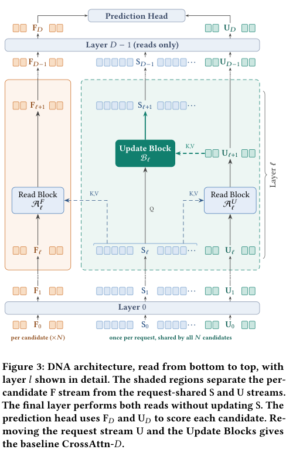

<!-- source-sha256: 90b1fa83da1fe794609b59f25bf20c44f9e6946f2ccd58fc71e12ab0e4c313eb -->
# DNA: Unlocking Depth Scaling in CTR Models

[简体中文](README.md)

> **l1_mechanism**: diagnostic component/interface only, not a complete capability reproduction. Full experiment: **high cost, not reproduced (review DONE)**.

## Paper information

| Field | Value |
| --- | --- |
| Paper link | [arXiv:2611.25659v1](https://arxiv.org/abs/2611.25659v1); [fixed PDF](https://arxiv.org/pdf/2611.25659v1) |
| Company / institution / school | Caiyuan Li: Alibaba Group (fixed-v1 PDF byline) |
| Original publication date | 2026-11-19T07:40:54Z (arXiv v1); announced2026-11-20 |
| Original source code | No verified author method code found in fixedv1/associated sources; arXiv feedback GitHub is not author code. |
| Local adapter / key | `dna`; `adapter: null`; not Evolve-integrated |
| Local reproduction code directory | `src/auto_research/reproductions/dna_components.py` |

## Original paper summary

### Background and principal changes

DNA couples request U and history S as candidate-independent streams. Each layer lets request U and candidate F separately read the same history K/V, then history tokens read the newly updated U. The next layer sees request-shaped history instead of another projection of fixed S0. Request/history states are shared across candidates within that request.

[Fixed-v1 primary source](https://arxiv.org/pdf/2611.25659v1)

~~~mermaid
flowchart LR
 S[Incoming history Sl] --> K[Group specific K V shared per request]
 K --> U[Request read produces Ul plus1]
 K --> F[Candidate read produces Fl plus1]
 U --> B[Composite projection update of every history token]
 S --> B
 B --> N[Next layer history]
 F --> P[Candidate head with final shared request]
 U --> P
~~~

<!-- paper-figure:start -->
### Original paper figure

[](https://arxiv.org/pdf/2611.25659v1#page=4)

Original PDF crop, no semantic editing; author evidence, not a local result. [Provenance](assets/provenance.json); copyright remains with the authors.
<!-- paper-figure:end -->

### Core equations

$$
F_{l+1}=A_l^F(F_l,S_l),\quad U_{l+1}=A_l^U(U_l,S_l),\quad S_{l+1}=B_l(S_l,U_{l+1})\ (l<D-1),\qquad \hat y=\sigma(\mathrm{MLP}(\mathrm{Mean}[F_D;U_D])).
$$

Depth D contains D request reads, D candidate reads and D-1 history updates; the final layer does not update an unused S. Reads use group-specific K/V projections and token-specific SwiGLUs. Updates apply composite K/V projections to concatenated request tokens, group-specific FFNs and padding zeroing. QKNorm and head scaling are retained.

### Paper offline and online results

At matched forward-compute tiers, reported AUC gains over CrossAttn are0.08–0.26percentage points. Taobao DNA-4 versus production CrossAttn-2 reports relative CTR+0.8% and GMV+0.5%; duration, traffic share and CI are not supplied in that section. At5,000 candidates, DNA-4 costs4.70T FLOPs/request versus78.41T for DNA-T-4. Sharing is within a request, not unconditional reuse across new requests.

## Local reproduction

### Data protocol and code mapping

Executes small differentiable attention, group-specific projections, token-specific SwiGLUs, composite request projections and D-1 updates. Controls compare batched/individual candidates, padding invariance, request-dependent history and finite gradients. score returns logits, not click probabilities; BCEWithLogits stably incorporates Eq13's sigmoid. Local QKNorm is per-head L2 normalization times learned scales. Width/depth are reduced. Explicit generated tokens replace HHFT inputs; private CTR training, the512-wide production model and serving benchmarks are absent. Fixture BCE is not CTR capability.

```bash
PYTHONPATH=src python -c 'from auto_research.reproductions.dna_components import diagnostic; print(diagnostic(42, device="cpu"))'
PYTHONPATH=src python -m pytest tests/test_nov20_root_components.py -q
```

Seeds42/43/44 check deterministic contracts/generated tensors, not independent capability comparisons. CUDA paths require separate real-GPU receipts; CPU results do not substitute.

### Same-topic comparison and boundaries

LONGER compresses long-history interaction into a smaller query/token path. DNA retains history tokens and updates each from a few request tokens before the next read. Both exploit candidate sharing, but share different states at different points. Local mechanism checks do not rank their recommendation quality.

### High-cost full experiment

Paper DNA-4 has roughly1.267B dense parameters excluding embedding tables, width512, eight heads, thousand-token histories, private Taobao training and multiple depth/compute comparisons. Full training/A/B is not reproduced. Tiny CPU/CUDA three-seed mechanisms should take under30seconds without model/data downloads or APIs.

Configuration-based cost judgment, not measured full-run duration. **High cost, not reproduced (review DONE)**; no automatic retry/implementation queue or capability/Evolve promotion.
