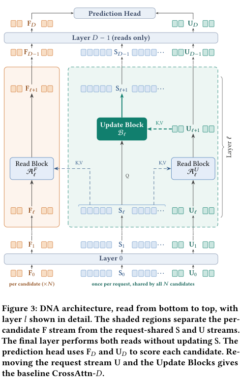

# DNA: Unlocking Depth Scaling in CTR Models

[English](README-en.md)

> **l1_mechanism**: 仅低成本机制/接口诊断，不是完整能力复现。完整实验：**成本过高，不复现（审查 DONE）**。

## 论文信息

| Field | Value |
| --- | --- |
| 论文链接 | [arXiv:2611.25659v1](https://arxiv.org/abs/2611.25659v1); [fixed PDF](https://arxiv.org/pdf/2611.25659v1) |
| 公司 / 机构 / 学校 | Caiyuan Li: Alibaba Group (fixed-v1 PDF byline) |
| 首次公开日期 | 2026-11-19T07:40:54Z (arXiv v1); announced2026-11-20 |
| 原作者开源代码 | 固定v1及关联来源未找到可核验的原作者本方法代码；arXiv报告问题的GitHub链接不算开源。 |
| 本地 adapter / key | `dna`; `adapter: null`; not Evolve-integrated |
| 本地复现代码目录 | `src/auto_research/reproductions/dna_components.py` |

## 原始论文总结

### 背景与主要改动

DNA把请求U与历史S组成候选无关的双流：每层请求和候选F分别读取同一组历史K/V，随后历史token再反向读取刚更新的U。这样下一层看到的是受当前请求塑形的历史，而不是每层重投影同一S0。请求与历史状态可在同一请求的所有候选间共享。

[Fixed-v1 primary source](https://arxiv.org/pdf/2611.25659v1)

~~~mermaid
flowchart LR
 S[Incoming history Sl] --> K[Group specific K V shared per request]
 K --> U[Request read produces Ul plus1]
 K --> F[Candidate read produces Fl plus1]
 U --> B[Composite projection update of every history token]
 S --> B
 B --> N[Next layer history]
 F --> P[Candidate head with final shared request]
 U --> P
~~~

<!-- paper-figure:start -->
### 原论文关键图

[](https://arxiv.org/pdf/2611.25659v1#page=4)

原始PDF裁切，没有语义编辑；是原作者证据，不是本地结果。[页码、裁切与SHA256](assets/provenance.json)，版权归原作者。
<!-- paper-figure:end -->

### 核心公式

$$
F_{l+1}=A_l^F(F_l,S_l),\quad U_{l+1}=A_l^U(U_l,S_l),\quad S_{l+1}=B_l(S_l,U_{l+1})\ (l<D-1),\qquad \hat y=\sigma(\mathrm{MLP}(\mathrm{Mean}[F_D;U_D])).
$$

共有D次请求read、D次候选read，却只有D-1次历史update，最后一层不再更新无人读取的S。read中各行为组使用不同K/V投影，各非序列token使用独立SwiGLU；update对全部请求token的拼接做composite K/V投影，行为组共享各自FFN，padding置零。QKNorm及head缩放保留。

### 论文离线与线上效果

原文在匹配forward FLOPs档位下，DNA相对CrossAttn的AUC绝对差为0.08–0.26个百分点。Taobao搜索DNA-4对线上CrossAttn-2报告CTR相对+0.8%、GMV+0.5%；原文该段没有披露实验时长、流量份额或CI，不补写。5,000候选成本示例中DNA-4约4.70T FLOPs/request，DNA-T-4约78.41T；这些依赖请求内共享，不代表跨请求可直接复用。

## 本地复现

### 数据协议与代码映射

实际执行小型可微attention、组特异投影、token特异SwiGLU、composite请求投影及D-1次update；比较同缓存逐候选/批量结果，检查padding不影响分数、请求确实改变S、history/request梯度与backward有限性。score返回logits而不是点击概率，Eq13的sigmoid用BCEWithLogits稳定合并；本地QKNorm为逐head L2归一化乘可学习缩放。维度和层数缩小，输入是显式生成token，不含HHFT tokenizer、私有CTR训练、512维生产模型、线上服务或吞吐测量。fixture BCE只表示数值链路，不表示CTR能力。

```bash
PYTHONPATH=src python -c 'from auto_research.reproductions.dna_components import diagnostic; print(diagnostic(42, device="cpu"))'
PYTHONPATH=src python -m pytest tests/test_nov20_root_components.py -q
```

seeds42/43/44只检查合同/生成张量，不是独立能力比较。CUDA路径需要单独真实GPU回执，CPU结果不能替代。

### 同主题比较与边界

LONGER先用少量query读取长历史，后续主要在压缩token上计算；DNA不靠删掉历史token，而让每个历史token从少量请求token吸收上下文，下一层继续读更新后的完整S。两者都关注候选共享，但共享的对象和更新时机不同；本地诊断不提供二者推荐指标胜负。

### 高成本完整实验

原文DNA-4约1.267B dense参数（不含embedding表），宽512、八heads，约千级历史token，私有Taobao日志训练并做多depth/FLOPs对照。完整规模训练与A/B不复现；仅预期三seed不足30秒的小张量CPU/CUDA机制运行，零模型/数据下载、零API。

这是配置依据的成本判断，不是完整实验实测耗时。**成本过高，不复现（审查 DONE）**；不自动重试/入实现队列，不声明能力提升或Evolve晋级。
