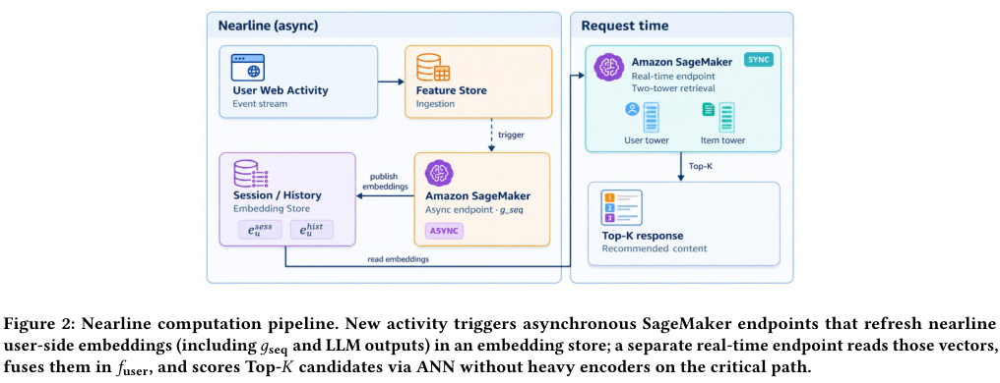

<!-- source-sha256: a5c7a66bc0a8ea182fe5b30352e5ffd8abea26b977f7510bd2ac3f1c4060e5d8 -->
# From Sessions to Serving: Integrating LLM-Based Embeddings into Retrieval for Production Content Recommendation

[简体中文](README.md)

> **l0_interface**: diagnostic component/interface only, not a complete capability reproduction. Full experiment: **high cost, not reproduced (review DONE)**.

## Paper information

| Field | Value |
| --- | --- |
| Paper link | [arXiv:2611.26096v1](https://arxiv.org/abs/2611.26096v1); [fixed PDF](https://arxiv.org/pdf/2611.26096v1) |
| Company / institution / school | Zhixiong Hu: Autodesk (fixed-v1 PDF byline) |
| Original publication date | 2026-11-19T13:31:04Z (arXiv v1); announced2026-11-20 |
| Original source code | No verified author method code found in fixedv1/associated sources; arXiv feedback GitHub is not author code. |
| Local adapter / key | `lser-serving`; `adapter: null`; not Evolve-integrated |
| Local reproduction code directory | `src/auto_research/reproductions/lser_protocol_components.py` |

## Original paper summary

### Background and principal changes

LSER fuses session, longer-term history, request features and optional LLM semantic vectors in a retrieval user tower. Expensive encoders refresh nearline asynchronously; request-time work reads available vectors, fuses them and performs ANN retrieval. LLM vectors complement rather than replace the BERT4Rec-style sequence encoder.

[Fixed-v1 primary source](https://arxiv.org/pdf/2611.26096v1)

~~~mermaid
flowchart LR
 E[Externally eligible logged events] --> P[Strict pre cutoff session and history windows]
 P --> X[Sequence and optional LLM encoders external]
 X --> C[Asynchronously completed vector records]
 C --> A[Available at request time only]
 A --> B[External compatible baseline or LLM fusion]
 B --> R[ANN retrieval external]
~~~

<!-- paper-figure:start -->
### Original paper figure

[](https://arxiv.org/pdf/2611.26096v1#page=7)

Original PDF crop, no semantic editing; author evidence, not a local result. [Provenance](assets/provenance.json); copyright remains with the authors.
<!-- paper-figure:end -->

### Core equations

$$
S_u=\{e:t_{\rm start}\le t_e<t_0,\ \operatorname{session}(e)=s_u\},\quad H_u=\{e:t_{\rm hist}\le t_e<t_{\rm start}\},\quad e_u=f_{\rm user}(e_u^{sess},e_u^{hist},e_u^{LLM},x_u).
$$

Session windows use logged session IDs; history ends at session start, and every event is strictly before the label/request cutoff. Eligibility, ID mapping, lookback and sessionization are external contracts, not invented receipt schemas. The paper prescribes no universal TTL. Choosing by(as_of,written_at) against out-of-order completion is a local interface safeguard.

### Paper offline and online results

The50/50 production A/B in Section4.2 compares rules with BERT4Rec-style learned retrieval plus nearline serving, with LLM vectors disabled. Relative CTR lifts of10.3% for product/industry carousels and36.1% for customer stories are not LLM effects. LLM evidence is an offline toggle: popular-product HR@10+9.6percentage points and MRR+0.021, with some other surfaces flat. Online duration/CI are not given; p<0.05 is reported.

## Local reproduction

### Data protocol and code mapping

Only point-in-time slicing and completed-vector selection. Callers must isolate events/records to one user and apply eligibility/catalog mapping first: there is no user_id authorization boundary or complete production leakage defense. Missing required vectors need external cold start; missing/disabled LLM pairs require compatible baseline fusion, not automatic changes to treatment input dimensions. Greatest-as_of selection and dropping incomplete LLM pairs are local handoff safeguards, not prescribed TTL/fallback algorithms. There is no BGE/Qwen encoder,16-layer decoder, InfoNCE training, private receipts, real store, ANN or learned cold start. No vectors are fabricated; encoder_calls is always0. This is L0, not retrieval capability.

```bash
PYTHONPATH=src python -c 'from auto_research.reproductions.lser_protocol_components import diagnostic; print(diagnostic(42, device="cpu"))'
PYTHONPATH=src python -m pytest tests/test_nov20_root_components.py -q
```

Seeds42/43/44 check deterministic contracts/generated tensors, not independent capability comparisons. CUDA paths require separate real-GPU receipts; CPU results do not substitute.

### Same-topic comparison and boundaries

YouTube DNN transforms aggregated watch history/context through a nonlinear user tower and trains next-watch classification. LSER separately encodes session/history and may add LLM semantic auxiliaries with nearline refresh. Both query an offline item index using user vectors; the difference is representation and freshness, not replacing ANN with token-by-token LLM generation. The paper's online control is rules, not YouTube DNN; local interfaces do not rank their quality.

### High-cost full experiment

The full path includes a frozen0.6B text embedding model, an adapted Qwen3-style16-layer/four-head event decoder, private multicontent label receipts, two-tower training, SageMaker serving and production experiments. Private contracts and the campaign exceed this short single-device budget. CPU protocol cases should take under30seconds/three seeds without model/data downloads or APIs.

Configuration-based cost judgment, not measured full-run duration. **High cost, not reproduced (review DONE)**; no automatic retry/implementation queue or capability/Evolve promotion.
