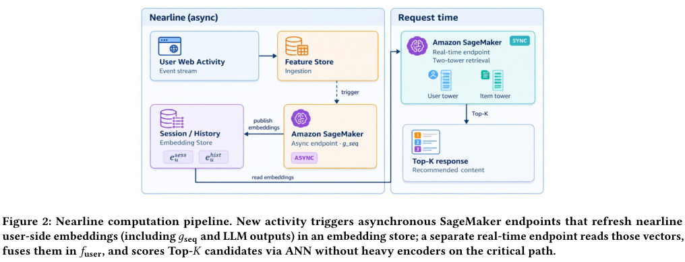

# From Sessions to Serving: Integrating LLM-Based Embeddings into Retrieval for Production Content Recommendation

[English](README-en.md)

> **l0_interface**: 仅低成本机制/接口诊断，不是完整能力复现。完整实验：**成本过高，不复现（审查 DONE）**。

## 论文信息

| Field | Value |
| --- | --- |
| 论文链接 | [arXiv:2611.26096v1](https://arxiv.org/abs/2611.26096v1); [fixed PDF](https://arxiv.org/pdf/2611.26096v1) |
| 公司 / 机构 / 学校 | Zhixiong Hu: Autodesk (fixed-v1 PDF byline) |
| 首次公开日期 | 2026-11-19T13:31:04Z (arXiv v1); announced2026-11-20 |
| 原作者开源代码 | 固定v1及关联来源未找到可核验的原作者本方法代码；arXiv报告问题的GitHub链接不算开源。 |
| 本地 adapter / key | `lser-serving`; `adapter: null`; not Evolve-integrated |
| 本地复现代码目录 | `src/auto_research/reproductions/lser_protocol_components.py` |

## 原始论文总结

### 背景与主要改动

LSER在双塔召回的用户侧融合会话、较长期历史、请求特征与可选LLM语义向量。较重encoder异步nearline计算，在线请求只读取已完成向量并融合/ANN检索。LLM路径并不替代BERT4Rec式encoder，而提供同一时间窗口的补充语义视角。

[Fixed-v1 primary source](https://arxiv.org/pdf/2611.26096v1)

~~~mermaid
flowchart LR
 E[Externally eligible logged events] --> P[Strict pre cutoff session and history windows]
 P --> X[Sequence and optional LLM encoders external]
 X --> C[Asynchronously completed vector records]
 C --> A[Available at request time only]
 A --> B[External compatible baseline or LLM fusion]
 B --> R[ANN retrieval external]
~~~

<!-- paper-figure:start -->
### 原论文关键图

[](https://arxiv.org/pdf/2611.26096v1#page=7)

原始PDF裁切，没有语义编辑；是原作者证据，不是本地结果。[页码、裁切与SHA256](assets/provenance.json)，版权归原作者。
<!-- paper-figure:end -->

### 核心公式

$$
S_u=\{e:t_{\rm start}\le t_e<t_0,\ \operatorname{session}(e)=s_u\},\quad H_u=\{e:t_{\rm hist}\le t_e<t_{\rm start}\},\quad e_u=f_{\rm user}(e_u^{sess},e_u^{hist},e_u^{LLM},x_u).
$$

session使用已记录的session ID，历史窗口止于session起点；所有事件严格早于label/request cutoff。通道资格、ID映射、回看长度和session规则是外部合同，未公开的receipt schema不能猜造。原文没有给出通用TTL；本地按(as_of,written_at)防异步乱序回退是接口防护，不冒称论文算法。

### 论文离线与线上效果

§4.2真实50/50随机线上对照是规则引擎vsBERT4Rec式学习召回+nearline，**当时未启用LLM向量**。报告产品/行业carousel CTR+10.3%、customer-story CTR+36.1%等相对lift，不能归因LLM。LLM贡献只由§4.1离线开关隔离：popular-products HR@10绝对+9.6个百分点、MRR+0.021；其他一些surface基本持平。线上时长/CI未提供，文中仅报p<0.05。

## 本地复现

### 数据协议与代码映射

只实现显式事件的point-in-time切分与已完成缓存向量选择。调用方必须先将events/records隔离为同一user并完成资格过滤与catalog映射；本接口没有user_id权限隔离，不是完整生产防泄漏系统。缺必需向量时显式要求外部cold-start；LLM缺失或关闭时需外部兼容baseline fusion，不能自动改变治疗模型的输入维度。按最大as_of选择和丢弃不完整LLM pair是本地handoff保护约定，不是论文规定的TTL或具体fallback算法。没有BGE/Qwen encoder、16层decoder、InfoNCE训练、私有label receipt、真实embedding store、ANN或模型冷启动。绝不生成假向量，encoder_calls始终为0；这是L0接口而非召回能力。

```bash
PYTHONPATH=src python -c 'from auto_research.reproductions.lser_protocol_components import diagnostic; print(diagnostic(42, device="cpu"))'
PYTHONPATH=src python -m pytest tests/test_nov20_root_components.py -q
```

seeds42/43/44只检查合同/生成张量，不是独立能力比较。CUDA路径需要单独真实GPU回执，CPU结果不能替代。

### 同主题比较与边界

YouTube DNN把聚合观看历史与上下文经非线性用户塔变成召回向量，训练为下一次观看分类；LSER显式区分session/history序列encoder，并可加入LLM辅助语义向量与nearline刷新。两者都能以用户向量查询离线item索引，差异是表征和更新合同，不是把ANN改为LLM逐token生成。原文线上对照是规则引擎，不是YouTube DNN；本地接口不提供两者质量胜负。

### 高成本完整实验

完整方案含冻结0.6B文本embedding模型、基于Qwen3式checkpoint适配的16层四head事件decoder、私有多内容label receipts、双塔训练、SageMaker近线服务与生产A/B。完整链路不在短时单A100/A30或Mac预算内且私有合同缺失；仅CPU协议三seed预期不足30秒，不下载模型/数据或调用API。

这是配置依据的成本判断，不是完整实验实测耗时。**成本过高，不复现（审查 DONE）**；不自动重试/入实现队列，不声明能力提升或Evolve晋级。
