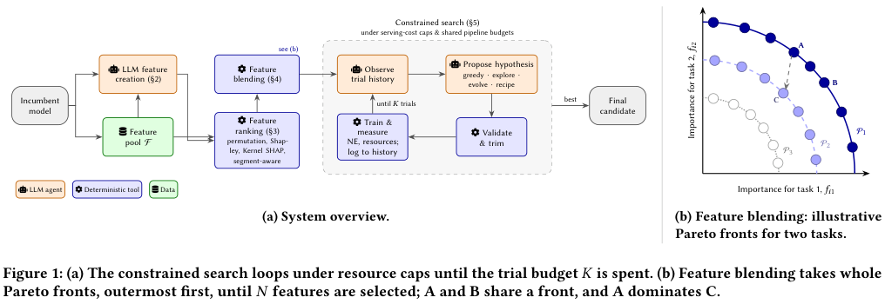

<!-- source-sha256: 92e05986add9227815ff2fc10ef63bd09893a705b350b8cffe07dcf19b157314 -->
# Cost-Aware Agentic Feature Optimization System for Fleet-Scale Ranking Models

[简体中文](README.md)

> **l1_mechanism**: diagnostic component/interface only, not a complete capability reproduction. Full experiment: **high cost, not reproduced (review DONE)**.

## Paper information

| Field | Value |
| --- | --- |
| Paper link | [arXiv:2611.26531v1](https://arxiv.org/abs/2611.26531v1); [fixed PDF](https://arxiv.org/pdf/2611.26531v1) |
| Company / institution / school | Chang Yang: Meta, Inc. (fixed-v1 PDF byline) |
| Original publication date | 2026-11-19T18:12:04Z (arXiv v1); announced2026-11-20 |
| Original source code | No verified author method code found in fixedv1/associated sources; arXiv feedback GitHub is not author code. |
| Local adapter / key | `fleet-feature-optimization`; `adapter: null`; not Evolve-integrated |
| Local reproduction code directory | `src/auto_research/reproductions/fleet_feature_components.py` |

## Original paper summary

### Background and principal changes

Meta combines feature creation, FI estimation, cross-task Pareto layers, multi-source blending and constrained search across a model fleet. LLMs propose hypotheses while deterministic tools validate them. Serving caps are model-specific, but upstream pipeline budgets are shared; another model's existing use can make an addition free for that budget.

[Fixed-v1 primary source](https://arxiv.org/pdf/2611.26531v1)

~~~mermaid
flowchart LR
 F[External feature importance vectors] --> P[Pareto layers]
 P --> B[Ordered sources and explicit integer quotas]
 B --> T[Set cost oracle trimming and same category refill]
 T --> E[External training and resource measurements]
 E --> W[Lowest feasible improved validation NE]
 L[LLM proposals external] --> B
~~~

<!-- paper-figure:start -->
### Original paper figure

[](https://arxiv.org/pdf/2611.26531v1#page=2)

Original PDF crop, no semantic editing; author evidence, not a local result. [Provenance](assets/provenance.json); copyright remains with the authors.
<!-- paper-figure:end -->

### Core equations

$$
\theta^\star=\arg\min_\theta\operatorname{NE}(\theta),\quad R_k(\theta)\le\rho_kR_k(\theta_0),\qquad \Delta_b=C_b(O_b\cup S)-C_b(O_b\cup I).
$$

Pareto dominance compares FI dimensions without summing task losses. Ordered sources contribute unselected features. The paper uses round(pi_m N) but does not specify rounding or last-front ties, so integer quotas and tie order are caller inputs. Shared set costs require a real oracle, not additive prices. Cross-budget removal order is external. Convert QPS to an upper-bound quantity such as1/QPS first.

### Paper offline and online results

Seven production models average0.31% lower NE within their budgets. Trimming six models saves2.3% pipeline cost on average with main loss no worse than about+0.03% measurement noise. A production A/B reports+0.20% on an unnamed primary metric, without traffic fraction, duration or CI; it is not renamed CTR or revenue. Evaluated search tunes feature volumes, not mixture pi.

## Local reproduction

### Data protocol and code mapping

CPU primitives implement Pareto layers, explicit-quota blending, set-dependent pipeline deltas, remove/refill trimming and admission of completed validation trials. FI, cost oracle, removal order and measured trials are external. No LLM feature proposer, FI estimator, asynchronous research controller or production launch runs. This is not a complete agentic optimizer.

```bash
PYTHONPATH=src python -c 'from auto_research.reproductions.fleet_feature_components import diagnostic; print(diagnostic(42, device="cpu"))'
PYTHONPATH=src python -m pytest tests/test_nov20_root_components.py -q
```

Seeds42/43/44 check deterministic contracts/generated tensors, not independent capability comparisons. CUDA paths require separate real-GPU receipts; CPU results do not substitute.

### Same-topic comparison and boundaries

MLE Agents calibrates candidate admission against a same-round variance probe. Fleet emphasizes shared feature cost and serving feasibility. Better NE cannot override a resource violation, and cheaper candidates still must improve NE. Neither diagnostic interface establishes model-engineering capability or production gains.

### High-cost full experiment

Real trial evaluation takes hours to days; a session contains about10–25 trials with4–8 concurrent jobs, private feature outcomes, fleet budget services and production rankers. The complete campaign exceeds one A100/A30 or Mac budget. Explicit-input CPU primitives should take under30seconds across three seeds, with no model/data downloads or API calls.

Configuration-based cost judgment, not measured full-run duration. **High cost, not reproduced (review DONE)**; no automatic retry/implementation queue or capability/Evolve promotion.
