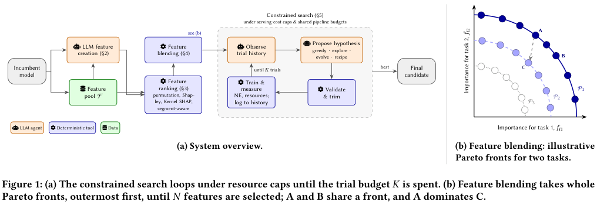

# Cost-Aware Agentic Feature Optimization System for Fleet-Scale Ranking Models

[English](README-en.md)

> **l1_mechanism**: 仅低成本机制/接口诊断，不是完整能力复现。完整实验：**成本过高，不复现（审查 DONE）**。

## 论文信息

| Field | Value |
| --- | --- |
| 论文链接 | [arXiv:2611.26531v1](https://arxiv.org/abs/2611.26531v1); [fixed PDF](https://arxiv.org/pdf/2611.26531v1) |
| 公司 / 机构 / 学校 | Chang Yang: Meta, Inc. (fixed-v1 PDF byline) |
| 首次公开日期 | 2026-11-19T18:12:04Z (arXiv v1); announced2026-11-20 |
| 原作者开源代码 | 固定v1及关联来源未找到可核验的原作者本方法代码；arXiv报告问题的GitHub链接不算开源。 |
| 本地 adapter / key | `fleet-feature-optimization`; `adapter: null`; not Evolve-integrated |
| 本地复现代码目录 | `src/auto_research/reproductions/fleet_feature_components.py` |

## 原始论文总结

### 背景与主要改动

Meta把特征创建、FI估计、跨任务Pareto分层、多来源混合和有约束搜索连成fleet级流程。LLM提出假设，确定性工具验证；每个模型同时面对自身serving限制和跨模型共享的上游pipeline预算。另一个模型已经使用某特征时，新增使用不一定新增pipeline成本。

[Fixed-v1 primary source](https://arxiv.org/pdf/2611.26531v1)

~~~mermaid
flowchart LR
 F[External feature importance vectors] --> P[Pareto layers]
 P --> B[Ordered sources and explicit integer quotas]
 B --> T[Set cost oracle trimming and same category refill]
 T --> E[External training and resource measurements]
 E --> W[Lowest feasible improved validation NE]
 L[LLM proposals external] --> B
~~~

<!-- paper-figure:start -->
### 原论文关键图

[](https://arxiv.org/pdf/2611.26531v1#page=2)

原始PDF裁切，没有语义编辑；是原作者证据，不是本地结果。[页码、裁切与SHA256](assets/provenance.json)，版权归原作者。
<!-- paper-figure:end -->

### 核心公式

$$
\theta^\star=\arg\min_\theta\operatorname{NE}(\theta),\quad R_k(\theta)\le\rho_kR_k(\theta_0),\qquad \Delta_b=C_b(O_b\cup S)-C_b(O_b\cup I).
$$

FI向量按所有任务的逐维支配关系分层，不先把任务loss相加。多个来源固定顺序取未选特征，论文写round(pi_m N)，却没有规定舍入与末层同分切分；本地将整数quota及层内顺序显式交给调用方。成本使用完整特征集合oracle，不把共享成本猜成各特征价格求和；跨预算的最贵删除顺序也由外部提供。QPS约束必须先变换成1/QPS这种上界口径。

### 论文离线与线上效果

原文七个高影响生产模型在各自预算内平均NE相对降低0.31%；六模型trimming平均降低pipeline成本2.3%，主任务loss变化不超过约+0.03%的测量噪声。线上报告一个未命名主指标+0.20%，未披露本批A/B的流量比例、时长或CI，不能改称CTR/营收。实验只调特征量，混合pi虽已实现但未评测。

## 本地复现

### 数据协议与代码映射

仅实现Pareto层、显式quota混合、集合依赖pipeline差值、删除/同类别补回原语和已完成validation trial准入。FI、成本oracle、删除顺序、训练与资源测量都为外部输入。不运行LLM feature proposer、FI估计、异步研究搜索或生产发布；这是CPU机制合同，不是完整Agent优化系统。

```bash
PYTHONPATH=src python -c 'from auto_research.reproductions.fleet_feature_components import diagnostic; print(diagnostic(42, device="cpu"))'
PYTHONPATH=src python -m pytest tests/test_nov20_root_components.py -q
```

seeds42/43/44只检查合同/生成张量，不是独立能力比较。CUDA路径需要单独真实GPU回执，CPU结果不能替代。

### 同主题比较与边界

MLE Agents用同轮方差探针对候选研发做目标准入；Fleet侧重特征共享成本与serving可行性。低NE不能覆盖资源超限，低成本也不能绕过NE必须优于基线的准入。两者诊断接口都不能自行证明模型研发或线上收益。

### 高成本完整实验

原文每次真实训练评估需数小时到数天，一次研究约10–25个trial、通常并行4–8个，并依赖私有feature outcomes、fleet预算服务和生产模型。完整活动不适合本轮一张A100/A30或Mac预算。仅CPU显式输入组件，预期三seed不足30秒，零模型/数据下载、零API。

这是配置依据的成本判断，不是完整实验实测耗时。**成本过高，不复现（审查 DONE）**；不自动重试/入实现队列，不声明能力提升或Evolve晋级。
