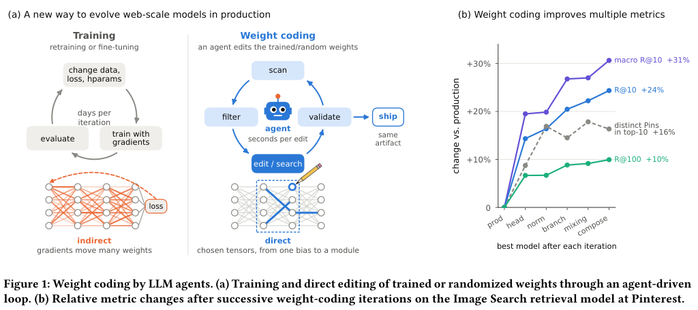

# Weight Coding: direct edits to industrial recommender weights

<!-- source-sha256: 5e6b1d32f2244dd70379a18037aecc20dd22d4d091a02c58af0ff5a3e242bb0f -->

[简体中文](README.md)

> **L1 mechanism component, diagnostic only, not a complete agent or recommender.** High-cost full experiments are not reproduced (review DONE); no Evolve promotion.

## Paper information

| Field | Value |
| --- | --- |
| Paper | [Weight Coding, fixed2611.29613v1](https://arxiv.org/html/2611.29613v1) |
| Company / institution | First author Junpeng Hou and all coauthors: Pinterest, Inc. |
| Original publication | 2026-11-22T17:11:38Z; discovered/reviewed November24; announcement date unverified |
| Author code | No verified paper-specific author repository found in fixedv1, arXiv or the reviewed author entry; third-party ES/model libraries are not this paper's release |
| Local adapter / key | `weight-coding`; null adapter, independent component |
| Local code | `src/auto_research/reproductions/weight_coding.py` |

## Original paper

### Background and method

Weight Coding edits trained parameters while fixing architecture, features and serving logic. An LLM agent scans module edits, filters sign reversals on separate dates, then edits values, searches, or re-searches composed parameters. Primitives include rescaling, resets, branch removal, compression, checkpoint interpolation and concept-direction steering. Changed support is not the number of independent controls. The paper's GPU cache recomputes affected modules and downstream paths without target-model backpropagation.

### Key original figure

[](https://arxiv.org/pdf/2611.29613v1#page=1)

Original Figure1 and caption from fixedv1 page1, visually verified without scientific modification. Copyright belongs to the original authors. [Provenance](assets/provenance.json). Not local experimental output.

### Core formula

$$
w'=(1-\lambda)w+\lambda\bar w,\quad b'=b+\alpha\frac{\mu_F-\mu_{\neg F}}{\|\mu_F-\mu_{\neg F}\|},\quad W'_{ij}=e^{s_i}W_{ij}.
$$

Each step uses16 antithetic Gaussian pairs. Value search uses initial tensor RMS and sigma0.05; row log-scale search uses sigma0.1. The32 objective scores become centered ranks followed by ascent Adam. Disjoint dev-positive halves serve search and validation, checked every10 steps. Filter dates only reject sign reversals; held-out dates never guide iteration. The local reference also checks the initial/final step and states unspecified numerical choices rather than claiming unpublished-code parity.

### Reported offline and online results

Fixedv1 Section4.7/Table4 reports real production A/B, approximately10million users per group for about a week. Three save-oriented groups increase source-attributed saves per user by8.4%–10.7% and saves per impression by4.3%–5.3%. These are not site-wide lifts: the text explicitly notes cannibalization of other retrievers. Offline held-out two-tower recall@10 improves by up to15.0 percentage points (+24% relative), not a local synthetic result.

### Relationship to existing methods

EvoPilot emphasizes comparison integrity: shared base, data, evaluator, effective output depth and the sole treatment must match before human acceptance. Weight Coding specifies what to search: weights and a small set of row scales under fixed architecture/serving. Verification protocols and search operators are complementary, not substitutes. Local ES is not completed autonomous research or deployment. The paper observes degradation from direct edit stacking and recovery through re-search, without guaranteeing gains from arbitrary local combinations.

## Local implementation

### Data protocol and code mapping

The CPU reference implements Table1 rescaling, explicit-reference resets, zeroing a selected projection, interpolation and steering, plus Section3.4 antithetic Gaussian ES, centered ranks, ascent Adam and validation-selected steps. Compression, LLM hypothesis generation, the cached production engine, TorchScript edits, real retrieval models and online A/B are absent. Adam details and tie rules were not published; the local reference explicitly uses (.9,.999), epsilon1e-8 and average tied ranks, without claiming private-code parity. Each seed uses20 steps and16 pairs on a synthetic quadratic, with no Evolve promotion.

```bash
PYTHONPATH=src python -c 'from auto_research.reproductions.weight_coding import diagnostic; print(diagnostic(42))'
PYTHONPATH=src python -m pytest -q tests/test_nov24_weight_coding.py
```

### Results, controls and limits

[CPU three-seed mechanism artifact](metrics/component-cpu-seeds42-44.json) is bound to frozen source. Controls check immutable inputs, identity edits, a unit concept direction, no update on tied scores, and validation retaining step0. Reusing one synthetic function for objective/validation tests convergence, not data generalization; a separate conflicting validation checks rejection of search-only gains. There are no gold answers, real user data or capability rankings. This CPU-only path rejects CUDA and advertises no GPU path.

### High-cost full experiment

Section3.3 evaluates approximately2,000 edit configurations and190,000 search candidates. Section4.1 uses private Pinterest date-partitioned logs and a147M two-tower model, with a106M generative retriever,1.37B ranker and50M-plus-Pin index elsewhere. Section4.7 runs roughly10-million-user, week-long A/B groups. Lower GPU cost than the authors' fine-tuning does not make the complete campaign affordable locally. The full agent/model/production experiments are not reproduced (review DONE), with no model/log downloads, production access request or automatic retry.
