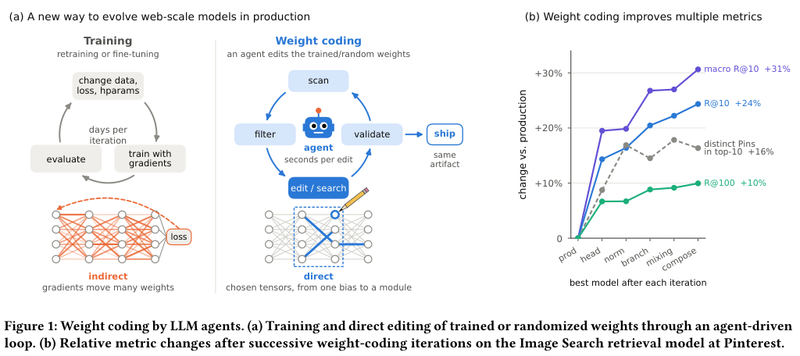

# Weight Coding：直接编辑工业推荐模型权重

[English](README-en.md)

> **L1机制组件，diagnostic only，不是完整Agent或推荐能力复现。** 完整实验成本过高，不复现（审查 DONE）；不接Evolve晋级。

## 论文信息

| 字段 | 内容 |
| --- | --- |
| 论文链接 | [Weight Coding, arXiv2611.29613v1](https://arxiv.org/html/2611.29613v1) |
| 公司 / 作者机构 | 一作Junpeng Hou与全体作者均署名Pinterest, Inc. |
| 首次公开日期 | **2026-11-22T17:11:38Z**；本轮发现/审查2026-11-24，公告日期未核定 |
| 原作者开源代码 | 固定v1与arXiv/作者入口未找到论文专属原作者开源仓库；不把第三方ES或模型库算作本文发布 |
| 本地 adapter / key | `weight-coding`；adapter为null，独立组件 |
| 本地复现代码 | `src/auto_research/reproductions/weight_coding.py` |

## 原始论文总结

### 背景与主要改动

Weight Coding把已训练权重本身变成可执行编辑对象，固定架构、特征和服务逻辑。LLM Agent先扫描单模块编辑，按独立filter日期排除方向翻转，再直接改值、搜索或重新搜索组合后的参数。编辑原语包括缩放、重置、移除分支、压缩、快照插值、概念方向平移；编辑支持大小不等于独立自由度。原论文的GPU缓存引擎只重算被影响模块及下游，搜索阶段不反传目标模型。

<!-- paper-figure:start -->
### 原论文关键图

[](https://arxiv.org/pdf/2611.29613v1#page=1)

图片来自[原论文](https://arxiv.org/pdf/2611.29613v1#page=1)第1页Figure1，版权归原作者所有；完整原图和图注裁剪，已视觉核对、未修改科学内容。[来源指纹](assets/provenance.json)。不是本地实验结果。
<!-- paper-figure:end -->

### 核心公式

$$
w'=(1-\lambda)w+\lambda\bar w,\quad b'=b+\alpha\frac{\mu_F-\mu_{\neg F}}{\|\mu_F-\mu_{\neg F}\|},\quad W'_{ij}=e^{s_i}W_{ij}.
$$

每步16对反向Gaussian扰动；值搜索按初始tensor RMS缩放、sigma=0.05；row log-scale搜索sigma=0.1。32个目标分转换centered ranks，再Adam上升。dev positives两半分别用于搜索/validation，每10步选最佳；filter日期只能排除方向翻转，held-out日期不引导迭代。本地额外评估初始/最终步，数值细节是显式参考选择，不假称作者未发布源码。

### 论文离线与线上效果

固定v1 §4.7/Table4是生产流量A/B：每组约1000万用户、约一周，save-oriented三组的该检索来源人均saves提高8.4%–10.7%，每曝光提高4.3%–5.3%。不是站点总收益：正文明确其他retrievers会被蚕食，不能将source-attributed收益直接解释为site-wide。离线双塔held-out recall@10最高+15.0个百分点（相对+24%），也不是本地合成分数。

### 与已有方法的关系

EvoPilot强调比较证据的完整性：共同base、数据、评测器、有效输出深度和唯一treatment都要匹配，再由人工审核接纳。Weight Coding则规定了可搜索对象：固定架构/服务上的权重数值和少量row scales。验证协议与搜索算子互补、不能互相替代；本地ES不等于已经完成自主研究或部署。原论文直接叠加编辑会退化、重新搜索可恢复，这不意味着任意两个本地算子组合必然有收益。

## 本地复现

### 数据协议与代码映射

本地CPU参考只实现Table1的缩放、显式reference重置、投影置零、插值、方向平移，以及§3.4反向配对Gaussian ES、centered rank、Adam上升和validation选步。没有compression、LLM假设生成、缓存生产引擎、TorchScript编辑、真实检索模型或线上A/B。原文未公布Adam细节和ties规则，本地显式采用(.9,.999)、epsilon=1e-8和平均并列rank；不能声称恢复私有实现。每seed20步×16对，synthetic quadratic仅查机制；不接Evolve晋级。

```bash
PYTHONPATH=src python -c 'from auto_research.reproductions.weight_coding import diagnostic; print(diagnostic(42))'
PYTHONPATH=src python -m pytest -q tests/test_nov24_weight_coding.py
```

### 结果、负控与边界

[CPU三seed机制产物](metrics/component-cpu-seeds42-44.json)绑定冻结源。检查原参数不突变、identity编辑、概念方向单位范数、平分无更新和validation可保留step0。合成objective/validation共用同一函数的收敛检查不是数据泛化实验；另用冲突validation检验拒绝改善search却恶化validation的候选。无gold、无真实用户数据、无能力排名。CPU-only拒绝CUDA；没有GPU宣传路径。

### 高成本完整实验

全文§3.3约2000编辑配置、190000搜索候选；§4.1为私有Pinterest多日期日志、147M双塔，另含106M生成检索、1.37B ranker、50M+Pin索引。§4.7每组约1000万真实用户、约一周A/B，离线GPU成本比作者finetune低不等于本地低成本可复现。完整Agent/模型/生产实验成本过高，不复现（审查 DONE）；不下载模型/日志，不请求线上权限，不自动重试。
