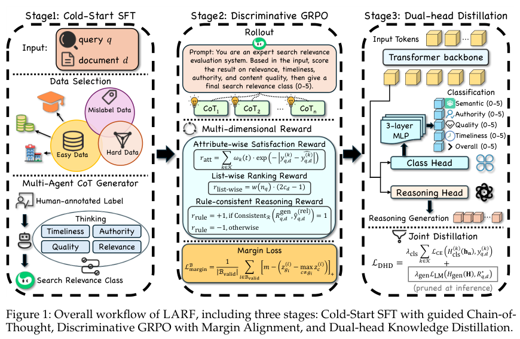

# LARF: reasoning supervision in training, relevance classification in serving

<!-- source-sha256: 8e6ff5949d91269651760f74be419371c5d839daaf6d007c3339d3035a431b4d -->

[简体中文](README.md)

> L1 CPU reward/objective components, diagnostic only. The private full pipeline and production experiments are too expensive and not reproduced (review DONE); this is neither complete LARF nor a promotion-eligible capability.

## Paper information

| Field | Value |
| --- | --- |
| Paper | [LARF, fixed v1](https://arxiv.org/abs/2611.32125v1); [PDF](https://arxiv.org/pdf/2611.32125v1) |
| Institutions | First author Tian Tang: Yuanbao Team, Tencent; Guo Chen also lists Southwest University |
| Original publication | 2026-11-24 07:41:25 UTC, original arXiv v1 submission. Its announcement date is absent from this batch's pool, not inferred |
| Author code | No public method repository is found/verified in fixed-v1 text or its links. Commit and license are unknown; the cited Dual-Head paper is not LARF source code |
| Local adapter / key | `larf`, identity `recommendation:larf`; `adapter: null` |
| Local code | `src/auto_research/reproductions/larf_components.py` |

## Original method

### Motivation and changes

LARF models semantic relevance, authority, quality, timeliness and overall relevance as five ordinal labels in0–5. Stage1 synthesizes label-conditioned multi-agent CoT for SFT. Gold is used for training targets and offline checking, not exposed to an evaluated agent. Stage2 combines attribute, within-query ordering and rule-consistency rewards with a direct margin on six terminal digit logits. Stage3 jointly trains five classification heads and an auxiliary generation head; serving discards generation instead of decoding CoT token by token.

### Original paper figure



Image from [the original paper](https://arxiv.org/pdf/2611.32125v1#page=4), Figure1. Copyright belongs to the original authors. Cropped from fixed-v1 page4 with caption intact, not local training evidence. [Provenance and SHA](assets/provenance.json).


### Core equations

Section4.3, Eqs.2–7 require caller-supplied dynamic weights $\omega_k(t)$ and rule-checker outcomes. Neither is guessed locally.

$$
r_{att}=\sum_{k=1}^5\omega_k(t)e^{-|y_k-\hat y_k|},\quad
c_d=\frac{P_d+0.5T_d}{P_d+N_d+T_d},\quad
r_{list}=\min\left(1,\sqrt{\frac{n_q-1}{\bar n-1}}\right)(2c_d-1),\quad
r=r_{att}+r_{list}+r_{rule}.
$$

Equal-gold document pairs are excluded from P/N/T. A predicted tie receives half credit, correct order is positive and inversion negative. The external checker supplies $r_{rule}\in\{-1,+1\}$; label equality is not a replacement checker.

Eqs.8–10 apply the following loss to the six digit logits at a uniquely identifiable terminal position:

$$
L_{margin}=\left[m-z_g+\max_{c\ne g}z_c\right]_+.
$$

The strongest competitor is selected across all non-gold classes, not only adjacent grades. Some prose discusses adjacent boundaries, but the equation is not rewritten. Samples without exactly one terminal position or a valid0–5 gold are excluded; the loss averages the valid subset.

Section4.4, Eq.12:

$$
L_{DHD}=\lambda_{cls}\sum_{k=1}^5CE(H^k_{cls}(h_n),y_k)+\lambda_{gen}L_{LM}(H_{gen}(H),R^*).
$$

Generation supplies training-time shared-representation supervision; it is not deleted during training. Figure1 labels a three-layer MLP while Section5.5 describes head linear projections, leaving full network details insufficiently specified. Local code implements the supplied-logit objective and both gradients, not a reconstructed network or teacher-to-student pipeline.

### Author-reported evidence

Table1's8B series improves six-class accuracy from45.20% to50.98% and NDCG from74.51 to79.56. The deployed1.7B student has45.80% accuracy and75.20 NDCG;8B results must not be assigned to it. Table6 reports0.97s/pair for the multidimensional classification configuration versus5.68s AR, an82.9% reduction measured on64 H20 GPUs, not single-GPU latency.

Section5.6/Table5 explicitly reports a real Yuanbao AI Search production A/B against the production baseline: LARF-1.7B has HSR(grades3–5)+1.77%, LSR(grades0–1)−3.22%, RS+3.63% and CS+2.49. Allocation, sample size and duration are undisclosed. Preserve the original percent notation without inventing percentage points or significance. These are author-reported, not local results.

### Comparison

[Yuanbao Rubric](../2611.22503-yuanbao-rubric/README-en.md) uses query-specific positive/negative criteria across retrieval, ranking and set selection, distilling the best group trajectory for poorer trajectories. LARF supervises five-dimensional document decisions, within-query pair order and a terminal digit. Its PNR is not multi-document rubric coverage; its dual-head loss is not best-trajectory distillation. Their online metrics and pipelines differ, so lifts are not directly comparable or additive.

## Local components

### Inputs and code

The module consumes external training labels, predictions, weights, rule booleans, logits and masks, implementing Eqs.2–10/12. There is no evaluated-agent interface receiving gold. `listwise_reward` handles one query group and rejects no-comparable-gold groups or mean group size at most1 because the original denominator is undefined. First-competitor selection under ties and zero subgradient at the hinge boundary are local conventions.

`dual_head_objective` sums five independently batch-mean class CEs. The LM term averages valid rationale tokens, an explicit local reduction where the paper gives no detail. Both logit gradients are returned; no backbone/MLP or parameter update is included.

```bash
PYTHONPATH=src python -c 'from auto_research.reproductions.larf_components import diagnostic; print(diagnostic(42))'
PYTHONPATH=src:scripts python -m pytest tests/test_nov25_post_components.py -q
```

### Results, controls and limits

CPU seeds42/43/44 were executed. [Stable metrics](metrics/component-cpu-seeds42-44.json) have maximum margin finite-difference error below$7.0\times10^{-11}$. Independent tests also check every dual-head logit gradient, masking, non-digit zeros, valid-subset reduction, gold-tie exclusion, predicted-tie zero centering and inversion penalties. Removing generation loss gives zero generation gradient as a control.

No dataset, LLM, CoT generator, real rule checker, GRPO, network training or online serving was executed. These checks cannot establish accuracy, latency or user-satisfaction benefits. Only CPU is supported, with `requires_gpu_validation=False` and no Evolve integration.

### Full-experiment cost

Section5.1 uses private approximately300K training/16K test instances. The main text has8B/235B teachers and a1.7B student; AppendixA.2 describes235B construction,64 H20 training,8192 tokens,2 epochs and GRPO rollout8. Do not collapse different backbones into one budget. Full private synthesis, RL, distillation and production A/B exceed one A100/A30 or a Mac: too expensive, not reproduced (review DONE), without downloads/probes, automatic retry or a training backlog.
