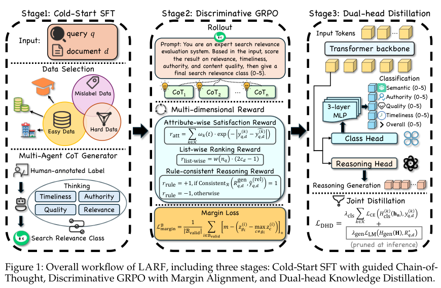
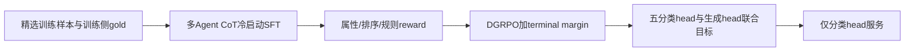

# LARF：把推理监督留在训练，把相关性判别留在服务

[English](README-en.md)

> L1 CPU奖励/目标组件，diagnostic only。完整私有训练与生产实验成本过高，不复现（审查 DONE）；不是完整LARF或可晋级能力实现。

## 论文信息

| 字段 | 内容 |
| --- | --- |
| 论文链接 | [LARF，固定v1](https://arxiv.org/abs/2611.32125v1)；[PDF全文](https://arxiv.org/pdf/2611.32125v1) |
| 公司 / 作者机构 | 一作Tian Tang：Yuanbao Team, Tencent；Guo Chen另署Southwest University |
| 首次公开日期 | 2026-11-24 07:41:25 UTC，arXiv v1原始提交；本轮公告池未捕获其公告日，不推断 |
| 原作者开源代码 | 固定v1全文及其链接未找到/未核实本篇公开作者方法仓库；commit与许可未知，不能把引用的Dual-Head论文当本篇源码 |
| 本地adapter / 稳定键 | `larf`，稳定身份`recommendation:larf`；`adapter: null` |
| 本地复现代码目录 | `src/auto_research/reproductions/larf_components.py` |

## 原始论文总结

### 背景与主要改动

LARF把搜索相关性定义为语义、权威、质量、时效与总体五个0–5级ordinal标签。第一阶段用多Agent合成label-conditioned CoT供SFT学习；gold仅用于训练target构造和离线checker，不给评测Agent。第二阶段用属性、query内排序、规则一致性奖励，再直接优化terminal六digit决策margin。第三阶段用五个分类head与辅助生成head联合训练，服务时丢弃生成head，不再逐token输出CoT。

<!-- paper-figure:start -->
### 原论文关键图



图片来自[原论文](https://arxiv.org/pdf/2611.32125v1#page=4)Figure1，版权归原作者所有；裁剪固定v1第4页，保留原图及图注，不是本地训练结果。[来源与SHA](assets/provenance.json)。
<!-- paper-figure:end -->



### 核心公式

§4.3 Eq.2–7：调用方给出动态权重$\omega_k(t)$，规则checker输出一致性；本地不猜造二者。

$$
r_{att}=\sum_{k=1}^5\omega_k(t)e^{-|y_k-\hat y_k|},\quad
c_d=\frac{P_d+0.5T_d}{P_d+N_d+T_d},\quad
r_{list}=\min\left(1,\sqrt{\frac{n_q-1}{\bar n-1}}\right)(2c_d-1),\quad
r=r_{att}+r_{list}+r_{rule}.
$$

同gold等级的文档对不参与$P/N/T$；predicted tie计半分，正确顺序为正、倒序为负。$r_{rule}\in\{-1,+1\}$来自外部规则checker，不能由标签相同替代。

Eq.8–10对唯一可辨识terminal位置的六digit logits使用

$$
L_{margin}=\left[m-z_g+\max_{c\ne g}z_c\right]_+.
$$

它选择所有非gold类中最强竞争者，不只相邻等级；正文部分“相邻边界”措辞不能改写这个max。无唯一terminal位置或gold不在0–5时排除，按有效子集均值聚合。

§4.4 Eq.12为

$$
L_{DHD}=\lambda_{cls}\sum_{k=1}^5CE(H^k_{cls}(h_n),y_k)+\lambda_{gen}L_{LM}(H_{gen}(H),R^*).
$$

生成head是训练期共享表示的辅助监督，不是在训练时删除。图1标注3-layer MLP而§5.5提到head线性投影，完整网络细节不足；本地只实现给定logits上的联合目标与两侧梯度，不冒充重建网络或教师—学生蒸馏。

### 论文离线与线上效果

§5/Table1的8B系列从45.20%到50.98%六类accuracy、NDCG74.51到79.56；部署1.7B学生为45.80% accuracy和75.20 NDCG，不能把8B结果写给学生。Table6的多维分类配置延迟0.97s/pair、相对AR5.68s降低82.9%，测量使用64×H20，不能外推为单卡延迟。

§5.6/Table5明确真实Yuanbao AI Search生产A/B，对照为production baseline：LARF-1.7B的HSR（grade3–5）+1.77%、LSR（grade0–1）−3.22%、RS+3.63%，CS+2.49。论文未披露流量分配、样本量或持续时长；保留原报百分号，不补充百分点或统计显著性。这些都是作者线上结果，不是本地测量。

### 与已有方法的关系

[Yuanbao Rubric](../2611.22503-yuanbao-rubric/README.md)用query特定的正/负标准统一检索、排序和集合选择，较差轨迹转而蒸馏组内最好轨迹。LARF的监督对象是单文档五维ordinal决策、query内pair顺序及terminal digit；其PNR不等于多文档rubric覆盖，dual-head目标也不是最佳轨迹蒸馏。两篇线上指标与链路不同，不能直接比较增幅或相加。

## 本地复现

### 数据协议与代码映射

模块接受外部训练标签、预测标签、权重、rule布尔结果、logits与mask。实现Eq.2–10/12；没有训练Agent可读取gold的接口。`listwise_reward`只处理一个query的文档组，拒绝无可比gold文档对或$\bar n\le1$，因为原式没有定义分母为0的fallback。margin最强竞争者并列取首个digit、hinge恰好为0取零次梯度是本地约定。

`dual_head_objective`对五个分类CE各自取batch均值再相加；LM项按有效rationale token均值，是论文未细述归约时的显式本地约定。它返回两head的logit梯度，不包含backbone/MLP，也不表示已完成参数更新。

```bash
PYTHONPATH=src python -c 'from auto_research.reproductions.larf_components import diagnostic; print(diagnostic(42))'
PYTHONPATH=src:scripts python -m pytest tests/test_nov25_post_components.py -q
```

### 结果、负控与边界

CPU seeds42/43/44已执行；[稳定标量](metrics/component-cpu-seeds42-44.json)的margin最大有限差分误差不超过$7.0\times10^{-11}$。独立单测还核双head全部logit梯度、mask、非digit零梯度、有效子集、gold tie排除、predicted tie零中心和逆序负奖励；关闭生成loss时生成梯度归零是负控。

没有数据集、LLM、CoT生成器、真实规则checker、GRPO、网络训练或线上服务。上述机制检查不证明准确率、低延迟或用户满意度收益。只开放CPU路径，`requires_gpu_validation=False`，不接Evolve。

### 高成本完整实验

§5.1为私有约300K训练/16K测试；正文有8B/235B教师和1.7B学生，附A.2说明235B构建、64×H20训练、8192长度、2epoch与GRPO rollout8。不能把多backbone设置合并成单个统一预算，也不下载/试跑核算。完整私有合成、RL、蒸馏和生产A/B明显超过单A100/A30或Mac范围：**成本过高，不复现（审查 DONE）**；无自动重试或补跑队列。
