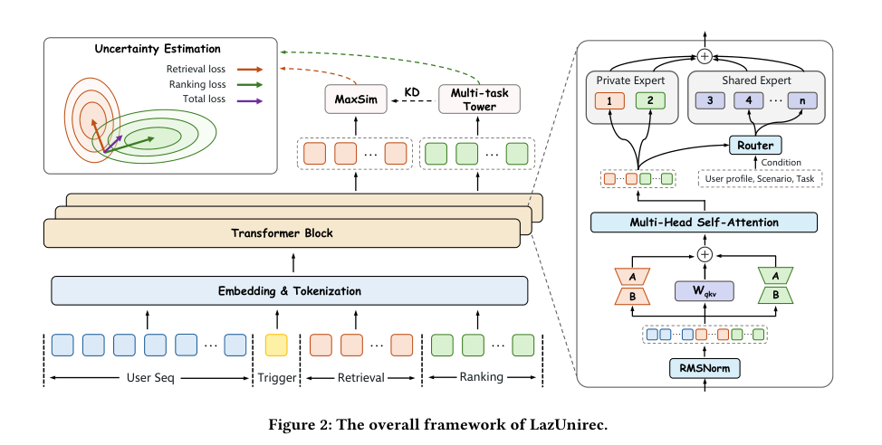

<!-- source-sha256: 4b8f8e8c927aae755f07d2f5595315353dcfd7afabc5945ee519463012da577b -->

# LazUnirec: Unifying Retrieval and Ranking in Multi-scenario Industrial Recommendation

[简体中文](README.md)

> L1 diagnostic component, not a complete model or capability reproduction. High-cost full experiments are not reproduced (review DONE); no Evolve promotion.

## Paper information

| Field | Value |
| --- | --- |
| Paper | [Fixed2611.32590v1](https://arxiv.org/pdf/2611.32590v1) |
| Company / first-author institution | Xiaodong Li; Alibaba International Digital Commerce Group |
| Original publication | 2026-11-24T13:26:54Z; discovered/reviewed November25; announcement unverified |
| Author code | No paper-specific author repository supplied in fixedv1; no verified public implementation found in this intake |
| Local adapter / key | `lazunirec`; null adapter, independent component |
| Local code | `src/auto_research/reproductions/lazunirec_components.py` |

## Original paper

### Background and method

LazUnirec organizes history, trigger, multi-interest retrieval queries and same-request candidates in one Transformer without forcing retrieval and ranking to share every parameter. Each task has private Q/K/V low-rank residuals and a private FFN expert, alongside top-two condition-routed shared experts. Scenario/task-specific histories of normalized shared-parameter gradients estimate directional reliability using EMA variance. Detached weights scale task losses, and ranking distills a request-local candidate distribution into retrieval.

<!-- paper-figure:start -->
### Key original figure

[](https://arxiv.org/pdf/2611.32590v1#page=3)

Original Figure2 from fixedv1 page3, with complete caption; visually checked without scientific modification. Copyright belongs to the original authors. Not local evidence. [Provenance/SHA256](assets/provenance.json).
<!-- paper-figure:end -->

### Core formula

Equation7 uses only the shared projection for history/trigger and adds BτAτ residuals for the two tasks. Equations10–11 re-softmax within selected shared experts, then directly add the private output rather than including it in that softmax. Equation12 clamps EMA second-minus-squared-first moment variance at zero and sets e=min(emax,(variance+epsilon)^−1/2). Reliability is r=Mean(e)/(1+Mean(e)), with omega=r/Mean(r) within a batch. Section4.1.4 clips this normalized weight to[0.8,1.2] without a second normalization; its final mean need not be one.

$$
\omega_i=\operatorname{clip}\left(\frac{r_i}{\operatorname{Mean}_j r_j},0.8,1.2\right),\quad
\mathcal L_{ue}=\sum_i\operatorname{sg}(\omega_i)\mathcal L_i.
$$

Equation15 multiplies each inner product by its interest probability before max over interests, not averaging after max. Equations16–17 softmax over aligned same-request candidates, detach ranking CTR teacher logits and minimize KL(teacher||retrieval). The reference uses paper temperatures0.5/0.01 and EMA decay0.99. Initialization, direction-normalization norm and epsilon/emax are not uniquely specified: zero initialization without bias correction, L2 and1e−8/100 are explicit bounded reference choices.

### Reported offline and online results

Fixedv1 Section4.8/Table5 reports a one-week,10%-traffic production A/B in October2026 over trigger-free/trigger-based e-commerce scenarios, replacing both MIMA retrieval and LazFormer ranking. Relative IPV/orders/buyers/GMV changes are5.25%/5.75%/4.57%/4.01% for the former and4.01%/4.64%/3.06%/3.06% for the latter. Table1 Scenario1 CTR GAUC changes from OneTrans-V2's0.6695 to0.6722. These are author results for a complete private production system, not local component metrics or causal attribution to one loss.

### Relationship to existing methods

OneTrans-V2 shares causal user context through stage-isolated tokens and transfers centered-logit/sigmoid signals from fine ranking to pre-ranking. LazUnirec addresses retrieval/ranking gradient conflict with task-private LoRA/experts and directional reliability, distilling a request-local softmax distribution into retrieval. Shared context does not mean fully shared parameters, and private parameters do not guarantee orthogonal gradients. The existing MovieLens OneTrans-V2 path is a concept demo, while this batch checks only operators; their proxy capability scores are not comparable.

## Local implementation

### Data protocol and code mapping

The component executes Equation7 task-private low-rank projection, Equations10–11 sparse shared/private output composition, Equations12–14 EMA evidence/relative weights/stop-gradient and Equations15–17 request-local MaxSim/KL, with real autograd path checks. Router scores, expert outputs, probed gradients and interest probabilities are explicit tensors; unspecified router/probability heads are not fabricated. The complete Transformer, RMSNorm, attention mask, embeddings, scenario pipeline, expert networks, MoE z-loss, training schedule and deployment are absent. This is not a complete model, formal benchmark or Evolve operator.

```bash
PYTHONPATH=src python -c 'from auto_research.reproductions.lazunirec_components import diagnostic; print(diagnostic(42))'
PYTHONPATH=src python -m pytest -q tests/test_nov25_lazunirec.py
```

### Results, controls and limits

All three seeds use tiny synthetic tensors and50-step direction histories, without user-model training, test data or private logs. Controls cover history bypassing LoRA, task-private gradient isolation, zero unselected-expert gradients, direct private-output addition, stable-versus-alternating directional evidence, detached weights/teacher, pi multiplication before max and no cross-request softmax pooling. Low variance does not prove a correct direction; passing these controls does not establish CTR, GMV or production throughput gains.

Source-bound three-seed CPU and real A100/A30 receipts cover only these small kernels, not a model benchmark. [CPU](metrics/component-cpu-seeds42-44.json) · [CUDA](metrics/component-cuda-seeds42-44.json).

### High-cost full experiment

Section4.1 trains on25 private log days and tests on the following day, using H100s, five layers, width256, four heads, history up to2048, up to15 ranking tokens and eight retrieval queries per request, and14 shared plus one private expert per task. The campaign includes multiple baselines/scenarios, serving optimizations and week-long A/B. Total samples, GPU count and GPU-hours are undisclosed; width256 alone cannot establish affordability. The complete data/model/serving matrix exceeds this single-A100/A30-or-Mac short-run budget and private inputs are unavailable: high cost, not reproduced (review DONE), with no downloads, probes or retries. Only the local component has a30-second-per-seed cap, zero checkpoint/data downloads and zero APIs.
