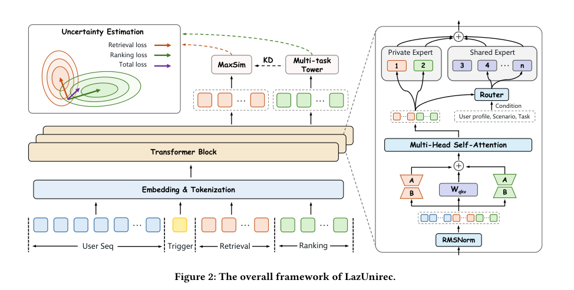

# LazUnirec: Unifying Retrieval and Ranking in Multi-scenario Industrial Recommendation

[English](README-en.md)

> L1机制组件，diagnostic only，不是完整模型或能力复现。高成本完整实验不复现（审查 DONE），不接Evolve晋级。

## 论文信息

| 字段 | 内容 |
| --- | --- |
| 论文链接 | [LazUnirec，固定2611.32590v1](https://arxiv.org/pdf/2611.32590v1) |
| 公司 / 作者机构 | 一作Xiaodong Li；全体署名Alibaba International Digital Commerce Group |
| 首次公开日期 | **2026-11-24T13:26:54Z**；本轮发现/审查2026-11-25，公告日期未核定 |
| 原作者开源代码 | 固定v1未给本篇作者代码仓库；本轮未找到可核验的公开方法实现 |
| 本地 adapter / key | `lazunirec`；adapter为null，独立组件 |
| 本地复现代码 | `src/auto_research/reproductions/lazunirec_components.py` |

## 原始论文总结

### 背景与主要改动

LazUnirec把历史、trigger、多兴趣检索query和同请求候选组织到同一Transformer，但不要求召回与排序完全共用全部参数。召回/排序各有Q/K/V低秩残差与private FFN expert，另由条件router选择top-2 shared experts。按scenario/task观察共享参数的归一化梯度历史，以EMA方向方差估计可靠性，停止梯度后重加权任务损失；排序还向召回做请求内候选分布蒸馏。

<!-- paper-figure:start -->
### 原论文关键图

[](https://arxiv.org/pdf/2611.32590v1#page=3)

图片来自[原论文](https://arxiv.org/pdf/2611.32590v1#page=3)第3页Figure2，完整保留图注，版权归原作者所有；已视觉核对、未改科学内容，不是本地结果。 [Provenance/SHA256](assets/provenance.json).
<!-- paper-figure:end -->

### 核心公式

Eq7对history/trigger只用共享投影，对两任务另加BτAτ残差；Eq10/11在选中的共享expert内重新softmax，再直接加private输出，而不是把private expert混入同一softmax。Eq12先将EMA二阶矩减一阶矩平方并截断到非负，e=min(emax,(variance+epsilon)^−1/2)；可靠性为r=Mean(e)/(1+Mean(e))，batch内omega=r/Mean(r)。§4.1.4在该归一后截到[0.8,1.2]，不再二次归一，因此最终权重均值未必为1。

$$
\omega_i=\operatorname{clip}\left(\frac{r_i}{\operatorname{Mean}_j r_j},0.8,1.2\right),\quad
\mathcal L_{ue}=\sum_i\operatorname{sg}(\omega_i)\mathcal L_i.
$$

Eq15是先用兴趣概率pi乘内积、再跨兴趣max，不是先max后平均；Eq16/17对同一请求候选做softmax，教师排序CTR logits detach，最小化KL(teacher||retrieval)。本地沿用论文温度0.5/0.01与EMA decay0.99；原文没有唯一规定初始化、方向归一范数、epsilon/emax，本地显式选零初始化无bias correction、L2与1e−8/100，只是有界数值参考。

### 论文离线与线上效果

固定v1 §4.8/Table5披露：2026年10月在工业电商trigger-free/trigger-based场景，以10%流量进行一周生产A/B，同时替换原MIMA召回与LazFormer排序。前者IPV/Orders/Buyers/GMV相对提高5.25%/5.75%/4.57%/4.01%，后者为4.01%/4.64%/3.06%/3.06%。Table1 Scenario1 CTR GAUC从OneTrans-V2的0.6695到0.6722。以上为完整私有生产系统的作者结果，不是本地组件指标，也不能归因到单独某个loss。

### 与已有方法的关系

OneTrans-V2用阶段隔离token共享因果用户上下文，精排向预排传递中心化logits/sigmoid信号；LazUnirec关注召回与排序的梯度冲突，用task-private LoRA/expert及方向可靠性区分更新，并向检索蒸馏请求内softmax分布。共享上下文不等于所有参数完全共用，独立任务参数也不自动保证梯度正交。旧OneTrans-V2公开MovieLens链路是concept demo，本批则只验局部算子，不能比较二者的代理能力分数。

## 本地复现

### 数据协议与代码映射

执行Eq7低秩任务投影、Eq10/11 sparse shared/private输出组合、Eq12–14 EMA evidence/相对权重/停止梯度及Eq15–17请求内MaxSim/KL，并用真实autograd验证参数路径。输入router scores/expert outputs/已探测gradient与interest probabilities是显式张量，不虚构未给细节的条件router或概率头。未实现完整Transformer/RMSNorm/attention mask、embedding、场景数据管线、expert网络、MoE z-loss、训练调度与部署；因此不是完整模型、正式benchmark或Evolve算子。

```bash
PYTHONPATH=src python -c 'from auto_research.reproductions.lazunirec_components import diagnostic; print(diagnostic(42))'
PYTHONPATH=src python -m pytest -q tests/test_nov25_lazunirec.py
```

### 结果、负控与边界

三seed均为小型合成张量与50步方向历史，不训练用户模型、不读取test或私有日志。检查history不读LoRA、task-private参数不串梯度、未选expert梯度为零、private输出直接相加、稳定方向较反复翻转方向可靠、权重和teacher断梯度、pi在max之前相乘以及请求间softmax不混合。方差小不证明方向正确；即使机制负控全过，也不证明CTR、GMV或生产吞吐提升。

冻结源绑定的CPU三seed和真实A100/A30回执只覆盖小型算子，不是模型benchmark。 [CPU](metrics/component-cpu-seeds42-44.json) · [CUDA](metrics/component-cuda-seeds42-44.json).

### 高成本完整实验

§4.1使用私有25天日志训练、后一日测试，H100上训练5层/256宽/4heads/最长2048历史，每请求最多15 ranking tokens与8 retrieval queries，每层14 shared experts+每任务1 private expert，并做多基线、多场景与线上优化/一周A/B。原文未披露总样本量、GPU数量或总GPU小时，不凭dim256推算可负担。完整数据/模型/服务矩阵超本轮单A100/A30或Mac短时预算且私有输入不可得，成本过高，不复现（审查 DONE），不下载、不探跑、不自动重试。仅局部组件每seed预算30秒、0checkpoint/数据下载、0API。
