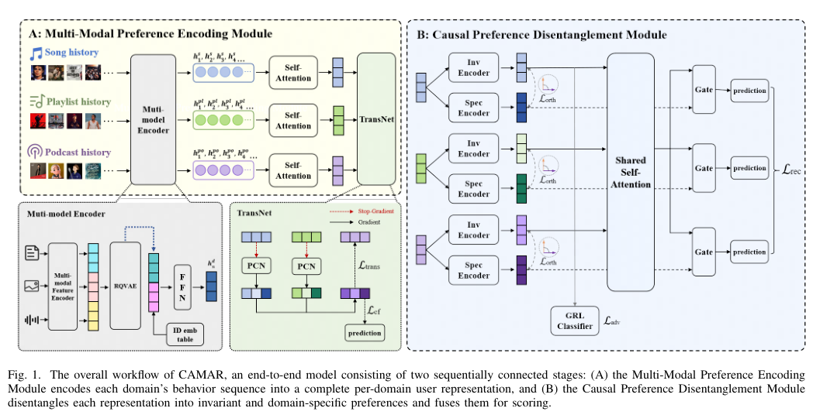
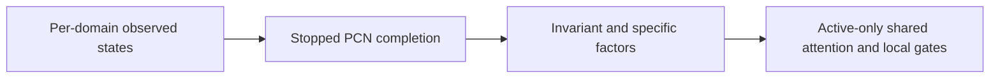

<!-- source-sha256: 5033a738391b4840fc81159daf71e68df54b806ac81804d18abdc23aa8881b91 -->

# Multi-Modal Causal Disentanglement for Multi-Domain Sequential Audio Recommendation

[简体中文](README.md)

> L1 mechanism diagnostic, not complete capability reproduction; full high-cost campaigns not reproduced(review DONE), no Evolve promotion.

## Paper information

| Field | Value |
| --- | --- |
| Paper | [Fixed 2611.33628v1](https://arxiv.org/pdf/2611.33628v1) |
| Company / first-author institution | Yu Ren; Hangzhou Dianzi University / NetEase Cloud Music; co-first author Pengcheng Li, NetEase Cloud Music |
| Original publication | 2026-11-25T01:57:30Z; discovered/reviewed 2026-11-26; verified announcement 2026-11-26 |
| Author code | No dedicated author repository given in fixedv1; no verified public method implementation found in this bounded intake |
| Local adapter / key | `camar`; `adapter: null`, standalone component |
| Local code | `src/auto_research/reproductions/camar_components.py` |

## Original paper summary

### Background and method

CAMAR first combines shared cross-domain RQ-VAE semantic IDs with independent domain sequence encoders, then uses directed-pair two-layer ReLU PCNs to impute missing domains. Linear maps split invariant and specific factors. Squared inner products separate them, a GRL classifier discourages domain identity in invariant factors, only invariant factors enter active-domain self-attention, and domain gates fuse the shared vector with the domain's own specific factor. This architectural constraint is not proof of identifying real causal factors.

<!-- paper-figure:start -->
### Key original figure

[](https://arxiv.org/pdf/2611.33628v1#page=4)

Image from [the original paper](https://arxiv.org/pdf/2611.33628v1#page=4), fixedv1 page4, with complete caption. Copyright belongs to the original authors. Visually checked, not local evidence. [Provenance/SHA256](assets/provenance.json).
<!-- paper-figure:end -->



### Core formula

Equation5 stops gradients at the PCN input and Equation7 also stops the target, so representation matching updates only PCNs. Equation10 squares the unnormalized inner product, not cosine similarity. Equations11/12 reverse gradients at the classifier input, not recall gradients. Equation13 attends bidirectionally among active domains and averages only active outputs; inactive imputed factors bypass attention and cannot contaminate the shared factor. Specific factors remain local. Equation14 applies elementwise gates then L2 normalization; Equation15 sums per-domain user-mean losses.

### Reported offline and online results

SectionV-E/TableV reports a two-week NetEase Cloud Music production A/B in May2026. Treatment adds CAMAR as a recall channel over existing per-domain recall while holding ranking/reranking shared. Song session listening duration increases1.0%, Playlist like rate3.0%, and Podcast listening duration1.6%. The paper states significance without p-values, confidence intervals or traffic fractions. Offline TablesII/III describe full models, not gains attributable to this local GRL or synthetic loss.

### Relationship to existing methods

LazUnirec uses private LoRA/experts and directional-reliability weights across retrieval/ranking tasks. CAMAR splits invariant/specific factors across song/playlist/podcast and permits only invariant cross-domain interaction. The former controls shared-update conflict; the latter constrains representation flow and domain distinguishability. Stable gradients do not establish domain invariance, and orthogonal inner products do not establish statistical independence. Neither private data nor local synthetic diagnostics support a direct quality ranking.

## Local implementation

### Data protocol and code mapping

The component executes Equations5–7 and9–15 on supplied domain states/candidates: real two-layer PCNs, linear factor maps, one active-only MHA layer, domain gates/classifier, GRL, orthogonality and sampled softmax. Multi-modal encoders, RQ-VAE/semantic codebooks, item/history backbones, Equation8 task-level cold-start loss, complete LTN and the three-stage trainer are absent; this is not full CAMAR. Bias-free factor maps, MHA details and MLP hidden widths are declared local choices where the paper does not uniquely specify them.

```bash
PYTHONPATH=src python -c 'from auto_research.reproductions.camar_components import diagnostic; print(diagnostic(42))'
PYTHONPATH=src python -m pytest tests/test_nov26_industrial_components.py -q
```

### Results, controls and limits

Three seeds use4 users,3 domains,width8 and five candidates per domain with real autograd/Adam updates. Controls verify detached imputation/source/target paths, GRL reversal only at inputs rather than classifier parameters, domain-specific noninterference, unchanged shared vectors after multiplying inactive perturbations by1000, and unit-norm outputs. Zero-active users, overlap-free representation supervision and invalid shapes are rejected. These checks establish neither Hit/NDCG, generalization, production lift nor causal independence.

Frozen-source three-seed artifacts, diagnostic only; the CUDA component additionally requires real A100/A30 evidence. [CPU](metrics/component-cpu-seeds42-44.json) · [CUDA](metrics/component-cuda-seeds42-44.json).

### High-cost full experiment

SectionV-A/TableI covers about539M private and16M Amazon interactions, multi-modal/RQ-VAE preprocessing, sequence backbones, nine baselines/ablations, multi-domain full-catalog evaluation and two-week production A/B. The paper lists A100 GPUs,4095 negatives and validation weight search without GPU count or total hours. The complete matrix exceeds this single-A100/A30-or-Mac short-run budget: high cost, not reproduced(review DONE). Only small components run; no data/checkpoint downloads or full probes.
