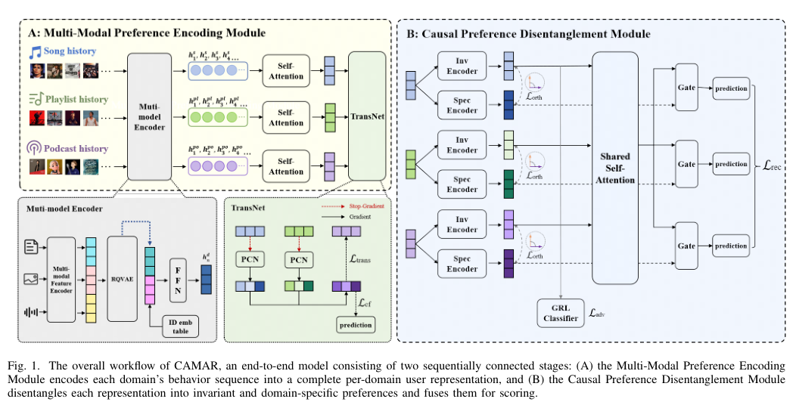
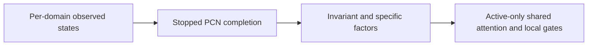

# Multi-Modal Causal Disentanglement for Multi-Domain Sequential Audio Recommendation

[English](README-en.md)

> L1机制诊断，不是完整能力复现；高成本完整实验不复现（审查 DONE），不接Evolve晋级。

## 论文信息

| 字段 | 内容 |
| --- | --- |
| 论文链接 | [Fixed 2611.33628v1](https://arxiv.org/pdf/2611.33628v1) |
| 公司 / 一作机构 | Yu Ren; Hangzhou Dianzi University / NetEase Cloud Music; co-first author Pengcheng Li, NetEase Cloud Music |
| 首次公开日期 | 2026-11-25T01:57:30Z; 发现/审查 2026-11-26; 已核公告日 2026-11-26 |
| 原作者开源代码 | 固定v1未给专属作者仓库；本轮未找到已核验公开方法代码，未找到/尚未发布，不把引用仓库当本文实现 |
| 本地adapter / key | `camar`; `adapter: null`, 独立组件 |
| 本地复现代码 | `src/auto_research/reproductions/camar_components.py` |

## 原始论文总结

### 背景与主要改动

CAMAR先用共享跨域RQ-VAE语义ID、独立域序列encoder形成偏好，再用有向域对的两层ReLU PCN对缺失域补全。每域线性拆出invariant/specific两部分；平方内积约束二者，GRL分类器去除invariant的域信息，仅invariant参与active-domain self-attention，最后按域gate融合共享向量与本域specific。该结构约束不是仅靠一个正则项声称发现真实因果因素。

<!-- paper-figure:start -->
### 原论文关键图

[](https://arxiv.org/pdf/2611.33628v1#page=4)

图片来自[原论文](https://arxiv.org/pdf/2611.33628v1#page=4)固定v1第4页，完整保留图注，版权归原作者所有；已目视核对，不是本地结果。 [Provenance/SHA256](assets/provenance.json).
<!-- paper-figure:end -->



### 核心公式

Eq5的PCN输入stop-gradient；Eq7的target也stop-gradient，表示匹配只更新PCN。Eq10是未归一化内积的平方，不是cosine。Eq11/12的GRL只反转classifier输入的梯度，不能把recall梯度也反向。Eq13对active域双向attention并只平均active输出，inactive imputed因子绕过attention，不污染shared；specific始终留在本域。Eq14逐元素gate后L2归一，Eq15每域用户均值后跨域求和。

### 论文离线与线上效果

§V-E/TableV：2026年5月在网易云音乐进行两周生产A/B，对照是原线上各域召回；实验组新增CAMAR通道，但共享相同精排/重排模块。Song会话平均播放时长+1.0%，Playlist喜欢率+3.0%，Podcast会话平均播放时长+1.6%；论文称统计显著但没有给p值/CI/流量比例。私有TableII/Public TableIII的离线收益属于完整模型；不能归给本地GRL或合成loss。

### 与已有方法的关系

LazUnirec对召回/排序任务用private LoRA/expert及梯度方向可靠性调权；CAMAR对song/playlist/podcast域显式拆invariant/specific，并只让invariant跨域。前者主要控制共享参数更新冲突，后者同时限制表示流动和域可辨识性。梯度稳定不等于域不变，内积正交也不等于统计独立；两者的私有数据与本地合成诊断都不能支持直接胜负比较。

## 本地复现

### 数据协议与代码映射

只实现给定per-domain state/candidate张量上的Eq5–7、9–15：真实两层PCN、双线性factor、单层active-only MHA、域gate/classifier、GRL、正交和sampled-softmax。没有多模态encoder、RQ-VAE/语义码本、item/history backbone、Eq8 task-level冷启动Lcf、完整LTN或三阶段训练器；因此不宣称完整CAMAR。bias-free factor、MHA细节/MLP隐藏宽度等原文未唯一给出，显式采用本地参考配置。

```bash
PYTHONPATH=src python -c 'from auto_research.reproductions.camar_components import diagnostic; print(diagnostic(42))'
PYTHONPATH=src python -m pytest tests/test_nov26_industrial_components.py -q
```

### 结果、负控与边界

三seed使用4用户×3域×8维合成state和每域5候选，做真实autograd/Adam更新。负控检查inactive补全与表示target/source均无encoder梯度、GRL只反转输入不反转classifier参数、改某域specific不影响其他域、把inactive invariant放大1000不改shared、输出L2范数为1。零active用户、无overlap表示监督和不合法形状直接拒绝。局部公式通过不证明Hit/NDCG、泛化、生产收益或因果独立性。

冻结源绑定三seed产物仅为诊断；CUDA组件另需真实A100/A30证据。 [CPU](metrics/component-cpu-seeds42-44.json) · [CUDA](metrics/component-cuda-seeds42-44.json).

### 高成本完整实验

§V-A/TableI约539M私有交互和16M Amazon交互；需多模态特征/RQ-VAE预处理、独立序列骨干、9基线/消融、多域全库评测与两周线上A/B。原文列A100 GPUs、4095负例和验证权重搜索，未给GPU数量/总小时。完整矩阵明显超单A100/A30或Mac短时预算：成本过高，不复现（审查 DONE）。只验小算子，不下载数据/权重或启动完整试跑。
