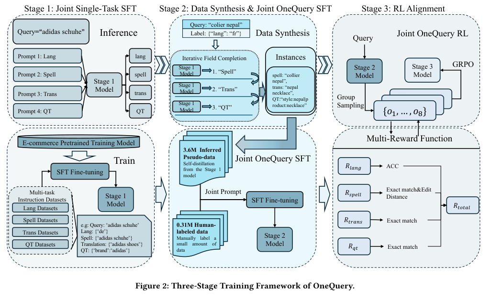

<!-- source-sha256: b5f8701ce65c21788e1f430185e4b4591f720c600552f0ea82ff14c452a556cb -->

# OneQuery: Unified Sequence-to-Structure Generation for Multilingual E-commerce Query Understanding

[简体中文](README.md)

> L1 mechanism diagnostic, not complete capability reproduction; full high-cost campaigns not reproduced(review DONE), no Evolve promotion.

## Paper information

| Field | Value |
| --- | --- |
| Paper | [Fixed 2611.33653v1](https://arxiv.org/pdf/2611.33653v1) |
| Company / first-author institution | Mingyu Zhang; Xiamen University; co-first author Jiejie Qin, Alibaba Group; Harbin Institute of Technology collaborator |
| Original publication | 2026-11-25T02:19:27Z; discovered/reviewed 2026-11-26; verified announcement 2026-11-26 |
| Author code | No dedicated author repository given in fixedv1; no verified public method implementation found in this bounded intake |
| Local adapter / key | `onequery`; `adapter: null`, standalone component |
| Local code | `src/auto_research/reproductions/onequery_components.py` |

## Original paper summary

### Background and method

OneQuery produces language, spelling, English translation and semantic tags in one schema-guided JSON generation rather than propagating errors through four independent models. Stage1 mixes single-task SFT. Stage2 retains observed labels and fills missing fields using Stage1, then combines3.6M cleaned pseudo-labels with310K human records. Stage3 uses task-specific rewards with GRPO. Production caches head-query outputs from14B offline and serves tail queries using a distilled0.3B student.

<!-- paper-figure:start -->
### Key original figure

[](https://arxiv.org/pdf/2611.33653v1#page=4)

Image from [the original paper](https://arxiv.org/pdf/2611.33653v1#page=4), fixedv1 page4, with complete caption. Copyright belongs to the original authors. Visually checked, not local evidence. [Provenance/SHA256](assets/provenance.json).
<!-- paper-figure:end -->


### Core formula

Equation7 uses the nonuniform reward-v4 weights from Section5.4:(0.35,0.25,0.25,0.15). Comparisons follow NFKC, lowercasing and whitespace normalization. Language and translation require exact matches; QT requires equality of the whole(type,text) set, not F1. When correction is needed, an exact correction earns1 and other outputs earn0.3 times normalized Levenshtein similarity. When no correction is needed, only preserving the input earns1. Equations5/6 define within-group normalized advantages and signed clipped-ratio arithmetic.

### Reported offline and online results

Table1 compares14B pipeline with Stage3: language accuracy0.9514→0.9665, translation ROUGE-2 78.20→80.50, spelling F1 0.8568→0.8717 and QT F1 0.8128→0.8366. Section5.6 reports real multi-country AliExpress A/B against the existing production QU system: L2P+0.5% and human SBS relevance+0.8points. Traffic fraction, sample count, duration and confidence intervals are undisclosed; SBS points are not a relative percentage. These are full cached/student/downstream-system results, not local reward measurements.

### Relationship to existing methods

LARF models five ordinal relevance attributes of one document with PNR, rule feedback and terminal-digit margins. OneQuery instead supervises four heterogeneous structured fields of one query. Its QT reward requires whole-set exact matching, not LARF's graded distance or inter-document ordering. LARF's training generation/serving classification split also differs from OneQuery's head cache/tail distillation. Their production metrics are not directly comparable.

## Local implementation

### Data protocol and code mapping

The local component executes only Equations5–13 reward, advantage and clipping arithmetic. QT is an explicit tuple list, not a fabricated parser for a private tag syntax. Invalid schemas are rejected rather than receiving an invented format reward. Empty-versus-empty edit similarity1, population standard deviation and delta1e-8 are declared boundary conventions. There is no language model, constrained decoder, label completion, SFT, GRPO parameter training, distillation or serving. References enter only the reward evaluator; no agent can read gold.

```bash
PYTHONPATH=src python -c 'from auto_research.reproductions.onequery_components import diagnostic; print(diagnostic(42))'
PYTHONPATH=src python -m pytest tests/test_nov26_industrial_components.py -q
```

### Results, controls and limits

CPU three-seed cases use small generated reward groups and check NFKC/set-order invariance, zero QT credit when one entity is missing, rejection of unnecessary corrections, partial spelling credit at most0.3, zero constant-group advantages and both signs of ratio clipping. Supplied weights are not silently renormalized. This is an L1 diagnostic, not query-understanding accuracy or Evolve evidence.

Frozen-source three-seed artifacts, diagnostic only; the CUDA component additionally requires real A100/A30 evidence. [CPU](metrics/component-cpu-seeds42-44.json).

### High-cost full experiment

Section5.1 uses ME-LLM5.2-14B and4B/8B variants in the complete three-stage pipeline on16 A100-80GB GPUs, with3.6M pseudo-labels,310K human records,31K RL queries and eight samples per query, plus19,087 private evaluation queries and production distillation/cache/A/B. Total GPU-hours are undisclosed; a0.3B serving student does not make the training campaign cheap. High cost, not reproduced(review DONE), with no model/data downloads, probes or retries.
